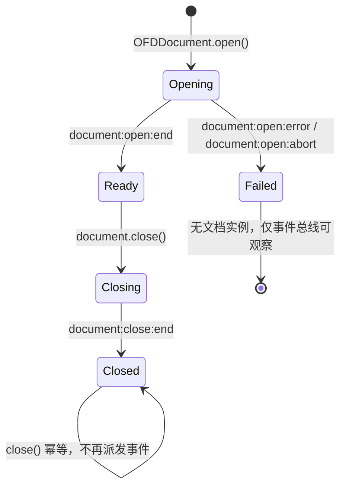
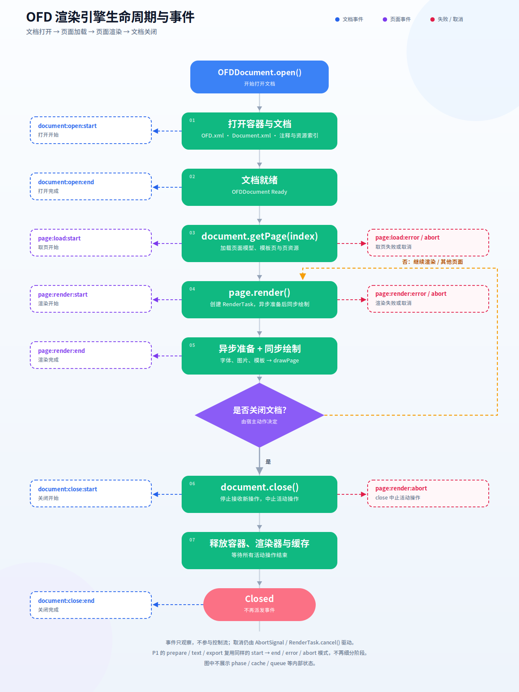
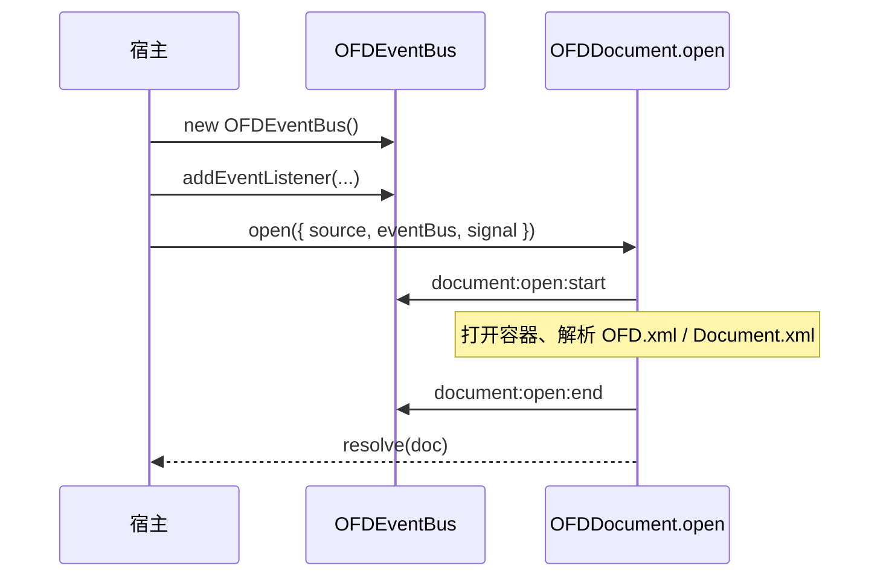
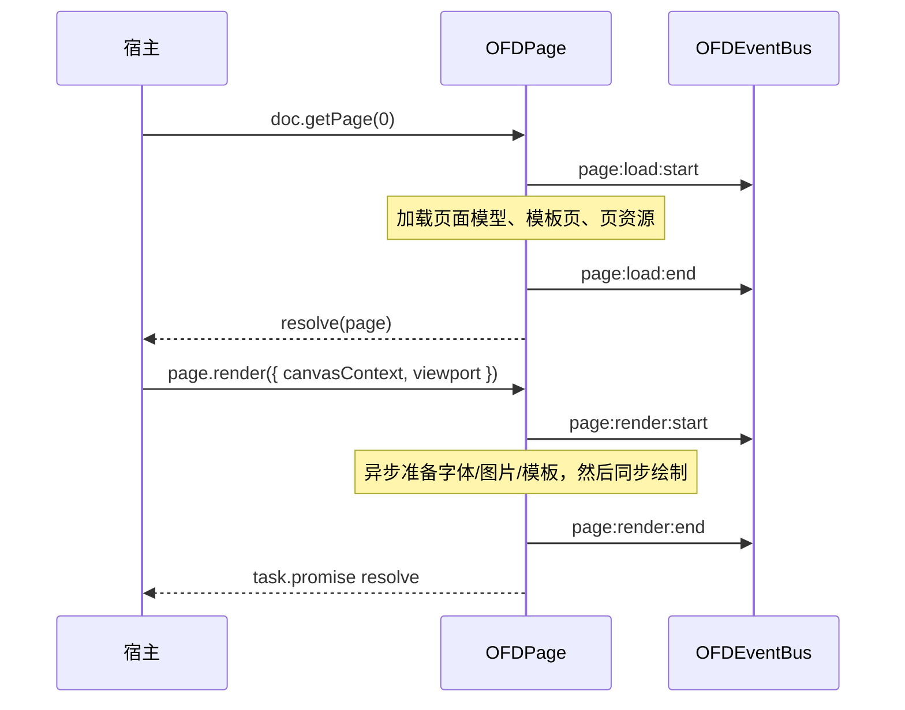
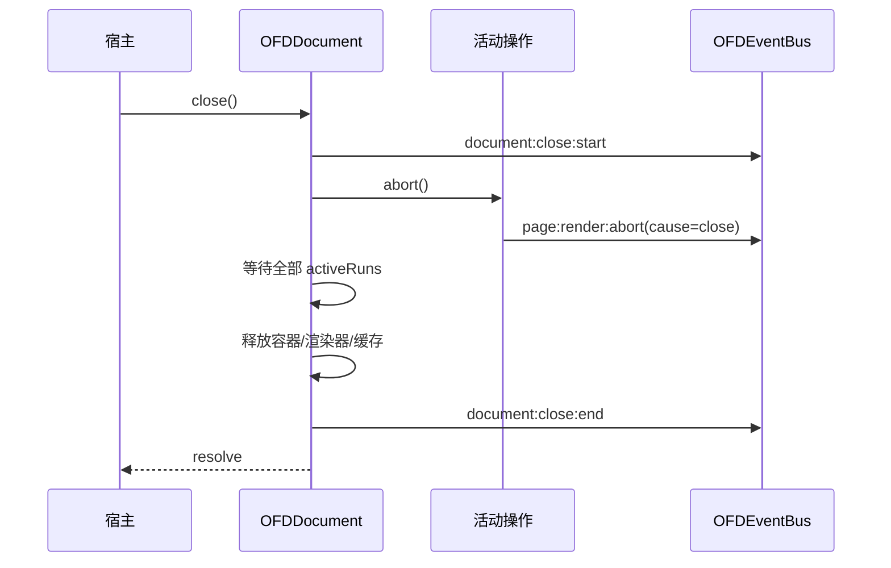

# OFD 渲染引擎生命周期与事件设计

| 项 | 内容 |
|---|---|
| 状态 | 设计讨论稿（Draft）；已补充 UI 加载动画需求 |
| 版本 | 0.3 |
| 日期 | 2026-10-23 |
| 目标包 | `@ofdrw/ofdrw-viewer-engine` |
| 关联文档 | [OFD 渲染引擎设计方案](./OFD渲染引擎设计方案.md)、[UI 所需引擎 API](./ofdrw-viewer-ui-engine-api.md)、[UI 设计方案](./ofdrw-viewer-ui设计方案.md) |
| 目标 | 为文档打开、页面加载、页面渲染、文档关闭建立页面级、类型化、平台无关的事件模型，供阅读器实现 loading、错误态和取消态 |

---

## 0. 结论摘要

1. **事件只观察，不参与控制流**。监听器不改变渲染结果；取消仍由 `AbortSignal` / `RenderTask.cancel()` 驱动，关闭仍由 `document.close()` 驱动。
2. **事件粒度到“页面级操作”为止**。不提供 `container/ofd/document` 等打开子阶段，也不提供 `queued/model/prepare/draw` 等渲染子阶段；一个操作只有 `start → end | error | abort`。
3. **不暴露缓存命中、共享加载、队列等待等内部状态**。这些是引擎优化，不应成为公开事件契约；宿主看到的只有操作开始、成功、失败、取消。
4. **文档事件 + 页面事件两层**：
   - 文档：`document:open:*`、`document:close:*`；
   - 页面：`page:load:*`、`page:render:*`。
5. **打开阶段的监听通过 `OFDOpenOptions.eventBus` 注入**。因为 `OFDDocument.open()` 返回前文档对象尚不存在，宿主需要先创建总线并注册监听；成功后 `document.events` 就是同一个总线。
6. **同时提供 `addEventListener` 风格和 `on/once/off` 风格**。`document` 和 `page` 都可监听；`page` 只接收本页事件，`document` 接收全部事件。
7. **每个事件有 `operationId`、`sequence`、`timestamp`**。并发渲染和同一 Canvas 串行可以用 `operationId` 区分，但不要求宿主理解内部队列。
8. **失败和取消分开**：`error` 表示真正失败，`abort` 表示调用方取消或文档关闭；Promise 的 `OFD_ABORTED` / `OFD_CLOSED` 语义保持不变。
9. **关闭顺序明确**：`document:close:start` → 活动操作各自 `abort` → 等待结束 → 释放资源 → `document:close:end`；之后不再有任何事件。
10. **兼容性是加法式**。不传事件总线时行为与当前一致；不改变现有 Promise 结果、Canvas 所有权和缓存策略。
11. **UI 加载动画只消费页面级事件**：文档全屏 loading 在 UI `documentopen` 结束；页面 loading 延迟 150 ms，首次骨架、重渲染保留旧画面；缩略图只对渲染窗口显示骨架；不新增公开 UI 事件。详见 §6。

---

## 1. 背景与目标

### 1.1 背景

当前引擎的生命周期分散在公开 API 中：

- `OFDDocument.open()`：打开容器、解析 `OFD.xml` / `Document.xml`、建立资源索引；
- `OFDDocument.getPage(index)`：加载页面模型、模板页和页资源；
- `OFDPage.prepare()`：准备字体、图片、模板、注释、签章和显示列表；
- `OFDPage.render()`：异步准备后同步绘制到 Canvas；
- `OFDPage.getTextContent()`：构建文本层；
- `OFDPage.exportImage()`：离屏渲染、旋转和编码；
- `OFDDocument.close()`：中止活动操作并释放资源。

宿主目前只能通过 Promise 的成功/失败推断状态。阅读器可以显示“加载中”，但无法可靠区分：

- 文档还在打开，还是已经可用；
- 页面正在加载，还是正在渲染；
- 操作是失败、被用户取消，还是因为文档关闭而中止；
- 多个页面同时渲染时，某个 loading 应该由哪个操作结束。

### 1.2 目标

- 提供稳定、可类型推导的页面级事件 API。
- 让 UI 能：
  - 在文档打开时显示全屏 loading；
  - 在页面渲染开始前显示页面占位/遮罩；
  - 在渲染完成后移除 loading；
  - 在失败、取消、关闭时可靠收尾；
  - 用 `operationId` 关联同一个 `RenderTask` 的事件。
- 事件模型可用于浏览器、Node.js、Electron、小程序和 Worker。
- 监听器异常不影响引擎结果，不产生未处理 rejection。
- 事件 API 可增量扩展，不破坏现有调用方。

### 1.3 非目标

- 不提供打开子阶段事件（`container/ofd/document/...`）。
- 不提供渲染子阶段事件（`queued/model/prepare/draw`）。
- 不提供缓存命中、共享加载、队列等待、字体/图片数量等内部指标。
- 不提供字节级下载/解压进度或百分比进度。
- 不提供逐对象、逐图元、逐字符的绘制进度。
- 不把事件作为控制接口，不支持在监听器中阻止渲染或修改参数。
- 不在事件中暴露 `PageModel`、`PreparedPageBundle`、XML 节点、原始字体/图片字节。
- 不改变现有 Canvas 所有权、缓存策略、取消语义和 Promise 结果。
- v1 不把 warning 事件化；warning 继续走 `onWarning`。

### 1.4 设计约束

| 约束 | 影响 |
|---|---|
| 核心平台无关 | 不使用 DOM `EventTarget`、`CustomEvent`、`window`、`document` |
| 异步准备 + 同步绘制 | `page:render` 只区分“开始”和“结束”，不把同步绘制拆成多个事件 |
| 页面模型/准备结果有缓存 | 缓存命中不派发特殊事件，只是 `end` 更快到达 |
| 同一 Canvas 串行、不同 Canvas 并行 | 用 `operationId` 区分，不暴露队列状态 |
| 取消与关闭是正常路径 | 必须有 `abort` 事件，不能被误报为 `error` |
| 公共 API 只增不改 | 新增字段/方法必须可选；不改变现有 Promise 结果 |
| 监听器由宿主编写 | 监听器异常必须隔离，不能破坏引擎状态 |

---

## 2. 生命周期

### 2.1 对象与生命周期

| 对象 | 创建者 | 生命周期 | 释放方式 |
|---|---|---|---|
| `OFDSource` | 宿主 | 由宿主传入 | 由宿主/字节源实现管理 |
| `VirtualContainer` | engine 默认 ZIP、`containerFactory` 或宿主 | 文档打开到 `close()` | engine 自有容器在 `close()` 关闭；借用容器只清引用 |
| `OFDDocument` | `OFDDocument.open()` | `open()` 成功到 `close()` | `close()` 幂等释放缓存/渲染器 |
| `OFDPage` | `document.getPage()` | 可长于一次渲染；文档关闭后失效 | 不单独关闭；随文档关闭失效 |
| `RenderTask` | `page.render()` | 一次渲染 | Promise 结束即完成 |
| 事件总线 | 宿主注入或 engine 创建 | 至少覆盖文档生命周期 | 文档关闭后不再派发；由宿主/文档持有 |

> 页面对象不拥有 Canvas，也不拥有页面模型；它只是文档能力的句柄。因此页面事件由文档级事件总线统一派发，页面监听器只是按 `pageIndex` 过滤的视图。

### 2.2 文档生命周期



说明：

- `Opening` 阶段文档对象尚未返回；宿主只能通过 `OFDOpenOptions.eventBus` 观察。
- `document:open:end` 在 `open()` 的 Promise resolve 之前同步派发。
- 打开失败或取消时没有可用的 `OFDDocument`；engine 先清理自己拥有的容器，再派发终止事件。
- `Closing` 期间仍可能有活动操作；它们会收到取消并各自派发 `abort`，但不能再开始新的公开操作。
- `Closed` 是终态；`close()` 重复调用直接返回，不重复派发 `document:close:*`。

### 2.3 页面生命周期

页面没有唯一的 `loading/rendering/ready` 状态，因为一个页面可以同时：

- 渲染到 Canvas A；
- 读取文本内容；
- 被宿主主动 `prepare()`；
- 导出图片到离屏 Canvas。

因此页面生命周期按**操作**定义，而不是按页面状态定义：

| 操作 | 公开入口 | v1 事件 | 说明 |
|---|---|---|---|
| 页面加载 | `document.getPage(index)` | `page:load:*` | 加载页面模型、模板页、页资源，返回页面句柄 |
| 页面渲染 | `page.render(params)` | `page:render:*` | 异步准备 + 同步绘制；同一 Canvas 串行 |
| 页面准备 | `page.prepare()` | P1 | 预取/预准备；不阻塞渲染 |
| 文本内容 | `page.getTextContent()` | P1 | 构建文本层 |
| 图片导出 | `page.exportImage()` | P1 | 离屏渲染、旋转和编码 |

每个操作都遵循同一模型：

```text
start ──▶ end
   ├──▶ error（真正失败）
   └──▶ abort（调用方取消 / 文档关闭）
```

- `start` 在入口校验通过、真正工作开始前派发。
- `end` 成功完成，在 Promise resolve 之前派发。
- `error` 在 Promise reject 之前派发，携带原始 `OFDError`。
- `abort` 在 Promise reject 之前派发，携带取消来源。
- 同一操作内 `end` / `error` / `abort` 三者互斥，且必有一个。
- **入口校验失败**（文档已关闭、页索引越界、viewport/Canvas 参数非法等）不进入操作生命周期：不派发 `start`，也不派发终止事件，Promise 直接拒绝。

### 2.4 生命周期图

下图是引擎的完整页面级生命周期：左侧是事件，右侧是失败/取消出口，中间是实际阶段。



- 矢量版：[ofd-engine-lifecycle.svg](diagrams/ofd-engine-lifecycle.svg)
- 可缩放 HTML：[ofd-engine-lifecycle.html](diagrams/ofd-engine-lifecycle.html)

图中的关键约定：

- `document:open:start` 在打开开始时派发，`document:open:end` 在文档可用时派发；
- 打开失败或取消走右侧 `document:open:error / abort`；
- `getPage()` 派发 `page:load:*`，只负责页面加载，不负责渲染；
- `page.render()` 派发 `page:render:*`，结束事件在绘制完成之后；
- 页面可以继续渲染其他页或重复渲染，最后 `document.close()`；
- 关闭时活动操作收到 `abort(cause=close)`，随后才是 `document:close:end`；
- 图中没有 phase、cache、queue 等内部状态。

### 2.5 关键时序

#### 2.5.1 打开文档



失败路径：`start` → `error` → `reject`；取消路径：`start` → `abort` → `reject`。

#### 2.5.2 页面加载与渲染



说明：

- `page:load:end` 在 `getPage()` Promise resolve 之前派发。
- `page:render:start` 在 `render()` 返回 `RenderTask` 之前同步派发，UI 可以立即显示页面 loading。
- `page:render:end` 在 `task.promise` resolve 之前派发。
- 缓存命中只会让 `end` 更快到达，不派发额外事件。

#### 2.5.3 关闭与活动操作



强保证：

1. `document:close:start` 先于所有由关闭触发的 `abort`。
2. 所有由关闭触发的 `abort` 先于 `document:close:end`。
3. `document:close:end` 之后不再派发任何事件。
4. 关闭触发的 `abort` 与用户主动取消通过 `cause` 区分。
5. `close()` 第二次调用不派发事件，直接返回已完成的 Promise。

---

## 3. 事件模型

### 3.1 设计原则

1. **类型优先**：事件名是字符串字面量联合，载荷按名称推导。
2. **同步派发**：`emit` 在调用栈内执行，不返回 Promise。
3. **快照派发**：派发前复制监听器集合；新增监听器不参与本次事件。
4. **异常隔离**：单个监听器抛错不影响其他监听器或引擎结果。
5. **无监听器零负担**：没有监听器时不构造载荷、不派发。
6. **不持有大对象**：载荷只包含标量、错误对象和必要元信息。
7. **关闭后静默**：`document:close:end` 是最后一帧。
8. **不重复 warning**：warning 继续走 `onWarning`，v1 不派发 warning 事件。

### 3.2 公共 API

#### 3.2.1 事件总线

```ts
export interface OFDAddEventListenerOptions {
  /** 是否只触发一次。 */
  once?: boolean;
  /** 绑定生命周期；abort 后自动移除监听器。 */
  signal?: AbortSignal;
}

export interface OFDEventBusOptions {
  /**
   * 监听器异常回调；省略时吞掉异常。
   *
   * @param error 监听器抛出的错误。
   * @param type 事件名。
   */
  onListenerError?: (error: unknown, type: OFDEventName) => void;
}

export class OFDEventBus {
  constructor(options?: OFDEventBusOptions);

  /** 订阅事件，返回退订函数；可重复调用。 */
  on<K extends OFDEventName>(type: K, handler: OFDEventHandler<K>): () => void;
  /** 订阅一次。 */
  once<K extends OFDEventName>(type: K, handler: OFDEventHandler<K>): () => void;
  /** 退订。 */
  off<K extends OFDEventName>(type: K, handler: OFDEventHandler<K>): void;

  /** DOM 风格订阅；返回 void，与 addEventListener 一致。 */
  addEventListener<K extends OFDEventName>(
    type: K,
    handler: OFDEventHandler<K>,
    options?: OFDAddEventListenerOptions,
  ): void;
  /** DOM 风格退订。 */
  removeEventListener<K extends OFDEventName>(
    type: K,
    handler: OFDEventHandler<K>,
  ): void;

  /** 移除指定事件或全部监听器；主要供宿主编排和测试清理。 */
  removeAllListeners(type?: OFDEventName): void;
  /** 当前监听器数量。 */
  listenerCount(type: OFDEventName): number;

  /**
   * 引擎内部派发入口。
   *
   * @internal 不属于宿主稳定 API；宿主只应订阅。
   */
  emit<K extends OFDEventName>(type: K, event: OFDEventMap[K]): void;
}
```

#### 3.2.2 文档对象

```ts
export class OFDDocument {
  /** 本文档使用的事件总线；若 open 时注入了 eventBus，则与注入对象相同。 */
  readonly events: OFDEventBus;

  on<K extends OFDEventName>(type: K, handler: OFDEventHandler<K>): () => void;
  once<K extends OFDEventName>(type: K, handler: OFDEventHandler<K>): () => void;
  off<K extends OFDEventName>(type: K, handler: OFDEventHandler<K>): void;
  addEventListener<K extends OFDEventName>(
    type: K,
    handler: OFDEventHandler<K>,
    options?: OFDAddEventListenerOptions,
  ): void;
  removeEventListener<K extends OFDEventName>(
    type: K,
    handler: OFDEventHandler<K>,
  ): void;
}
```

#### 3.2.3 页面对象

```ts
export class OFDPage {
  /** 只接收本页事件；文档级事件不会进入页面监听器。 */
  on<K extends OFDPageEventName>(type: K, handler: OFDEventHandler<K>): () => void;
  once<K extends OFDPageEventName>(type: K, handler: OFDEventHandler<K>): () => void;
  off<K extends OFDPageEventName>(type: K, handler: OFDEventHandler<K>): void;
  addEventListener<K extends OFDPageEventName>(
    type: K,
    handler: OFDEventHandler<K>,
    options?: OFDAddEventListenerOptions,
  ): void;
  removeEventListener<K extends OFDPageEventName>(
    type: K,
    handler: OFDEventHandler<K>,
  ): void;
}
```

页面级监听器是对文档总线的**按 `pageIndex` 过滤视图**：

- `page.on('page:render:start', ...)` 只在本页渲染时触发；
- `doc.on('page:render:start', ...)` 在所有页渲染时触发；
- 同一回调分别注册到页面和文档会触发两次，宿主应避免重复注册；
- `page:load:*` 主要监听在 `document.events` 上；页面对象在加载完成后才存在，页面级监听更适合 `page:render:*`。
- 页面监听器在文档关闭时由引擎清理。

#### 3.2.4 打开时注入总线

```ts
export interface OFDOpenBaseOptions {
  // ...现有字段
  /**
   * 打开阶段与后续文档生命周期使用的事件总线。
   *
   * 需要在 open 完成前监听 `document:open:*` 时传入；省略时由引擎创建，
   * 并通过 `document.events` 访问。一个总线只对应一个文档实例。
   */
  eventBus?: OFDEventBus;
  /** 打开取消信号；中止时 open 以 OFD_ABORTED 拒绝。 */
  signal?: AbortSignal;
}
```

#### 3.2.5 取页取消

```ts
getPage(pageIndex: number, options?: { signal?: AbortSignal }): Promise<OFDPage>;
```

- 现有 `getPage(pageIndex)` 调用不变。
- 取消只影响本次等待；共享页面模型加载不被单个调用方中止（沿用现有共享加载语义）。
- 文档关闭仍会中止共享加载。

### 3.3 命名规范

事件名格式：

```text
<对象>:<操作>:<后缀>
```

| 片段 | 取值 |
|---|---|
| 对象 | `document` / `page` |
| 操作 | `open` / `close` / `load` / `render`（P1：`prepare` / `text` / `export`） |
| 后缀 | `start` / `end` / `error` / `abort` |

示例：

- `document:open:start`
- `document:open:end`
- `page:load:start`
- `page:render:end`
- `page:render:abort`

约定：

- 全部小写，使用冒号分层。
- `start` 与 `end` 成对；`error` / `abort` 是替代 `end` 的终止事件。
- 不使用 `done`、`complete`、`finish` 等同义词。
- 不提供 UI 风格别名（如 `pagerendered`）；UI 在自己的事件层做适配。

### 3.4 派发语义

| 语义 | 约定 |
|---|---|
| 同步 | 监听器在 `emit` 调用栈内执行；引擎不等待返回值 |
| 快照 | 派发开始时复制监听器集合；新增监听器不参与本次派发 |
| `once` | 调用前移除；监听器抛错也不会再次触发 |
| `signal` | 注册时已 abort 则不注册；注册后 abort 自动移除 |
| 退订 | `off` / `removeEventListener` 移除匹配的原回调；重复注册全部移除 |
| 异常 | 单个监听器异常被捕获；配置 `onListenerError` 时上报，否则静默 |
| 重入 | 允许监听器再次调用引擎 API；新操作使用新的 `operationId` |
| 顺序 | 同一操作内严格 `start → 终止`；并发操作之间不保证相对顺序，用 `sequence` 观察全序 |
| 关闭后 | `document:close:end` 之后不再派发事件；已注册监听器保留但不再被调用 |

> 不建议宿主在监听器里同步调用 `document.close()`。引擎允许重入，但关闭会等待当前活动操作，容易造成宿主状态竞争。关闭应由明确的用户/生命周期动作触发。

### 3.5 通用字段与单位

```ts
export interface OFDEventBase {
  /** 事件名。 */
  readonly type: OFDEventName;
  /** 事件时间，Unix 毫秒（Date.now）。 */
  readonly timestamp: number;
  /** 总线派发序号，从 1 开始单调递增。 */
  readonly sequence: number;
}

export interface OFDOperationEventBase extends OFDEventBase {
  /** 操作 ID，文档内唯一，从 1 开始；RenderTask.id 使用同一编号。 */
  readonly operationId: number;
}

export interface OFDPageOperationEventBase extends OFDOperationEventBase {
  /** 页索引，从 0 开始。 */
  readonly pageIndex: number;
}
```

单位约定：

| 字段 | 单位 | 说明 |
|---|---|---|
| `timestamp` | Unix 毫秒 | 事件发生时间 |
| `durationMs` | 毫秒 | 操作总耗时 |
| `width` / `height` | 设备像素 | `page:render:start` 输出的 Canvas 尺寸 |
| `dpi` | DPI | 渲染精度 |
| `widthMm` / `heightMm` | 毫米 | 页面物理尺寸 |
| `packageSize` | byte | 原始 OFD 包字节数 |
| `pageCount` | 页 | 文档总页数 |
| `abortedOperations` | 个 | 本次关闭中止的活动操作数量 |

事件对象是只读契约：引擎不会在派发后复用或修改字段；监听器也不应修改。

### 3.6 事件目录

#### 3.6.1 文档事件

| 事件 | 触发时机 | 关键载荷 | 终止 |
|---|---|---|---|
| `document:open:start` | `open()` 接受请求后、容器打开前 | `sourceKind`、`documentIndex`、`viaContainer` | 否 |
| `document:open:end` | 文档构造完成、Promise resolve 前 | `pageCount`、`version`、`packageSize`、`durationMs` | 是 |
| `document:open:error` | 打开失败 | `error`、`durationMs` | 是 |
| `document:open:abort` | 打开被 `signal` 取消 | `cause:'caller'`、`reason?`、`durationMs` | 是 |
| `document:close:start` | 开始关闭 | `operationId` | 否 |
| `document:close:end` | 资源释放完成 | `durationMs`、`abortedOperations` | 是 |

#### 3.6.2 页面事件

| 事件 | 触发时机 | 关键载荷 | 终止 |
|---|---|---|---|
| `page:load:start` | `getPage()` 入口校验通过后 | `pageIndex` | 否 |
| `page:load:end` | 页面句柄创建完成、Promise resolve 前 | `pageIndex`、`widthMm`、`heightMm`、`durationMs` | 是 |
| `page:load:error` | 页面模型/资源加载失败 | `pageIndex`、`error`、`durationMs` | 是 |
| `page:load:abort` | 取页取消或文档关闭 | `pageIndex`、`cause`、`reason?`、`durationMs` | 是 |
| `page:render:start` | 入口校验通过、`render()` 返回前同步派发 | `pageIndex`、`dpi`、`width`、`height` | 否 |
| `page:render:end` | 绘制完成、`task.promise` resolve 前 | `pageIndex`、`durationMs` | 是 |
| `page:render:error` | 准备或绘制失败 | `pageIndex`、`error`、`durationMs` | 是 |
| `page:render:abort` | `task.cancel()`、外部 signal 或文档关闭 | `pageIndex`、`cause`、`reason?`、`durationMs` | 是 |

> P1 的 `page:prepare:*`、`page:text:*`、`page:export:*` 复用同样的 `start → end / error / abort` 结构，不增加 phase 或缓存字段。

### 3.7 事件载荷定义

以下类型放在 `src/api/events.ts`，从 `src/index.ts` 导出。

```ts
// ---------------------------------------------------------------------------
// 文档打开/关闭
// ---------------------------------------------------------------------------

export interface DocumentOpenStartEvent extends OFDOperationEventBase {
  readonly type: 'document:open:start';
  /** 来源类型；不携带来源内容本身。 */
  readonly sourceKind: OFDSource['kind'];
  /** 多文档包中的文档索引。 */
  readonly documentIndex: number;
  /** 是否通过 container/containerFactory 注入，而非 engine 默认 ZIP。 */
  readonly viaContainer: boolean;
}

export interface DocumentOpenEndEvent extends OFDOperationEventBase {
  readonly type: 'document:open:end';
  readonly pageCount: number;
  readonly version: string;
  /** 原始包字节数，byte。 */
  readonly packageSize: number;
  readonly durationMs: number;
}

export interface DocumentOpenErrorEvent extends OFDOperationEventBase {
  readonly type: 'document:open:error';
  readonly error: OFDError;
  readonly durationMs: number;
}

export interface DocumentOpenAbortEvent extends OFDOperationEventBase {
  readonly type: 'document:open:abort';
  readonly cause: 'caller';
  readonly reason?: unknown;
  readonly durationMs: number;
}

export interface DocumentCloseStartEvent extends OFDOperationEventBase {
  readonly type: 'document:close:start';
}

export interface DocumentCloseEndEvent extends OFDOperationEventBase {
  readonly type: 'document:close:end';
  readonly durationMs: number;
  /** 本次关闭中止的活动操作数量。 */
  readonly abortedOperations: number;
}

/** 取消来源。 */
export type OFDAbortCause = 'caller' | 'close';

// ---------------------------------------------------------------------------
// 页面加载
// ---------------------------------------------------------------------------

export interface PageLoadStartEvent extends OFDPageOperationEventBase {
  readonly type: 'page:load:start';
}

export interface PageLoadEndEvent extends OFDPageOperationEventBase {
  readonly type: 'page:load:end';
  readonly widthMm: number;
  readonly heightMm: number;
  readonly durationMs: number;
}

export interface PageLoadErrorEvent extends OFDPageOperationEventBase {
  readonly type: 'page:load:error';
  readonly error: OFDError;
  readonly durationMs: number;
}

export interface PageLoadAbortEvent extends OFDPageOperationEventBase {
  readonly type: 'page:load:abort';
  readonly cause: OFDAbortCause;
  readonly reason?: unknown;
  readonly durationMs: number;
}

// ---------------------------------------------------------------------------
// 页面渲染
// ---------------------------------------------------------------------------

export interface PageRenderStartEvent extends OFDPageOperationEventBase {
  readonly type: 'page:render:start';
  readonly dpi: number;
  /** viewport 宽度，设备像素。 */
  readonly width: number;
  /** viewport 高度，设备像素。 */
  readonly height: number;
}

export interface PageRenderEndEvent extends OFDPageOperationEventBase {
  readonly type: 'page:render:end';
  readonly durationMs: number;
}

export interface PageRenderErrorEvent extends OFDPageOperationEventBase {
  readonly type: 'page:render:error';
  readonly error: OFDError;
  readonly durationMs: number;
}

export interface PageRenderAbortEvent extends OFDPageOperationEventBase {
  readonly type: 'page:render:abort';
  readonly cause: OFDAbortCause;
  readonly reason?: unknown;
  readonly durationMs: number;
}
```

事件映射与监听器类型：

```ts
export interface OFDEventMap {
  'document:open:start': DocumentOpenStartEvent;
  'document:open:end': DocumentOpenEndEvent;
  'document:open:error': DocumentOpenErrorEvent;
  'document:open:abort': DocumentOpenAbortEvent;
  'document:close:start': DocumentCloseStartEvent;
  'document:close:end': DocumentCloseEndEvent;
  'page:load:start': PageLoadStartEvent;
  'page:load:end': PageLoadEndEvent;
  'page:load:error': PageLoadErrorEvent;
  'page:load:abort': PageLoadAbortEvent;
  'page:render:start': PageRenderStartEvent;
  'page:render:end': PageRenderEndEvent;
  'page:render:error': PageRenderErrorEvent;
  'page:render:abort': PageRenderAbortEvent;
}

export type OFDEventName = keyof OFDEventMap;
export type OFDEventHandler<K extends OFDEventName> = (event: OFDEventMap[K]) => void;

/** 页面监听器可接收的事件。 */
export type OFDPageEventName = Extract<OFDEventName, `page:${string}`>;
export type OFDPageEventMap = Pick<OFDEventMap, OFDPageEventName>;
```

### 3.8 错误、取消与关闭

#### 3.8.1 终止事件选择

| 场景 | 终止事件 | `cause` / `error` | Promise |
|---|---|---|---|
| 正常完成 | `end` | — | resolve |
| 入口校验失败（参数/状态） | 无事件 | — | reject `OFDError`（未进入操作） |
| 已进入操作后的加载/绘制/编码失败 | `error` | `error: OFDError` | reject `OFDError` |
| 宿主 `signal` 中止 | `abort` | `cause:'caller'` | reject `OFD_ABORTED` |
| `RenderTask.cancel()` | `abort` | `cause:'caller'` | reject `OFD_ABORTED` |
| `document.close()` 中止 | `abort` | `cause:'close'` | 现有语义：`OFD_ABORTED` 或 `OFD_CLOSED` |
| 文档关闭后调用 | 无事件 | — | reject `OFD_CLOSED`（未进入操作） |

说明：

- “文档关闭后新调用”不派发 `start`，也不派发终止事件；API 直接拒绝。
- 已经开始的操作用于关闭而中止时，即使 Promise 以 `OFD_CLOSED` 拒绝，也派发 `abort`，因为 UI 需要的是“加载被取消，不是渲染错误”。
- `error` 只表示真正失败；`OFD_ABORTED` 不会被包装成 `error`。
- `RenderTask.cancel()` 重复调用只生效一次；对应 `abort` 也只派发一次。

#### 3.8.2 关闭顺序

```text
document:close:start
  → [活动操作] page:load:abort / page:render:abort / ...
  → [等待全部 activeRuns settle]
  → [释放资源]
document:close:end
```

强保证：

1. `document:close:start` 先于所有由关闭触发的 `abort`。
2. 所有由关闭触发的 `abort` 先于 `document:close:end`。
3. `document:close:end` 之后不再派发任何事件。
4. 关闭触发的 `abort` 与用户主动取消通过 `cause` 区分。
5. `close()` 第二次调用不派发事件，直接返回已完成的 Promise。

#### 3.8.3 监听器异常

- 监听器异常不会改变操作结果、不会阻止其他监听器、不会产生未处理 rejection。
- 若提供 `OFDEventBusOptions.onListenerError`，则回调；回调自身抛错也被吞掉。
- 未提供时静默，避免在宿主未处理时污染控制台；调试时可显式传入 `onListenerError`。
- 引擎不会把监听器异常包装成 `OFDError` 或派发 `error` 事件。

### 3.9 并发与 `operationId`

- 不同页面/不同 Canvas 的渲染可以并发：事件交错，`operationId` 不同。
- 同一 Canvas 的渲染串行：后一个操作在内部等待，但 `page:render:start` 仍然立即派发；不暴露 `queued` 事件。
- 同一页面的 `render`、`getTextContent`、`prepare`、`exportImage` 可以并发：各自独立操作，共享底层缓存。
- `sequence` 给出总线级全序；`operationId` 给出操作归属；`pageIndex` 给出页面归属。
- 宿主应按 `operationId` 维护 loading 状态，不要用一个布尔值代表整个页面。

### 3.10 与 warning 的关系

- warning 继续通过 `OFDOpenOptions.onWarning` 上报，语义、去重、错误码不变。
- v1 不派发 `document:warning` 事件，避免同一诊断同时走回调和事件两条通道。
- 如果后续需要统一监听，可增加 `document:warning`，并明确“与 `onWarning` 同时派发，宿主二选一”。该变更需单独评审。
- warning 不改变操作生命周期：页面仍以 `end` 结束，除非资源错误被引擎判定为致命。

### 3.11 明确不纳入 v1 的内容

| 候选 | 不纳入理由 |
|---|---|
| 打开子阶段 `phase` | 用户只需要“打开完成”，不需要容器/OFD/Document 分布文案 |
| 渲染子阶段 `phase` | 异步准备 + 同步绘制对宿主是一个整体，拆细会增加契约负担 |
| 缓存命中/共享加载/队列等待 | 属于引擎内部优化，不应成为公开事件 |
| 字节级下载/解压进度 | 默认 ZIP 容器不强制报告字节进度；自定义容器可能没有 |
| 逐对象/逐图元绘制进度 | 同步循环中逐对象派发会造成事件风暴 |
| Canvas 实际呈现（compositor）完成 | 引擎无法知道浏览器何时合成到屏幕 |
| Worker/多线程渲染事件 | 当前无 Worker 渲染管线 |
| 局部/瓦片渲染事件 | `renderRegion` 未实现 |
| 辅助数据（大纲/书签/签章/附件）独立事件 | Promise 足够；需要时统一增加 `document:query:*` |
| warning 事件 | 保持 `onWarning` 单一通道 |

---

## 4. 公开 API 变更

### 4.1 新增导出

从 `src/index.ts` 新增：

```ts
export { OFDEventBus } from './api/events';
export type {
  OFDAddEventListenerOptions,
  OFDEventBusOptions,
  OFDEventBase,
  OFDOperationEventBase,
  OFDPageOperationEventBase,
  OFDEventName,
  OFDEventHandler,
  OFDPageEventName,
  OFDPageEventMap,
  OFDEventMap,
  OFDAbortCause,
  DocumentOpenStartEvent,
  DocumentOpenEndEvent,
  DocumentOpenErrorEvent,
  DocumentOpenAbortEvent,
  DocumentCloseStartEvent,
  DocumentCloseEndEvent,
  PageLoadStartEvent,
  PageLoadEndEvent,
  PageLoadErrorEvent,
  PageLoadAbortEvent,
  PageRenderStartEvent,
  PageRenderEndEvent,
  PageRenderErrorEvent,
  PageRenderAbortEvent,
} from './api/events';
```

### 4.2 `OFDOpenBaseOptions`

```ts
export interface OFDOpenBaseOptions {
  // 现有字段保持不变
  eventBus?: OFDEventBus;
  signal?: AbortSignal;
}
```

- `eventBus`：省略时 engine 创建；提供时 engine 使用并返回同一个总线。
- `signal`：打开取消；中止后 engine 关闭自有容器并以 `OFD_ABORTED` 拒绝。
- 不改变 `OFDOpenOptions.source` 或 `OFDOpenFromContainerOptions.container` 的必填规则。

### 4.3 `getPage` 取消选项

```ts
getPage(pageIndex: number, options?: { signal?: AbortSignal }): Promise<OFDPage>;
```

- 现有调用不变。
- 取消只影响本次等待；共享页面模型加载不被单个调用方中止。
- 文档关闭仍会中止共享加载。

### 4.4 `RenderTask.id`

```ts
export class RenderTask {
  /** 本次渲染的操作 ID；与 page:render:* 事件的 operationId 相同。 */
  readonly id: number;
  readonly promise: Promise<void>;
  cancel(): void;
}
```

- 现有 `promise` / `cancel()` 不变。
- `id` 用于把 `page:render:*` 事件与具体 `RenderTask` 关联。

### 4.5 兼容性

| 变更 | 类型 | 兼容性 |
|---|---|---|
| 新增 `OFDEventBus` | 新增类 | 无破坏 |
| 新增 `OFDOpenBaseOptions.eventBus` / `signal` | 可选字段 | 无破坏 |
| 新增 `getPage` 第二参数 | 可选参数 | 无破坏 |
| 新增 `RenderTask.id` | 只读字段 | 无破坏 |
| 新增 `document.events` / `on` / `addEventListener` | 新增成员 | 无破坏 |
| 新增 `page.on` / `addEventListener` | 新增成员 | 无破坏 |
| 不传 `eventBus` 时行为不变 | 运行时 | 无破坏 |
| 不派发 phase / cache / joined | 事件契约 | 首版即如此，无迁移成本 |

---

## 5. 使用示例

### 5.1 文档打开 loading

```ts
import { OFDEventBus, OFDDocument } from '@ofdrw/ofdrw-viewer-engine';

const events = new OFDEventBus({
  onListenerError: (error, type) => {
    console.warn(`[ofd] ${type} 监听器异常`, error);
  },
});

events.addEventListener('document:open:start', () => {
  showFullscreenLoading('正在打开文档…');
});

events.addEventListener('document:open:end', (event) => {
  console.info(`打开完成：${event.pageCount} 页，${event.durationMs}ms`);
  hideFullscreenLoading();
});

events.addEventListener('document:open:error', (event) => {
  showFullscreenError(event.error);
});

events.addEventListener('document:open:abort', () => {
  hideFullscreenLoading();
});

const controller = new AbortController();
const doc = await OFDDocument.open({
  source: { kind: 'blob', blob: file },
  eventBus: events,
  signal: controller.signal,
});
```

### 5.2 页面渲染 loading

```ts
const loadingByPage = new Map<number, number>();

doc.addEventListener('page:render:start', (event) => {
  loadingByPage.set(event.pageIndex, event.operationId);
  pageView(event.pageIndex).setLoading(true, '正在渲染页面…');
});

doc.addEventListener('page:render:end', (event) => {
  if (loadingByPage.get(event.pageIndex) !== event.operationId) return;
  loadingByPage.delete(event.pageIndex);
  pageView(event.pageIndex).setLoading(false);
});

doc.addEventListener('page:render:error', (event) => {
  loadingByPage.delete(event.pageIndex);
  pageView(event.pageIndex).fail(event.error);
});

doc.addEventListener('page:render:abort', (event) => {
  loadingByPage.delete(event.pageIndex);
  pageView(event.pageIndex).cancel();
});
```

> 同一个页面可能有多个渲染操作；用 `operationId` 判断“最后结束的是不是当前 loading”，避免旧任务的 `abort` 把新任务的 loading 关掉。

### 5.3 页面级监听

```ts
import type { PageRenderStartEvent } from '@ofdrw/ofdrw-viewer-engine';

const page = await doc.getPage(0);

const off = page.on('page:render:end', (event) => {
  // 只会收到 pageIndex === 0 的渲染完成事件
  console.log(event.operationId, event.durationMs);
});

// 只监听一次
page.once('page:render:start', (event) => {
  console.log('本页渲染开始', event.operationId);
});

// DOM 风格
const onStart = (event: PageRenderStartEvent): void => {
  console.log('本页渲染开始', event.operationId);
};
page.addEventListener('page:render:start', onStart);
page.removeEventListener('page:render:start', onStart);

// 退订
off();
```

### 5.4 取消与关闭

```ts
const task = page.render({
  canvasContext: ctx,
  viewport,
});

doc.on('page:render:abort', (event) => {
  if (event.operationId === task.id && event.cause === 'caller') {
    console.log('用户取消了渲染');
  }
});

task.cancel();

await doc.close(); // 关闭前会中止所有活动操作，并等待它们结束
```

### 5.5 Node.js

```ts
import { OFDEventBus, OFDDocument } from '@ofdrw/ofdrw-viewer-engine';

const events = new OFDEventBus();
events.on('page:render:end', (event) => {
  console.log(`page ${event.pageIndex} rendered in ${event.durationMs}ms`);
});

const doc = await OFDDocument.open({
  source: { kind: 'arraybuffer', data: bytes },
  eventBus: events,
});
```

---

## 6. UI 加载动画与事件对接

> 视觉、动效和验收细节见 [UI 设计方案 §5.3 / §5.5 / §6.9](./ofdrw-viewer-ui设计方案.md)。本节只定义引擎事件如何被 UI 消费，重点解决“主页面和缩略图共用 `page.render()` 时事件如何归属”。

### 6.1 事件映射

| 引擎事件 | UI 行为 | 备注 |
|---|---|---|
| `document:open:start` | 文档状态置为 `opening`；启动 150 ms 全屏 loading 计时 | 不立即显示遮罩，避免小文件闪一下 |
| `document:open:end` | 引擎文档已就绪；继续等待 UI 页壳布局 | **不在这里撤全屏**；UI 的 `documentopen` 才是结束点 |
| `document:open:error` | 立即显示全屏错误 + 重试/关闭 | 错误不等待 150 ms |
| `document:open:abort` | 清理全屏 loading；回到空态 | 用户取消不报错 |
| `document:close:start` | 停止 loading 计时器，准备清理页面/缩略图状态 | 不再接受新的公开操作 |
| `document:close:end` | 移除所有 loading/错误覆盖层；清理事件映射 | 之后不再有事件 |
| `page:load:*` | 不作为主阅读区 loading 触发器 | 页壳由 `getPageInfos` 先建好；页面加载错误由渲染队列的 Promise 统一处理 |
| `page:render:start` | 登记 `operationId`；启动 150 ms 页面 loading 计时 | 主页面/缩略图按 6.3.1 归属 |
| `page:render:end` | 清除计时器；隐藏页面 loading | UI 的 `pagerendered` 仍在 `task.promise` resolve 后派发 |
| `page:render:error` | 清除计时器；页内错误卡 + 重试 | 不重复弹 toast |
| `page:render:abort` | 清除计时器；静默隐藏 loading | 取消不是错误 |
| 缩略图 `page:render:*` | 只更新对应缩略图项，不影响主页面 | 由 `pendingStarts` + `operationId` 区分 |

### 6.2 文档级加载

#### 6.2.1 状态

```text
idle → opening → ready
          ├──→ error
          └──→ closed（用户取消）
```

- `opening` 从 `document:open:start` 开始，到 UI `documentopen` 或错误/取消结束。
- `document:open:end` 只代表引擎文档可用，不代表页壳已经布局完成；UI 还需要 `getPageInfos()`、`PageLayout` 和初始页计算。
- 全屏 loading 的结束点是 **UI `documentopen`**，此时页壳、页尺寸和初始滚动位置已就绪，页面骨架可以接管。

#### 6.2.2 时序

```text
document:open:start
  → UI status = opening
  → 启动 150 ms 计时
      ├─ 150 ms 内 documentopen → 不显示全屏 loading
      └─ 150 ms 后仍 opening → 显示全屏 loading
            → documentopen
            → 满足最短展示 300 ms
            → 150 ms 淡出
            → 页面骨架接管
```

- 全屏内容：文档名/文件名（缺失时显示“文档”）、不确定进度环、“正在打开文档…”和“取消”按钮。
- 不显示百分比：引擎事件没有字节级进度，不做假进度。
- `document:open:error` 到来时立即切换为全屏错误卡，显示 `OFD_*` 错误码、可读消息、“重试”和“关闭”。
- `document:open:abort` 到来时关闭全屏，清理页壳和计时器，回到空态；不弹错误 toast。
- `document:close:start` 到来时立即停止计时器并隐藏全屏，避免关闭后还残留 loading。

#### 6.2.3 取消

- UI 为每次 `open()` 创建独立的 `AbortController`，传给 `OFDOpenOptions.signal`。
- 点击“取消”后按钮进入“正在取消…”并禁用，避免重复触发。
- 取消时如果引擎文档已经打开、但 UI 还没完成布局，UI 必须调用 `document.close()` 清理，不能只隐藏遮罩。
- 取消完成后回到空态，提供“重新选择文件”；不保留半成品页壳。

### 6.3 页面级加载

#### 6.3.1 先解决事件归属

`page:render:*` 只带 `pageIndex` 和 `operationId`，不带“这是主页面还是缩略图”。同一页可能同时有主页面渲染和缩略图渲染，不能只按 `pageIndex` 更新主页面 loading。

UI 在每次调用 `page.render()` 前登记用途：

```ts
// 调用前压入；page:render:start 保证在 render() 返回前同步派发。
pendingStarts.get(pageIndex)?.push({ purpose: 'main' | 'thumbnail' });

const task = page.render({ canvasContext, viewport, signal });
// start 事件处理器从 pendingStarts 取出并记录：
// operationId → { purpose, pageIndex, pageView }
```

- `page:render:start` 的同步保证来自 §2.5.2，UI 依赖这一点完成归属。
- 如果 `page.render()` 在入口校验阶段直接抛错、没有派发 `start`，调用方必须在 `catch` 中弹出刚压入的 pending 项。
- `page:render:end/error/abort` 按 `operationId` 路由；没有登记过的 `operationId` 直接忽略。
- 缩略图只更新缩略图项；主页面只更新 `PageView`。两者共用同一个 `OFDEventBus`，但用途映射不同。

#### 6.3.2 显示时机

```text
page:render:start
  → 记录 activeMainOperationId
  → 启动 150 ms 计时
      ├─ 150 ms 内 end/error/abort → 不显示 loading
      └─ 150 ms 后仍未终止
            ├─ 首次渲染（无 canvas）→ 页面骨架脉冲 + 20 px spinner
            └─ 重渲染（有旧 canvas）→ 保留旧画面 + 半透明遮罩 + 20 px spinner
```

- 页面 loading 只在主页面渲染时显示；缩略图渲染不触发主页面遮罩。
- 页面首次渲染的骨架保持页面宽高比，避免布局跳动。
- 重渲染保留旧 canvas，避免缩放/旋转时闪白；遮罩覆盖该页，阻断该页点击和文本选择，但不阻断主滚动容器。
- 加载层出现后最短展示 200 ms，随后 120 ms 淡出；快速渲染不显示 loading。
- 同一页有多个主页面操作时，以最新 `operationId` 为准；旧操作晚到的 `abort` 不能关闭新操作的 loading。

#### 6.3.3 终止

| 事件 | UI 行为 |
|---|---|
| `page:render:end` | 清除计时器；如果 loading 已显示，满足最短展示后淡出；`PageView.completeRender()`；`pagerendered` 仍等 `task.promise` |
| `page:render:error` | 清除计时器；立即隐藏 loading；显示页内错误卡 + 重试；派发 UI `error` |
| `page:render:abort` | 清除计时器；静默隐藏 loading；`PageView.cancelRender()`；不派发 UI `error` |
| `document:close:start` | 清除该文档所有页面计时器；不再启动新渲染 |

- 错误卡沿用现有 `.ofd-page__error`，显示可读消息和“重试”，不阻断其他页。
- 取消后如果该页没有旧 canvas，回到空白/骨架态；有旧 canvas 则继续显示旧画面。
- 同一页的重试递增 generation；旧 generation 的终止事件不得覆盖新状态。

### 6.4 缩略图加载

- 缩略图骨架只对“当前渲染窗口内、尚未生成 canvas”的项启用，避免 1000 页同时脉冲。
- 窗口内尚未开始的项：`data-state="queued"`，显示低对比骨架 + 页码。
- 正在渲染的项：`data-state="rendering"`，保留骨架，不单独放 spinner。
- 已完成：`data-state="rendered"`，显示 canvas，隐藏骨架。
- 失败：`data-state="failed"`，灰色占位 + 页码；用户点击可重试，不自动无限重试。
- 窗口外的 `idle` 项只显示静态页码，不播放动画。
- 缩略图渲染的 `page:render:*` 事件只更新缩略图项，不能触发主页面 loading；反之亦然。
- 缩略图骨架不影响 `aria-label`，页码仍可被读屏识别。

### 6.5 防闪烁与动效参数

| 场景 | 延迟显示 | 最短展示 | 淡出 | 说明 |
|---|---:|---:|---:|---|
| 文档全屏 | 150 ms | 300 ms | 150 ms | 全屏遮罩，避免打开小文件时闪一下 |
| 页面遮罩 | 150 ms | 200 ms | 120 ms | 快速渲染不显示；显示后不瞬间消失 |
| 缩略图骨架 | 0 ms | — | 120 ms | 骨架是布局占位，立即显示 |

- 所有计时器按 `pageIndex`/`operationId` 管理，终止事件必须清理；不要被无关事件重置。
- 动画只使用 `opacity`、`transform`、`background-position`，不触发布局。
- 骨架脉冲约 1.6 s；spinner 约 0.9 s 线性旋转；均为低对比度，避免抢阅读内容。
- `prefers-reduced-motion: reduce` 时关闭脉冲、旋转和淡出，保留静态骨架/静态圆环和文字。
- 不使用 `setInterval` 轮询；用 `setTimeout` 一次性计时 + CSS 动画。

### 6.6 无障碍

- 全屏 loading：`role="status"`、`aria-live="polite"`、`aria-busy="true"`；取消按钮可键盘聚焦，但不自动抢焦点。
- 全屏错误：`role="alert"`；显示错误码和消息；焦点可落到“重试”。
- 页面 loading：在 `.ofd-page` 上设置 `aria-busy="true"`；spinner 和骨架 `aria-hidden="true"`；不逐页 `aria-live`，避免 1000 页朗读轰炸。
- 当前页状态通过页面已有的 `aria-label`（“第 N 页，共 M 页”）和 `aria-busy` 暴露；如需播报，只播报当前页，且去抖 ≥ 500 ms。
- 缩略图骨架 `aria-hidden="true"`；按钮的页码标签保持可读；失败态文案可被读屏读取。
- 骨架、spinner 不得作为唯一状态表达；必须有文字或 `aria-busy`。

### 6.7 与现有 UI 事件的关系

- 不新增 UI 公开事件；`ViewerEventMap` 保持现有事件和载荷不变。
- UI 内部创建独立的 `OFDEventBus`，通过 `OFDOpenOptions.eventBus` 注入；不把 UI 的 `EventBus` 直接传给引擎。
- UI 的 `documentopen` 是“页壳布局完成”，也是全屏 loading 的结束点；引擎的 `document:open:end` 更早，不能混用。
- UI 的 `pagerendered` 仍在 `task.promise` resolve 后派发；页面 loading 可以在 `page:render:end` 时先隐藏，但“已渲染页”集合仍等 Promise，保持现有队列语义。
- `pagesloaded` 的现有派发时机本次不修改，也不作为 loading 结束条件；避免改变宿主可见行为。
- `documentclose` 后必须清空所有 loading 计时器、页面遮罩、缩略图骨架和 `operationId` 映射。

### 6.8 UI 不应做的事

- 不要用 `phase`、`cacheHit`、`joined`、百分比等不存在的字段做加载文案。
- 不要为每个页面/缩略图创建独立 `aria-live` 区域。
- 不要在 `page:render:start` 监听器里同步执行重活；它位于 `render()` 调用栈内，会延迟任务返回。
- 不要把 `page:render:abort` 当成错误提示；取消和关闭是正常路径。
- 不要用 `page:load:*` 和 `page:render:*` 对同一页面重复报错；页面错误只保留一个出口。
- 不要在 UI `EventBus` 上直接转发引擎事件；事件名和载荷不同，必须显式映射。
- 不要用 `pagesloaded` 隐藏全屏 loading；它不代表首屏渲染完成。

---

## 7. 性能与测试

### 7.1 性能

| 项 | 设计 |
|---|---|
| 无监听器 | `emit` 先检查监听器集合；为空直接返回 |
| 载荷构造 | 只在有监听器时构造事件对象；标量成本低 |
| 派发 | 同步、无 Promise、无微任务 |
| 监听器数量 | 每个事件一个 `Set`；页面监听使用过滤包装，按页面数量线性增长 |
| 事件风暴 | 每个操作最多 2 个事件（start + 终止），没有 phase 风暴 |
| 内存 | 事件对象不持有页面模型、字节、显示列表 |
| 关闭清理 | 文档关闭时清理页面过滤监听器 |

### 7.2 单元测试

| 用例 | 断言 |
|---|---|
| `open` 成功 | `start` → `end`；`end` 早于 Promise resolve |
| `open` 失败（坏包/加密包） | 只发一个 `error`；无 `end` |
| `open` 取消 | `start` → `abort(cause='caller')`；Promise 拒绝 `OFD_ABORTED`；自有容器被关闭 |
| `getPage` 首次 | `start` → `end`；`end` 早于 Promise resolve |
| `getPage` 缓存 | 仍然 `start` → `end`；不出现额外事件 |
| `getPage` 越界 | 不发任何事件；Promise 拒绝 `OFD_PAGE_NOT_FOUND` |
| `render` 首次 | `start` 同步 → `end`；`task.id === operationId` |
| `render` 缓存 | 仍然 `start` → `end`；不出现额外事件 |
| `render` 非法 viewport | 不发任何事件；Promise 拒绝 |
| `render` `task.cancel()` | `abort(cause='caller')`；Promise 拒绝 `OFD_ABORTED`；只一次 |
| `render` 外部 signal | 同上 |
| 同 Canvas 串行 | 两个操作各自 `start`/`end`；`operationId` 不同 |
| 不同 Canvas 并发 | 事件交错；各自独立终止 |
| `close` | `close:start` → 活动操作 `abort(cause='close')` → `close:end`；之后无事件 |
| `close` 幂等 | 第二次无事件、Promise resolve |
| 关闭后调用 | `getPage` / `render` / `prepare` / `text` / `export` 均不发事件；Promise 拒绝 `OFD_CLOSED` |
| 监听器抛错 | 不影响 Promise；其他监听器仍执行；`onListenerError` 收到 |
| `once` | 只触发一次；抛错也不重复 |
| `addEventListener({signal})` | abort 后自动移除 |
| `off` / `removeEventListener` | 精确移除；重复注册全部移除 |
| 页面过滤 | `page.on` 只收到本页事件；`doc.on` 收到全部 |
| 类型 | `page.on` 不接受文档事件；载荷按名称推导 |

### 7.3 集成验收

| 场景 | 验收 |
|---|---|
| 浏览器打开 1000 页文档 | 全屏 loading 在 `open:end` 后消失 |
| 可见页滚动渲染 | 每页 loading 按 `operationId` 正确结束；快速滚动取消不残留 loading |
| 缩放重渲染 | 旧任务 `abort`、新任务 `end`；UI 不闪烁到错误态 |
| 关闭/重新打开 | `close:end` 后旧页面事件不再到达新文档的 UI 状态 |
| Node/CLI | 无 DOM 环境下事件正常派发；无 `window` 引用 |
| 监听器异常 | 渲染结果不变，无未处理 rejection |
| 性能 | 无监听器时渲染耗时相对基线无可测量回退 |

### 7.4 文档与类型检查

- `pnpm -C packages/ofdrw-viewer-engine typecheck`
- `pnpm -C packages/ofdrw-viewer-engine test`
- 新增事件类型从 `src/index.ts` 导出，导入边界测试通过。
- 若接入 UI，补充 UI 单元测试和 Playwright 加载态截图。

---

## 8. 实施拆分（建议）

| 阶段 | 内容 | 依赖 | 产出 |
|---|---|---|---|
| P0-1 | `OFDEventBus`、事件类型、导出 | 无 | 可单测的事件总线 |
| P0-2 | `OFDOpenBaseOptions.eventBus` / `signal`、`document.events` / `on` / `addEventListener` | P0-1 | 打开/关闭事件 |
| P0-3 | `page:load:*`、`page.on` 过滤、`getPage` signal | P0-2 | 页面加载生命周期 |
| P0-4 | `page:render:*`、`RenderTask.id` | P0-3 | 渲染 loading 能力 |
| P1-1 | `page:prepare:*` | P0-4 | 预取进度（可选） |
| P1-2 | `page:text:*` | P0-4 | 文本层 loading（可选） |
| P1-3 | `page:export:*` | P0-4 | 导出进度（可选） |
| P2-1 | UI 接入与 loading 去抖 | P0/P1 | 阅读器加载动画 |
| P2-2 | 可选百分比/字节进度 | P1 | 更细进度（需重新评审契约） |
| P2-3 | 辅助数据 `document:query:*` | P2-1 | 侧栏 loading（如需要） |

建议先落 P0-1～P0-4，用一个最小页面完整验证“打开 → 取页 → 渲染 → 取消 → 关闭”的事件闭环，再扩展 P1。

---

## 9. 待讨论决策点

| # | 问题 | 选项 | 建议 |
|---|---|---|---|
| 1 | 事件命名风格 | A. `page:render:start`（本文）<br>B. `pagerenderstart`（接近 UI 现有小写）<br>C. `page-render-start` | A：命名空间清晰，和 UI 事件解耦 |
| 2 | 事件范围 | A. 文档 open/close + 页面 load/render（本文）<br>B. 再加 prepare/text/export<br>C. 只做 render | A：覆盖首屏和阅读器主流程；B 作为 P1 |
| 3 | 是否保留 phase 事件 | A. 不保留（本文）<br>B. 只保留打开 phase<br>C. 保留渲染 phase | A：用户只需要页面级 loading，phase 收益低 |
| 4 | 是否暴露缓存命中/共享加载 | A. 不暴露（本文）<br>B. 通过 `cacheHit`/`joined` 暴露 | A：属于内部优化，避免契约膨胀 |
| 5 | 打开前监听方式 | A. `OFDOpenOptions.eventBus`（本文）<br>B. `onEvent` 回调<br>C. 新增 `OFDLoader` 对象 | A：与 `addEventListener` 一致，改动最小 |
| 6 | 是否新增 `open` 取消 | A. 新增 `signal`（本文）<br>B. 不做，打开不可取消 | A：与其余 API 一致，便于“取消打开” |
| 7 | 页面事件是否同时发到文档总线 | A. 是，页面监听为过滤视图（本文）<br>B. 只发页面，不发文档 | A：宿主可集中处理所有页；页面仍可局部监听 |
| 8 | `getPage` 是否支持取消 | A. 新增 `{ signal }`（本文）<br>B. 不支持 | A：与 `page.render` 一致 |
| 9 | warning 是否事件化 | A. 保持 `onWarning` 单通道（本文）<br>B. 增加 `document:warning` 双通道 | A：避免重复提示和契约分叉 |
| 10 | 是否导出事件常量表 | A. 导出 `OFD_EVENTS`<br>B. 只用字符串字面量 | A：减少拼写错误；可作为可选导出 |

---

## 附录 A：事件速查

| 事件 | 终止 | 主要用途 |
|---|---|---|
| `document:open:start` | 否 | 全屏 loading 开始 |
| `document:open:end` | 是 | 文档解析完成 |
| `document:open:error` | 是 | 打开失败 |
| `document:open:abort` | 是 | 打开取消 |
| `document:close:start` | 否 | 关闭开始 |
| `document:close:end` | 是 | 关闭完成 |
| `page:load:start` | 否 | 页面加载开始 |
| `page:load:end` | 是 | 页面句柄可用 |
| `page:load:error` | 是 | 页面加载失败 |
| `page:load:abort` | 是 | 页面加载取消 |
| `page:render:start` | 否 | 显示页面 loading |
| `page:render:end` | 是 | 隐藏 loading |
| `page:render:error` | 是 | 页面错误态 |
| `page:render:abort` | 是 | 取消态 |

## 附录 B：现有代码映射

| 设计阶段 | 现有入口/方法 | 备注 |
|---|---|---|
| 打开容器 | `OFDDocument.open` → `openZipVirtualContainer`/`containerFactory`/宿主 `container` | 统一归入 `document:open:*` |
| 解析包/文档 | `decodeOfdRoot` / `decodeDocument` / 资源索引 | 统一归入 `document:open:*` |
| 页面模型 | `getPageEntry` / `loadPageEntry` | `page:load:*` |
| 页面准备 | `preparePage` | 归入 `page:render:*` 内部；P1 可单独暴露 |
| 同步绘制 | `drawPage` | 归入 `page:render:*` 内部 |
| 文本 | `collectTextPageMm` | P1 `page:text:*` |
| 图片导出 | `exportPage` / `runExportPage` / `encodeExportCanvas` | P1 `page:export:*` |
| 关闭 | `OFDDocument.close` | `document:close:*` |
| warning | `WarningCollector` | 保持 `onWarning` |
| 取消 | `combineAbortSignals` / `createRenderTask` | `abort` 事件来源 |