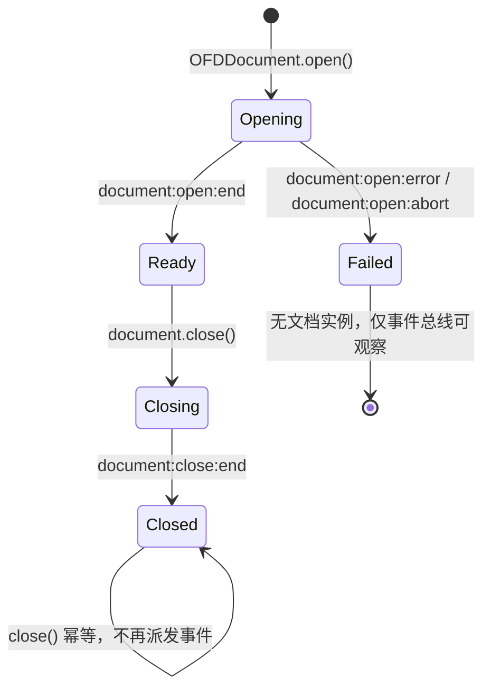
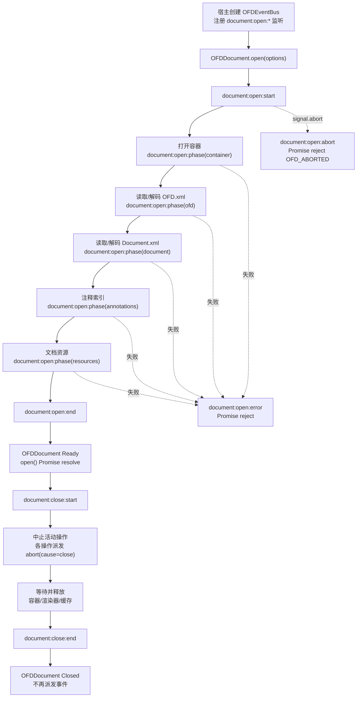
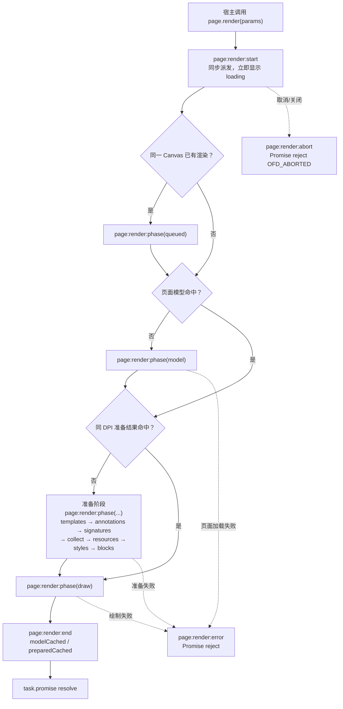
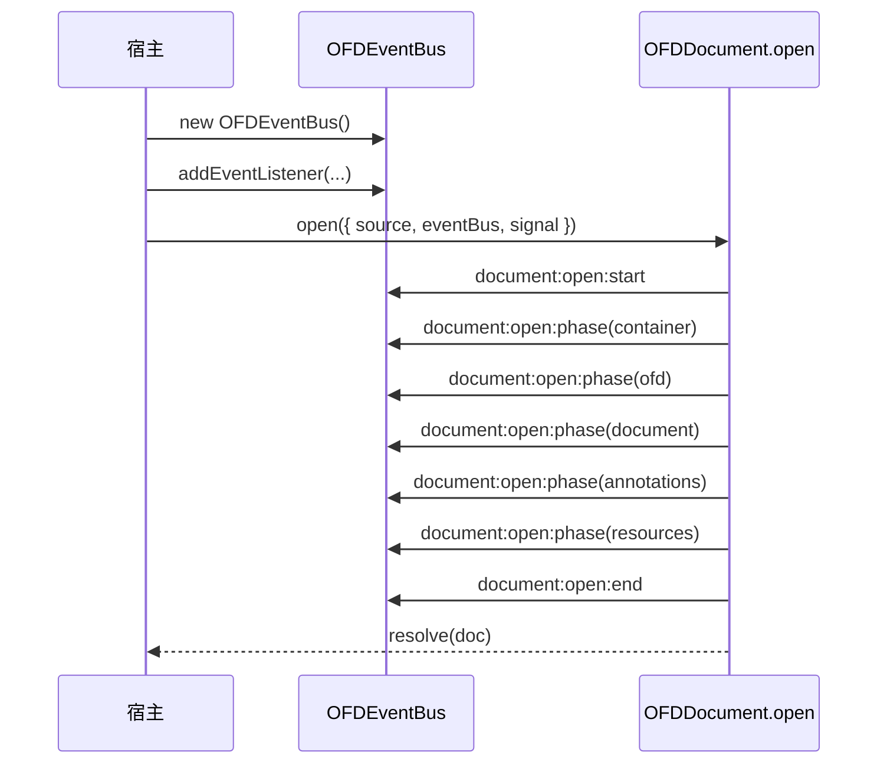
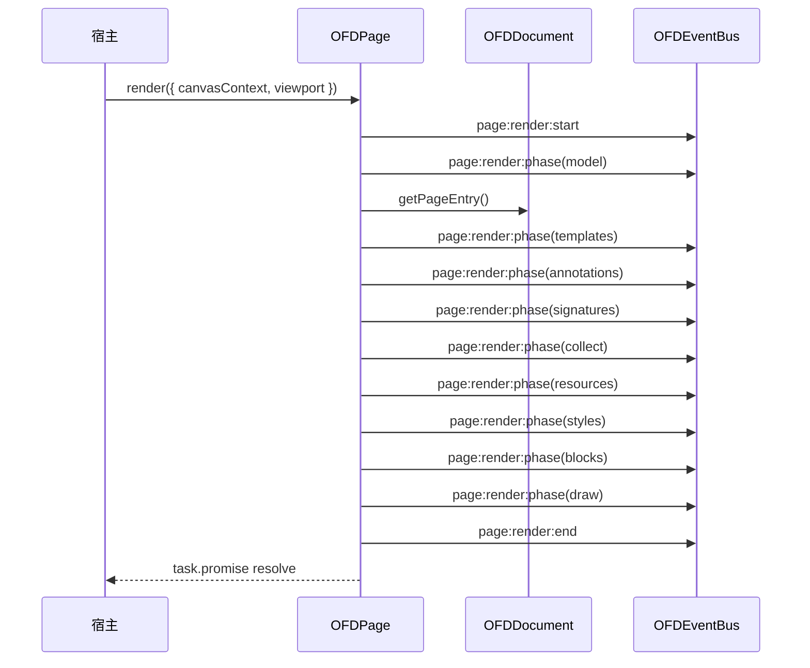
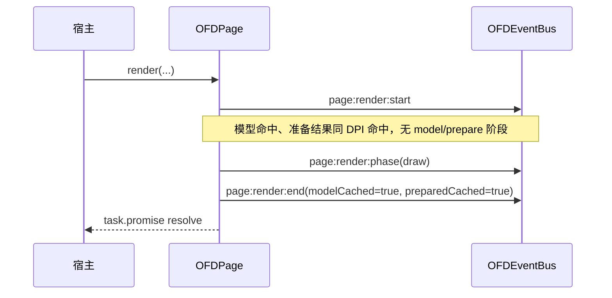
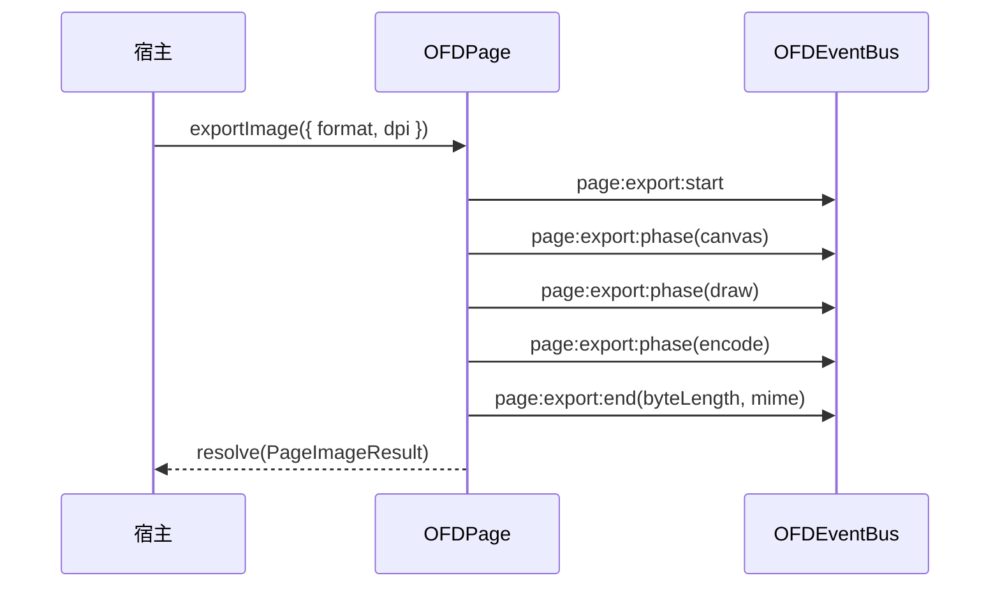
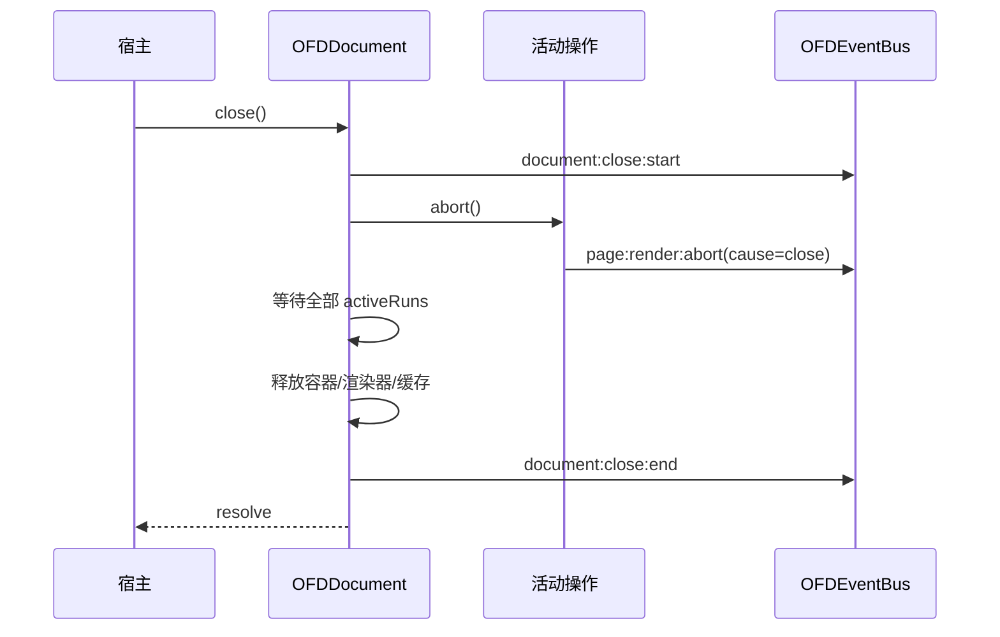

# OFD 渲染引擎生命周期与事件设计

| 项 | 内容 |
|---|---|
| 状态 | 设计讨论稿（Draft） |
| 版本 | 0.1 |
| 日期 | 2026-10-23 |
| 目标包 | `@ofdrw/ofdrw-viewer-engine` |
| 关联文档 | [OFD 渲染引擎设计方案](./OFD渲染引擎设计方案.md)、[UI 所需引擎 API](./ofdrw-viewer-ui-engine-api.md)、[UI 设计方案](./ofdrw-viewer-ui设计方案.md) |
| 目标 | 为文档打开、页面加载/准备/渲染/文本/导出/关闭等关键阶段建立统一、类型化、平台无关的事件模型，供阅读器实现加载态、进度提示和诊断 |

---

## 0. 结论摘要

1. **事件是观察通道，不参与控制流**。事件监听器只观察，不改变渲染结果；取消仍以 `AbortSignal`/`RenderTask.cancel()` 为准，关闭仍以 `document.close()` 为准。
2. **采用引擎自己的类型化事件总线，不依赖 DOM `EventTarget`/`CustomEvent`**。核心包必须能在 Node.js、小程序和 Worker 中运行，事件载荷使用普通对象，不引入 DOM 类型。
3. **同时提供 `addEventListener` 风格与 `on/once/off` 风格**。`document` 和 `page` 都是可监听对象；`page` 只接收本页事件，`document` 接收全部事件。
4. **打开阶段的监听通过 `OFDOpenOptions.eventBus` 注入**。因为 `OFDDocument.open()` 返回前文档对象尚不存在，宿主需要先创建总线并注册监听；`open()` 成功后 `document.events` 就是同一个总线。
5. **事件按“公开 API 操作”组织**：一次 `document.open`、`getPage`、`page.prepare`、`page.render`、`page.getTextContent`、`page.exportImage`、`document.close` 各有一条完整生命周期。操作内部用 `phase` 事件描述阶段，不用嵌套的独立事件流，避免监听方难以配对。
6. **每个操作有唯一 `operationId`，每个事件有 `sequence` 和 `timestamp`**。并发渲染、同一 Canvas 串行、共享页面加载都可以通过 ID 区分。
7. **默认只上报离散阶段，不承诺百分比**。引擎可以在打开阶段报告 `container/ofd/document/annotations/resources`，在页面准备阶段报告 `templates/annotations/signatures/collect/resources/styles/blocks`，但不把“已加载字节数”作为 v1 契约；后续可加可选进度字段。
8. **事件命名采用命名空间冒号风格**：`document:open:start`、`page:render:phase`、`page:export:end`。该命名与 UI 现有小写事件（`documentopen`/`pagerendered`）解耦，由 UI 做适配，避免两个包的公开事件名互相绑定。
9. **关闭顺序明确**：`document:close:start` → 中止活动操作（操作发出 `abort`）→ 等待全部结束 → 释放容器/渲染器/缓存 → `document:close:end`。`close:end` 之后不再有任何页面事件。
10. **兼容性是加法式**。不改变现有 API 行为；不传事件总线时行为与当前完全一致；监听器异常不影响渲染、不改变 Promise 结果。

---

## 1. 背景、目标与边界

### 1.1 背景

当前引擎的生命周期分散在多个公开 API 中：

- `OFDDocument.open()`：读取并解析容器、`OFD.xml`、`Document.xml`、文档资源和注释索引；
- `OFDDocument.getPage(index)`：加载页面模型、模板页与页资源，解析页尺寸；
- `OFDPage.prepare()`：异步准备字体、图片、模板、注释、签章、样式和独立块；
- `OFDPage.render()`：在同一 Canvas 的串行链上完成页面模型加载、准备和同步绘制；
- `OFDPage.getTextContent()`：复用页面准备结果并构建文本层；
- `OFDPage.exportImage()`：离屏画布、渲染、旋转和编码；
- `OFDDocument.close()`：中止活动操作、等待、释放资源。

这些阶段目前只能通过 Promise 的成功/失败推断，宿主无法知道“正在打开容器”“正在解码字体”“正在绘制”“正在编码”等中间状态。阅读器因此只能显示一个笼统的加载动画，或者在 `page.render()` 返回后自己猜测阶段。

### 1.2 目标

- 提供一套稳定、可类型推导的事件 API，覆盖文档与页面的关键生命周期。
- 让 UI 阅读器能够：
  - 在文档打开时显示分阶段文案；
  - 在页面渲染开始前显示占位/骨架，结束后移除；
  - 区分“加载资源”“准备页面”“同步绘制”“编码导出”等阶段；
  - 在取消、关闭、失败时可靠地结束加载态；
  - 在导出、文本层、预取等操作上复用同一套监听方式。
- 事件模型可被 CLI、Node.js、Electron、小程序等非 DOM 宿主使用。
- 事件监听不改变引擎行为、不引入未处理异常、不造成明显性能回退。

### 1.3 非目标

- 不把事件当作控制接口：不支持在监听器中“阻止默认行为”“拦截渲染”“修改绘制参数”。
- 不提供逐对象、逐图元、逐字符的绘制进度；同步绘制阶段仍是一个整体。
- 不提供字节级下载/解压进度百分比作为 v1 契约。
- 不在事件中暴露 `PageModel`、`PreparedPageBundle`、XML 节点、原始字体/图片字节等内部数据。
- 不改动现有 Canvas 所有权、缓存策略、渲染结果和取消语义。
- 不为 UI 的 `ViewerEventMap` 定义事件；UI 在引擎事件之上做自己的聚合和转发。

### 1.4 设计约束

| 约束 | 影响 |
|---|---|
| 核心平台无关 | 不使用 DOM `EventTarget`、`CustomEvent`、`window`、`document` |
| 渲染分“异步准备 + 同步绘制” | `render` 事件在异步准备前后、同步绘制前后分别上报；绘制阶段内部不再细分 |
| 页面模型/准备结果有缓存和并发去重 | 事件必须能表达缓存命中、共享加载和“加入已有操作” |
| 同一 Canvas 串行、不同 Canvas 可并行 | 事件必须用 `operationId` 与 `sequence` 支持并发区分 |
| 取消与关闭是正常路径 | 必须有 `abort` 事件，且不能被误报为 `error` |
| 公共 API 只增不改 | 新增字段/方法必须是可选的；不改变现有 Promise 结果 |
| 监听器由宿主编写 | 监听器异常必须隔离，不能破坏引擎状态 |

---

## 2. 生命周期梳理

### 2.1 对象与所有权

| 对象 | 创建者 | 生命周期 | 释放方式 |
|---|---|---|---|
| `OFDSource` | 宿主 | 由宿主传入 | 由宿主/字节源实现管理 |
| `VirtualContainer` | engine 默认 ZIP、`containerFactory` 或宿主 | 文档打开到 `close()` | engine 自有容器在 `close()` 关闭；借用容器只清引用 |
| `OFDDocument` | `OFDDocument.open()` | `open()` 成功到 `close()` | `close()` 幂等释放缓存/渲染器 |
| `OFDPage` | `document.getPage()` | 可长于一次渲染；文档关闭后失效 | 不单独关闭；随文档关闭失效 |
| 页面模型（`PageEntry`） | `getPageEntry()` | LRU 缓存（默认 8 页） | LRU 淘汰或 `close()` |
| 准备结果（`PreparedPageBundle`） | `preparePage()` | 每页一个，按 DPI 复用 | 新 DPI 准备、LRU/覆盖或 `close()` |
| `RenderTask` | `page.render()` | 一次渲染 | Promise 结束即完成 |
| 事件总线 | 宿主注入或 engine 创建 | 至少覆盖文档生命周期 | 文档关闭后不再派发；由宿主/文档持有 |

> 页面对象本身不拥有 Canvas，也不拥有页面模型；它只是文档能力的句柄。因此页面级事件必须由文档级事件总线转发/过滤，而不是页面自己维护独立资源。

### 2.2 文档状态机



说明：

- `Opening` 阶段文档对象尚未返回给宿主；宿主只能通过 `OFDOpenOptions.eventBus` 观察。
- `document:open:end` 在 `open()` 的 Promise resolve 之前同步派发；监听器先于 `await open()` 的后续代码执行。
- `Failed` 表示 `open()` 以错误或取消结束，没有可用的 `OFDDocument`；engine 会先清理自己拥有的容器，再派发终止事件。
- `Closing` 期间仍可能有活动操作；它们会收到取消并各自派发 `abort`，但不能再开始新的公开操作。
- `Closed` 是终态，`close()` 重复调用直接返回；不重复派发 `document:close:*`。

#### 2.2.1 事件视角：文档生命周期图

下图把“状态迁移”和“该阶段可监听的事件”放在同一张图里；实线是成功路径，虚线是失败/取消分支。节点的第二行就是该阶段对应的事件，可直接对照第 3 章的 API 使用。



> `annotations`/`resources` 等阶段可能因文档没有对应条目而跳过；图中画的是“若存在则经过”的顺序。打开失败时，engine 会先关闭自己拥有的容器，再派发 `document:open:error`。任一打开阶段收到 `signal.abort` 都会转入 `document:open:abort`，图中只画一条示意边。

### 2.3 操作生命周期

除 `close()` 外，每个公开异步操作都遵循同一模型：

```text
start ──▶ phase? ──▶ phase? ──▶ ... ──▶ end
   │
   ├──▶ error（非取消失败）
   └──▶ abort（调用方取消 / 文档关闭）
```

约定：

- `start` 在操作被接受、真正工作开始前派发；对于 `page.render()`，它在同步调用栈内派发，保证宿主能立即显示加载态。文档已关闭、参数越界、viewport/Canvas/像素上限等**入口校验失败**不进入操作生命周期：不派发 `start`，也不派发终止事件，Promise 直接拒绝。
- `phase` 表示进入一个实际执行的阶段；阶段按固定顺序出现，可跳过；同一操作内同一阶段最多出现一次。
- 只有已派发 `start` 的调用才进入操作生命周期；此时 `end`、`error`、`abort` 三者互斥，且必有一个，称为**终止事件**。
- 终止事件在对应 Promise settle 之前派发：监听器先于 `await` 的后续代码执行。
- `error` 携带原始 `OFDError`；`abort` 不携带异常作为主字段，只携带取消原因。
- `close()` 没有 `error` 终止事件；它按现有设计不向调用方抛错。

| 终止事件 | 触发条件 | Promise 结果 |
|---|---|---|
| `end` | 操作成功完成 | resolve |
| `error` | 参数错误、解析/解码失败、画布/编码失败等 | reject `OFDError` |
| `abort` | 宿主 signal、`RenderTask.cancel()`、`document.close()` | reject `OFD_ABORTED` 或 `OFD_CLOSED`（沿用现有 API 语义） |

> `abort` 是“取消”语义事件，不要求 Promise 一定以 `OFD_ABORTED` 拒绝。现有 `getPage`/`prepare`/`getTextContent`/`exportImage` 在文档关闭时可能以 `OFD_CLOSED` 拒绝；事件层仍统一归为 `abort`，并通过 `cause: 'close'` 标识。宿主应以 Promise 的 `code` 做程序分支，以事件做 UI 状态收尾。

### 2.4 页面不是单一状态机

页面可以同时处于多个操作中：一边渲染到 Canvas A，一边读取文本内容，或者宿主主动 `prepare()`。因此不为页面定义唯一的 `loading/rendering/ready` 状态，而是定义三类缓存状态和多个**操作状态**：

| 维度 | 状态 | 说明 |
|---|---|---|
| 页面模型 | `missing` / `loading` / `ready` | `getPageEntry()` 的 LRU 与并发去重 |
| 准备结果 | `missing` / `preparing` / `ready` | 按页、按 DPI 缓存；`prepare()` 固定 96 DPI |
| 渲染 | 每个 Canvas 一条串行链 | 同一 Canvas 的渲染串行，不同 Canvas 可并行 |
| 文本 | 共享构建 + 每调用方独立等待 | mm 结果按配置缓存；最后一个 waiter 离开可中止构建 |
| 导出 | 每次独立离屏画布 | 不经过宿主主 Canvas |

事件在操作维度上报，监听方不能假设 `page:render:start` 之后一定紧跟 `page:render:end` 而中间没有其他页面事件；并发操作会交错。

#### 2.4.1 事件视角：页面操作生命周期图

以最常用的 `page.render()` 为例。`prepare`/`text`/`export` 共享同一套 `start → phase… → 终止` 模型，只是阶段枚举不同；`prepare` 的阶段是本节准备阶段的子集，`text` 增加 `text` 阶段，`export` 增加 `canvas/rotate/encode` 阶段。



> `queued`、`model`、准备阶段都是可选的：缓存命中时直接进入 `draw`。`page:render:start` 在 `render()` 返回 `RenderTask` 之前同步派发；`page:render:end`/`error`/`abort` 在 `task.promise` settle 之前派发。

### 2.5 关键阶段清单

#### 2.5.1 文档打开（`OFDDocument.open`）

| 阶段 | 现有实现 | 是否 I/O | 事件 |
|---|---|---|---|
| 构造/打开容器 | 默认 ZIP、`containerFactory` 或宿主注入 | 是 | `document:open:phase`，`phase='container'` |
| 读取并解码 `OFD.xml` | `decodeOfdRoot` | 是 | `phase='ofd'` |
| 选择 `DocRoot`、读取并解码 `Document.xml` | `decodeDocument` | 是 | `phase='document'` |
| 文档注释索引 | `decodeAnnotationsIndex` | 是（可选） | `phase='annotations'` |
| 文档级资源索引 | `PublicRes` + `DocumentRes` | 是（可选） | `phase='resources'` |
| 字体库/渲染器初始化 | 内存构造 | 否 | 不单独上报 |
| 文档可用 | 构造函数完成 | — | `document:open:end` |

- 容器由宿主直接注入时，`container` 阶段跳过；没有注释索引或资源文件时，对应阶段跳过。
- `documentIndex` 非法、加密包、包结构错误等失败，`document:open:error.phase` 指向失败时所在阶段。
- 打开成功但后续页面数据损坏不属于打开失败；由页级 warning 处理。

#### 2.5.2 页面加载（`OFDDocument.getPage`）

| 阶段 | 现有实现 | 事件 |
|---|---|---|
| 读取/解码页面 `Content.xml` | `loadPageEntry` | `document:page:load:phase`，`phase='content'` |
| 按引用加载模板页 | `loadTemplatePageModel` | `phase='templates'` |
| 合并 Area/模板/CommonData 回退并得到页尺寸 | `resolvePageArea` / `applyPageArea` | `phase='size'` |
| 读取页资源 XML、创建资源作用域 | `loadResourceIndex` / `createPageScope` | `phase='resources'` |
| 返回 `OFDPage` | `new OFDPage` | `document:page:load:end` |

- 页面模型缓存命中时没有 `phase`，`end.cacheHit=true`。
- 加载被多个调用方共享时，阶段只由实际执行者上报；加入者收到 `start.joined=true` 和 `end.joined=true`。

#### 2.5.3 页面准备（`OFDPage.prepare` 及渲染/文本/导出的内部准备）

公开 `page.prepare()` 的阶段通过 `page:prepare:phase` 派发；由 `render`/`text`/`export` 内部触发时，阶段并入对应操作的 `page:render:phase`/`page:text:phase`/`page:export:phase`，不额外派发 `page:prepare:*`。

| 阶段 | 现有实现 | 事件 |
|---|---|---|
| 页面模型加载（若未缓存） | `getPageEntry` | `phase='model'` |
| 模板页加载 | `preparePage` 的 `Promise.allSettled` | `phase='templates'` |
| 注释加载 | `loadAnnotations` | `phase='annotations'` |
| 签章戳记与印章解码 | `loadSignatureStamps` / `decodeSeal` | `phase='signatures'` |
| 资源收集（字体/图片/底纹/复合/注释外观） | `collectBlock` | `phase='collect'` |
| 字体与图片解码（并行） | `Promise.all([loadFontsSafely, loadImagesSafely])` | `phase='resources'` |
| 绘制参数/样式结算 | `resolvePageStyles` | `phase='styles'` |
| 复合块/底纹/注释显示列表构建 | `buildComposite` / `buildBlockDisplayList` | `phase='blocks'` |

- 字体和图片在实现中是并行加载的，因此合并为一个 `resources` 阶段，不虚构先后顺序。
- 阶段为空（例如没有模板、没有注释）时可以跳过。
- 准备结果缓存命中时，公开 `prepare()` 只派发 `start` 和 `end(cacheHit=true)`，不派发 `phase`。

#### 2.5.4 页面渲染（`OFDPage.render`）

| 阶段 | 说明 | 事件 |
|---|---|---|
| 入队 | 同一 Canvas 上已有渲染时等待 | `page:render:phase`，`phase='queued'`（仅等待时） |
| 页面模型 | 缓存未命中时重新加载 | `phase='model'` |
| 准备 | 没有同 DPI 准备结果时执行 2.5.3 | `phase='templates'...` 直至 `'blocks'` |
| 同步绘制 | `drawPage`：`beginPage` → 图层/注释/签章 → `endPage` | `phase='draw'` |
| 完成 | 绘制返回且未取消 | `page:render:end` |

- `page:render:start` 在入口校验通过后、`OFDPage.render()` 返回 `RenderTask` 之前同步派发。
- 入口校验失败（viewport 非法、Canvas 太小、像素超限、上下文无效）时不派发事件，`RenderTask.promise` 直接拒绝。
- 同一 Canvas 的串行等待只影响 `queued` 阶段和 `end.queueMs`，不影响 `start` 的及时性。
- 绘制阶段是同步的，`phase='draw'` 之后到 `end` 之间不会再派发其他事件；宿主不应在此期间依赖动画帧更新。

#### 2.5.5 文本内容（`OFDPage.getTextContent`）

| 阶段 | 说明 | 事件 |
|---|---|---|
| 页面模型 | 缓存未命中时加载 | `page:text:phase`，`phase='model'` |
| 准备 | 没有 96 DPI 准备结果时执行准备 | `phase` 为准备阶段 |
| 文本收集 | `collectTextPageMm` | `phase='text'` |
| 完成 | 返回 `TextContent` | `page:text:end` |

- 文本 mm 结果命中缓存时，没有 `phase`，`end.cacheHit=true`。
- 多个调用方共享同一次文本构建时，所有者派发阶段；加入者只派发自己的 `start(joined=true)` 和 `end(joined=true)`。

#### 2.5.6 图片导出（`OFDPage.exportImage`）

| 阶段 | 说明 | 事件 |
|---|---|---|
| 画布 | 创建离屏画布、填充背景 | `page:export:phase`，`phase='canvas'` |
| 页面模型 | 缓存未命中时加载 | `phase='model'` |
| 准备 | 没有同 DPI 准备结果时执行准备 | 同准备阶段 |
| 绘制 | 复用页面绘制管线 | `phase='draw'` |
| 旋转 | 90/270 输出时旋转并重铺背景 | `phase='rotate'`（仅旋转非 0） |
| 编码 | `convertToBlob`/`toBlob`/`encodeImage` | `phase='encode'` |
| 完成 | 返回 `PageImageResult` | `page:export:end` |

- 导出**不派发** `page:render:*` 或 `page:prepare:*` 事件，避免宿主把导出误当成主视图渲染。
- 导出的内部绘制仍复用同一实现；阶段由 `page:export:*` 统一表达。

#### 2.5.7 关闭（`OFDDocument.close`）

| 步骤 | 说明 | 事件 |
|---|---|---|
| 置关闭标记 | 拒绝新操作 | `document:close:start` |
| 中止 | 中止 `closeController` 与活动 controller | 活动操作各自派发 `abort` |
| 等待 | `Promise.allSettled(activeRuns)` | 不派发 |
| 释放 | 关闭自有容器、渲染器、字体库、全部缓存 | 不派发 |
| 完成 | 清空引用 | `document:close:end` |

- `close()` 幂等；第二次调用不再派发任何事件。
- `document:close:end` 之后不允许再出现任何页面事件。
- `document:close:end.abortedOperations` 记录本次关闭中止的活动操作数量，便于诊断。

#### 2.5.8 辅助数据加载

以下 API 在 v1 不设独立事件，Promise 足以表达完成/失败；如果 UI 需要在侧栏显示 loading，建议使用 UI 自己的异步状态，或后续统一增加 `document:query:*` 事件：

| API | 读取内容 | v1 事件 |
|---|---|---|
| `getPageInfos()` | 页树 + 每页 Area/模板回退 | 设 `document:pageinfos:*`（轻量，建议保留） |
| `getOutline()` | `Document.xml` 大纲 | 无独立事件 |
| `getBookmarks()` | `Document.xml` 书签 | 无独立事件 |
| `getMetadata()` | `OFD.xml` 的 DocInfo | 无独立事件 |
| `getPermissions()` | `Document.xml` 权限声明 | 无独立事件 |
| `getSignatureEntries()` | `Signatures.xml`/`Signature.xml` | 无独立事件 |
| `getAttachments()` / `getAttachmentData()` | 附件索引/原始字节 | 无独立事件 |
| `getSignedValue()` | `SignedValue.dat` 原始字节 | 无独立事件 |

### 2.6 关键时序

#### 2.6.1 打开文档



失败路径：`start` → `phase(...)` → `error` → `reject`；取消路径：`start` → `phase(...)` → `abort` → `reject`。

#### 2.6.2 首次渲染（模型与准备均未缓存）



#### 2.6.3 缓存命中的重复渲染



#### 2.6.4 导出



导出内部即使重新加载模型/准备，也只通过 `page:export:phase` 的 `model` 与准备阶段表达，不派发 `page:render:*`。

#### 2.6.5 关闭与活动操作



---

## 3. 事件模型

### 3.1 设计原则

1. **类型优先**：事件名是字符串字面量联合，载荷按事件名推导；避免 `any`/字符串索引。
2. **同步派发**：`emit` 在调用栈内同步执行，不返回 Promise；事件只做状态通知。
3. **快照派发**：派发前复制当前监听器集合；派发过程中新增的监听器不参与本次事件，移除的监听器是否已被快照由实现按快照语义决定。
4. **异常隔离**：单个监听器抛错不影响其他监听器、不影响引擎操作；由 `OFDEventBusOptions.onListenerError` 上报。
5. **无监听器零负担**：没有监听器时不做载荷构造、不派发；阶段调用本身保持廉价。
6. **不持有大对象**：事件载荷只含标量、错误对象和必要的结果元信息；不携带原始字节、页面模型、显示列表。
7. **可关闭即静默**：文档关闭后总线不再派发新事件；`close:end` 是最后一帧。
8. **不重复现有 warning**：warning 继续走 `onWarning`，不默认转成事件，避免同一诊断出现两条通道。

### 3.2 公共 API 形态

#### 3.2.1 事件总线

```ts
export interface OFDAddEventListenerOptions {
  /** 是否只触发一次。 */
  once?: boolean;
  /** 绑定生命周期；abort 后自动移除监听器。 */
  signal?: AbortSignal;
}

export interface OFDEventBusOptions {
  /**
   * 监听器异常回调；省略时吞掉异常。
   *
   * @param error 监听器抛出的错误。
   * @param type 事件名。
   */
  onListenerError?: (error: unknown, type: OFDEventName) => void;
}

export class OFDEventBus {
  constructor(options?: OFDEventBusOptions);

  /** 订阅事件，返回退订函数；可重复调用。 */
  on<K extends OFDEventName>(type: K, handler: OFDEventHandler<K>): () => void;
  /** 订阅一次。 */
  once<K extends OFDEventName>(type: K, handler: OFDEventHandler<K>): () => void;
  /** 退订。 */
  off<K extends OFDEventName>(type: K, handler: OFDEventHandler<K>): void;

  /** DOM 风格订阅；返回 void，与 addEventListener 一致。 */
  addEventListener<K extends OFDEventName>(
    type: K,
    handler: OFDEventHandler<K>,
    options?: OFDAddEventListenerOptions,
  ): void;
  /** DOM 风格退订。 */
  removeEventListener<K extends OFDEventName>(
    type: K,
    handler: OFDEventHandler<K>,
  ): void;

  /** 移除指定事件或全部监听器；主要供宿主编排和测试清理。 */
  removeAllListeners(type?: OFDEventName): void;
  /** 当前监听器数量。 */
  listenerCount(type: OFDEventName): number;

  /**
   * 引擎内部派发入口。
   *
   * @internal 不属于宿主稳定 API；宿主只应订阅，不应伪造引擎事件。
   */
  emit<K extends OFDEventName>(type: K, event: OFDEventMap[K]): void;
}
```

> `OFDEventBus` 同时被引擎用于内部派发。`emit` 标记为内部入口，不作为稳定公共 API 文档化；宿主只应订阅。

#### 3.2.2 文档对象

```ts
export class OFDDocument {
  /** 本文档使用的事件总线；若 open 时注入了 eventBus，则与注入对象相同。 */
  readonly events: OFDEventBus;

  on<K extends OFDEventName>(type: K, handler: OFDEventHandler<K>): () => void;
  once<K extends OFDEventName>(type: K, handler: OFDEventHandler<K>): () => void;
  off<K extends OFDEventName>(type: K, handler: OFDEventHandler<K>): void;
  addEventListener<K extends OFDEventName>(
    type: K,
    handler: OFDEventHandler<K>,
    options?: OFDAddEventListenerOptions,
  ): void;
  removeEventListener<K extends OFDEventName>(
    type: K,
    handler: OFDEventHandler<K>,
  ): void;
}
```

#### 3.2.3 页面对象

```ts
export class OFDPage {
  /** 只接收本页事件；文档级事件不会进入页面监听器。 */
  on<K extends OFDPageEventName>(type: K, handler: OFDEventHandler<K>): () => void;
  once<K extends OFDPageEventName>(type: K, handler: OFDEventHandler<K>): () => void;
  off<K extends OFDPageEventName>(type: K, handler: OFDEventHandler<K>): void;
  addEventListener<K extends OFDPageEventName>(
    type: K,
    handler: OFDEventHandler<K>,
    options?: OFDAddEventListenerOptions,
  ): void;
  removeEventListener<K extends OFDPageEventName>(
    type: K,
    handler: OFDEventHandler<K>,
  ): void;
}
```

页面级监听器是对文档总线的**按 `pageIndex` 过滤视图**：

- `page.on('page:render:start', ...)` 只在本页渲染时触发；
- `doc.on('page:render:start', ...)` 在所有页渲染时触发；
- 同一回调注册到页面和文档会各触发一次，宿主自行避免重复注册；
- 页面监听器在文档关闭时由引擎清理，避免总线持有失效页面。

#### 3.2.4 打开时注入总线

```ts
export interface OFDOpenBaseOptions {
  // ...现有字段
  /**
   * 打开阶段与后续文档生命周期使用的事件总线。
   *
   * 需要在 open 完成前监听 `document:open:*` 时传入；省略时由引擎创建，
   * 并通过 `document.events` 访问。一个总线只对应一个文档实例。
   */
  eventBus?: OFDEventBus;
  /** 打开取消信号；中止时 open 以 OFD_ABORTED 拒绝。 */
  signal?: AbortSignal;
}
```

### 3.3 命名规范

事件名格式：

```text
<对象>:<操作>:<后缀>
```

| 片段 | 取值 | 说明 |
|---|---|---|
| 对象 | `document` / `page` | 事件所属对象 |
| 操作 | `open` / `close` / `page:load` / `pageinfos` / `prepare` / `render` / `text` / `export` | 公开操作 |
| 后缀 | `start` / `phase` / `end` / `error` / `abort` | 生命周期位置 |

示例：

- `document:open:start`
- `document:open:phase`
- `document:page:load:end`
- `page:render:phase`
- `page:export:abort`

约定：

- 全部小写，使用冒号分层；不使用 camelCase、kebab-case 或下划线。
- `start`/`end` 成对；`error`/`abort` 是替代 `end` 的终止事件。
- 不使用 `done`、`complete`、`finish` 等同义词，避免 API 分叉。
- 不为同一语义同时提供别名（例如不再提供 `pagerendered` 风格别名）。

### 3.4 派发语义

| 语义 | 约定 |
|---|---|
| 同步 | 监听器在 `emit` 调用栈内执行；引擎不等待返回值 |
| 快照 | 派发开始时复制监听器集合；新增监听器不参与本次派发 |
| `once` | 调用前移除，监听器抛错也不会再次触发 |
| `signal` | `addEventListener` 时若 signal 已 abort，则不注册；注册后 abort 自动移除 |
| 退订 | `off`/`removeEventListener` 移除该事件下匹配的原回调；重复注册则全部移除 |
| 异常 | 单个监听器异常被捕获；若配置 `onListenerError` 则上报；否则静默 |
| 重入 | 允许监听器再次调用引擎 API；新操作使用新的 `operationId`，事件会嵌套/交错 |
| 顺序 | 同一操作内严格按 `start → phase... → 终止`；并发操作之间不保证相对顺序，用 `sequence` 观察全序 |
| 关闭后 | `document:close:end` 之后总线不再派发事件；已注册监听器保留但不会再被调用 |

> 建议宿主不要在监听器里同步调用 `document.close()`。虽然引擎允许重入，但关闭会等待当前活动操作，容易造成宿主自己的状态竞争。关闭应由明确的用户/生命周期动作触发。

### 3.5 通用字段与单位

```ts
export interface OFDEventBase {
  /** 事件名。 */
  readonly type: OFDEventName;
  /** 事件时间，Unix 毫秒（Date.now）。 */
  readonly timestamp: number;
  /** 总线派发序号，从 1 开始单调递增。 */
  readonly sequence: number;
}

export interface OFDOperationEventBase extends OFDEventBase {
  /** 操作 ID，文档内唯一，从 1 开始；RenderTask.id 使用同一编号。 */
  readonly operationId: number;
}

export interface OFDPageOperationEventBase extends OFDOperationEventBase {
  /** 页索引，从 0 开始。 */
  readonly pageIndex: number;
}
```

单位约定：

| 字段 | 单位 | 说明 |
|---|---|---|
| `timestamp` | Unix 毫秒 | 事件发生时间 |
| `durationMs` / `queueMs` / `prepareMs` / `drawMs` | 毫秒 | 操作用时 |
| `width` / `height` | 设备像素 | 渲染/导出输出尺寸 |
| `dpi` | DPI | 输出精度 |
| `widthMm` / `heightMm` | 毫米 | 页面物理尺寸 |
| `packageSize` / `byteLength` | byte | 包大小/图片字节数 |
| `fontCount` / `imageCount` / `templateCount` / `textItemCount` / `charCount` | 个 | 计数 |
| `rotation` | 度 | 0/90/180/270，顺时针 |

事件对象是只读契约：引擎不会在派发后复用它或修改字段；监听器也不应修改。

### 3.6 阶段枚举

```ts
/** 文档打开阶段。 */
export type OFDDocumentOpenPhase =
  | 'container'
  | 'ofd'
  | 'document'
  | 'annotations'
  | 'resources';

/** getPage 的页面模型加载阶段。 */
export type OFDPageLoadPhase = 'content' | 'templates' | 'size' | 'resources';

/** 页面准备阶段；字体与图片并行，合并为 resources。 */
export type OFDPreparePhase =
  | 'templates'
  | 'annotations'
  | 'signatures'
  | 'collect'
  | 'resources'
  | 'styles'
  | 'blocks';

/** 页面渲染阶段。 */
export type OFDRenderPhase = 'queued' | 'model' | OFDPreparePhase | 'draw';

/** 文本内容阶段；text 表示 collectTextPageMm。 */
export type OFDTextPhase = 'model' | OFDPreparePhase | 'text';

/** 图片导出阶段。 */
export type OFDExportPhase =
  | 'canvas'
  | 'model'
  | OFDPreparePhase
  | 'draw'
  | 'rotate'
  | 'encode';

/** 取消来源。 */
export type OFDAbortCause = 'caller' | 'close';
```

阶段出现规则：

- 只在实际进入该阶段时派发；不为了“凑齐序列”而派发空阶段。
- 同一操作内阶段顺序固定，不允许回退。
- 准备结果命中缓存时，`model` 之后直接进入 `draw`/`text`/`encode`，不派发准备阶段。
- 页面模型命中缓存时，不派发 `model`。
- 字体和图片并行加载，统一为 `resources`，不拆成 `fonts`/`images` 两个可能交错的阶段。

### 3.7 事件目录

#### 3.7.1 文档事件

| 事件 | 触发时机 | 关键载荷 | 终止 |
|---|---|---|---|
| `document:open:start` | `open()` 接受请求后、容器打开前 | `sourceKind`、`documentIndex`、`viaContainer` | 否 |
| `document:open:phase` | 进入打开阶段 | `phase: OFDDocumentOpenPhase` | 否 |
| `document:open:end` | 文档构造完成、Promise resolve 前 | `pageCount`、`version`、`packageSize`、`durationMs` | 是 |
| `document:open:error` | 打开失败 | `phase`、`error`、`durationMs` | 是 |
| `document:open:abort` | 打开被 signal 取消 | `phase`、`cause:'caller'`、`reason`、`durationMs` | 是 |
| `document:close:start` | 开始关闭 | `operationId` | 否 |
| `document:close:end` | 资源释放完成 | `durationMs`、`abortedOperations` | 是 |
| `document:page:load:start` | 开始 `getPage()` | `pageIndex`、`joined` | 否 |
| `document:page:load:phase` | 进入页面模型加载阶段 | `pageIndex`、`phase: OFDPageLoadPhase` | 否 |
| `document:page:load:end` | 页面句柄创建完成 | `pageIndex`、`cacheHit`、`widthMm`、`heightMm`、`durationMs`、`joined` | 是 |
| `document:page:load:error` | 页面加载失败 | `pageIndex`、`error`、`durationMs` | 是 |
| `document:page:load:abort` | 页面加载取消/关闭 | `pageIndex`、`cause`、`reason`、`durationMs` | 是 |
| `document:pageinfos:start` | 开始 `getPageInfos()` | `start`、`count`（请求值） | 否 |
| `document:pageinfos:end` | 页尺寸读取完成 | `count`、`durationMs` | 是 |
| `document:pageinfos:error` | 页尺寸读取失败 | `error`、`durationMs` | 是 |
| `document:pageinfos:abort` | 页尺寸读取取消 | `cause`、`reason`、`durationMs` | 是 |

#### 3.7.2 页面事件

| 事件 | 触发时机 | 关键载荷 | 终止 |
|---|---|---|---|
| `page:prepare:start` | 公开 `prepare()` 开始或加入共享准备 | `dpi`、`joined` | 否 |
| `page:prepare:phase` | 进入准备阶段 | `dpi`、`phase: 'model' \| OFDPreparePhase` | 否 |
| `page:prepare:end` | 准备完成 | `cacheHit`、`durationMs`、`templateCount`、`fontCount`、`imageCount`、`joined` | 是 |
| `page:prepare:error` | 准备失败 | `phase?`、`error`、`durationMs` | 是 |
| `page:prepare:abort` | 准备取消/关闭 | `phase?`、`cause`、`reason`、`durationMs` | 是 |
| `page:render:start` | `render()` 返回 `RenderTask` 前同步派发 | `dpi`、`width`、`height` | 否 |
| `page:render:phase` | 进入渲染阶段 | `phase: OFDRenderPhase` | 否 |
| `page:render:end` | 绘制完成、Promise resolve 前 | `durationMs`、`queueMs?`、`prepareMs?`、`drawMs?`、`modelCached`、`preparedCached` | 是 |
| `page:render:error` | 校验/加载/绘制失败 | `phase?`、`error`、`durationMs` | 是 |
| `page:render:abort` | 取消/关闭 | `phase?`、`cause`、`reason`、`durationMs` | 是 |
| `page:text:start` | `getTextContent()` 开始 | `dpi`、`joined` | 否 |
| `page:text:phase` | 进入文本阶段 | `dpi`、`phase: OFDTextPhase` | 否 |
| `page:text:end` | 文本内容返回前 | `durationMs`、`dpi`、`textItemCount`、`charCount`、`cacheHit`、`preparedCached`、`joined` | 是 |
| `page:text:error` | 文本构建失败 | `phase?`、`error`、`durationMs` | 是 |
| `page:text:abort` | 文本构建取消/关闭 | `phase?`、`cause`、`reason`、`durationMs` | 是 |
| `page:export:start` | `exportImage()` 开始 | `dpi`、`format`、`rotation`、`width`、`height` | 否 |
| `page:export:phase` | 进入导出阶段 | `phase: OFDExportPhase` | 否 |
| `page:export:end` | 编码完成 | `durationMs`、`byteLength`、`mime`、`width`、`height`、`dpi`、`format`、`rotation`、`modelCached`、`preparedCached` | 是 |
| `page:export:error` | 导出失败 | `phase?`、`error`、`durationMs` | 是 |
| `page:export:abort` | 导出取消/关闭 | `phase?`、`cause`、`reason`、`durationMs` | 是 |

### 3.8 事件载荷定义

以下为公开类型草案；最终实现时放入 `src/api/events.ts` 并从 `src/index.ts` 导出。

```ts
// ---------------------------------------------------------------------------
// 文档打开/关闭
// ---------------------------------------------------------------------------

export interface DocumentOpenStartEvent extends OFDOperationEventBase {
  readonly type: 'document:open:start';
  /** 来源类型；不携带来源内容本身。 */
  readonly sourceKind: OFDSource['kind'];
  /** 多文档包中的文档索引。 */
  readonly documentIndex: number;
  /** 是否通过 container/containerFactory 注入，而非 engine 默认 ZIP。 */
  readonly viaContainer: boolean;
}

export interface DocumentOpenPhaseEvent extends OFDOperationEventBase {
  readonly type: 'document:open:phase';
  readonly phase: OFDDocumentOpenPhase;
}

export interface DocumentOpenEndEvent extends OFDOperationEventBase {
  readonly type: 'document:open:end';
  readonly pageCount: number;
  readonly version: string;
  /** 原始包字节数，byte。 */
  readonly packageSize: number;
  readonly durationMs: number;
}

export interface DocumentOpenErrorEvent extends OFDOperationEventBase {
  readonly type: 'document:open:error';
  /** 失败时所在阶段；参数校验等早期失败可能缺省。 */
  readonly phase?: OFDDocumentOpenPhase;
  readonly error: OFDError;
  readonly durationMs: number;
}

export interface DocumentOpenAbortEvent extends OFDOperationEventBase {
  readonly type: 'document:open:abort';
  readonly phase?: OFDDocumentOpenPhase;
  readonly cause: 'caller';
  readonly reason?: unknown;
  readonly durationMs: number;
}

export interface DocumentCloseStartEvent extends OFDOperationEventBase {
  readonly type: 'document:close:start';
}

export interface DocumentCloseEndEvent extends OFDOperationEventBase {
  readonly type: 'document:close:end';
  readonly durationMs: number;
  /** 本次关闭中止的活动操作数量。 */
  readonly abortedOperations: number;
}

// ---------------------------------------------------------------------------
// getPage
// ---------------------------------------------------------------------------

export interface DocumentPageLoadStartEvent extends OFDPageOperationEventBase {
  readonly type: 'document:page:load:start';
  readonly joined: boolean;
}

export interface DocumentPageLoadPhaseEvent extends OFDPageOperationEventBase {
  readonly type: 'document:page:load:phase';
  readonly phase: OFDPageLoadPhase;
}

export interface DocumentPageLoadEndEvent extends OFDPageOperationEventBase {
  readonly type: 'document:page:load:end';
  readonly cacheHit: boolean;
  readonly widthMm: number;
  readonly heightMm: number;
  readonly durationMs: number;
  readonly joined: boolean;
}

export interface DocumentPageLoadErrorEvent extends OFDPageOperationEventBase {
  readonly type: 'document:page:load:error';
  readonly error: OFDError;
  readonly durationMs: number;
}

export interface DocumentPageLoadAbortEvent extends OFDPageOperationEventBase {
  readonly type: 'document:page:load:abort';
  readonly cause: OFDAbortCause;
  readonly reason?: unknown;
  readonly durationMs: number;
}

// ---------------------------------------------------------------------------
// getPageInfos
// ---------------------------------------------------------------------------

export interface DocumentPageInfosStartEvent extends OFDOperationEventBase {
  readonly type: 'document:pageinfos:start';
  /** 请求的起始页；省略表示默认 0。 */
  readonly start?: number;
  /** 请求的页数；省略表示剩余全部。 */
  readonly count?: number;
}

export interface DocumentPageInfosEndEvent extends OFDOperationEventBase {
  readonly type: 'document:pageinfos:end';
  /** 实际返回的页数。 */
  readonly count: number;
  readonly durationMs: number;
}

export interface DocumentPageInfosErrorEvent extends OFDOperationEventBase {
  readonly type: 'document:pageinfos:error';
  readonly error: OFDError;
  readonly durationMs: number;
}

export interface DocumentPageInfosAbortEvent extends OFDOperationEventBase {
  readonly type: 'document:pageinfos:abort';
  readonly cause: OFDAbortCause;
  readonly reason?: unknown;
  readonly durationMs: number;
}

// ---------------------------------------------------------------------------
// 页面准备
// ---------------------------------------------------------------------------

export interface PagePrepareStartEvent extends OFDPageOperationEventBase {
  readonly type: 'page:prepare:start';
  /** 准备使用的 DPI；当前 prepare() 固定 96。 */
  readonly dpi: number;
  /** 是否加入已有共享准备，而不是本次发起。 */
  readonly joined: boolean;
}

export interface PagePreparePhaseEvent extends OFDPageOperationEventBase {
  readonly type: 'page:prepare:phase';
  readonly dpi: number;
  readonly phase: 'model' | OFDPreparePhase;
}

export interface PagePrepareEndEvent extends OFDPageOperationEventBase {
  readonly type: 'page:prepare:end';
  readonly dpi: number;
  readonly cacheHit: boolean;
  readonly durationMs: number;
  readonly templateCount: number;
  readonly fontCount: number;
  readonly imageCount: number;
  readonly joined: boolean;
}

export interface PagePrepareErrorEvent extends OFDPageOperationEventBase {
  readonly type: 'page:prepare:error';
  readonly dpi: number;
  readonly phase?: 'model' | OFDPreparePhase;
  readonly error: OFDError;
  readonly durationMs: number;
}

export interface PagePrepareAbortEvent extends OFDPageOperationEventBase {
  readonly type: 'page:prepare:abort';
  readonly dpi: number;
  readonly phase?: 'model' | OFDPreparePhase;
  readonly cause: OFDAbortCause;
  readonly reason?: unknown;
  readonly durationMs: number;
}

// ---------------------------------------------------------------------------
// 页面渲染
// ---------------------------------------------------------------------------

export interface PageRenderStartEvent extends OFDPageOperationEventBase {
  readonly type: 'page:render:start';
  readonly dpi: number;
  /** viewport 宽度，设备像素。 */
  readonly width: number;
  /** viewport 高度，设备像素。 */
  readonly height: number;
}

export interface PageRenderPhaseEvent extends OFDPageOperationEventBase {
  readonly type: 'page:render:phase';
  readonly phase: OFDRenderPhase;
}

export interface PageRenderEndEvent extends OFDPageOperationEventBase {
  readonly type: 'page:render:end';
  readonly durationMs: number;
  /** 等待同 Canvas 串行链的时间，毫秒；未等待时缺省。 */
  readonly queueMs?: number;
  /** 准备阶段耗时，毫秒；命中缓存时缺省。 */
  readonly prepareMs?: number;
  /** 同步绘制耗时，毫秒。 */
  readonly drawMs?: number;
  /** 页面模型是否命中缓存。 */
  readonly modelCached: boolean;
  /** 是否命中同 DPI 的准备结果。 */
  readonly preparedCached: boolean;
}

export interface PageRenderErrorEvent extends OFDPageOperationEventBase {
  readonly type: 'page:render:error';
  readonly phase?: OFDRenderPhase;
  readonly error: OFDError;
  readonly durationMs: number;
}

export interface PageRenderAbortEvent extends OFDPageOperationEventBase {
  readonly type: 'page:render:abort';
  readonly phase?: OFDRenderPhase;
  readonly cause: OFDAbortCause;
  readonly reason?: unknown;
  readonly durationMs: number;
}

// ---------------------------------------------------------------------------
// 文本内容
// ---------------------------------------------------------------------------

export interface PageTextStartEvent extends OFDPageOperationEventBase {
  readonly type: 'page:text:start';
  readonly dpi: number;
  readonly joined: boolean;
}

export interface PageTextPhaseEvent extends OFDPageOperationEventBase {
  readonly type: 'page:text:phase';
  readonly dpi: number;
  readonly phase: OFDTextPhase;
}

export interface PageTextEndEvent extends OFDPageOperationEventBase {
  readonly type: 'page:text:end';
  readonly dpi: number;
  readonly durationMs: number;
  readonly textItemCount: number;
  readonly charCount: number;
  /** 文本 mm 缓存是否命中。 */
  readonly cacheHit: boolean;
  /** 是否命中 96 DPI 准备结果。 */
  readonly preparedCached: boolean;
  readonly joined: boolean;
}

export interface PageTextErrorEvent extends OFDPageOperationEventBase {
  readonly type: 'page:text:error';
  readonly dpi: number;
  readonly phase?: OFDTextPhase;
  readonly error: OFDError;
  readonly durationMs: number;
}

export interface PageTextAbortEvent extends OFDPageOperationEventBase {
  readonly type: 'page:text:abort';
  readonly dpi: number;
  readonly phase?: OFDTextPhase;
  readonly cause: OFDAbortCause;
  readonly reason?: unknown;
  readonly durationMs: number;
}

// ---------------------------------------------------------------------------
// 图片导出
// ---------------------------------------------------------------------------

export interface PageExportStartEvent extends OFDPageOperationEventBase {
  readonly type: 'page:export:start';
  readonly dpi: number;
  readonly format: PageImageFormat;
  readonly rotation: 0 | 90 | 180 | 270;
  /** 输出宽度，设备像素（旋转后）。 */
  readonly width: number;
  /** 输出高度，设备像素（旋转后）。 */
  readonly height: number;
}

export interface PageExportPhaseEvent extends OFDPageOperationEventBase {
  readonly type: 'page:export:phase';
  readonly phase: OFDExportPhase;
}

export interface PageExportEndEvent extends OFDPageOperationEventBase {
  readonly type: 'page:export:end';
  readonly dpi: number;
  readonly format: PageImageFormat;
  readonly rotation: 0 | 90 | 180 | 270;
  readonly width: number;
  readonly height: number;
  /** 编码后字节数，byte。 */
  readonly byteLength: number;
  readonly mime: PageImageMime;
  readonly durationMs: number;
  readonly modelCached: boolean;
  readonly preparedCached: boolean;
}

export interface PageExportErrorEvent extends OFDPageOperationEventBase {
  readonly type: 'page:export:error';
  readonly phase?: OFDExportPhase;
  readonly error: OFDError;
  readonly durationMs: number;
}

export interface PageExportAbortEvent extends OFDPageOperationEventBase {
  readonly type: 'page:export:abort';
  readonly phase?: OFDExportPhase;
  readonly cause: OFDAbortCause;
  readonly reason?: unknown;
  readonly durationMs: number;
}
```

事件映射与监听器类型：

```ts
export interface OFDEventMap {
  'document:open:start': DocumentOpenStartEvent;
  'document:open:phase': DocumentOpenPhaseEvent;
  'document:open:end': DocumentOpenEndEvent;
  'document:open:error': DocumentOpenErrorEvent;
  'document:open:abort': DocumentOpenAbortEvent;
  'document:close:start': DocumentCloseStartEvent;
  'document:close:end': DocumentCloseEndEvent;
  'document:page:load:start': DocumentPageLoadStartEvent;
  'document:page:load:phase': DocumentPageLoadPhaseEvent;
  'document:page:load:end': DocumentPageLoadEndEvent;
  'document:page:load:error': DocumentPageLoadErrorEvent;
  'document:page:load:abort': DocumentPageLoadAbortEvent;
  'document:pageinfos:start': DocumentPageInfosStartEvent;
  'document:pageinfos:end': DocumentPageInfosEndEvent;
  'document:pageinfos:error': DocumentPageInfosErrorEvent;
  'document:pageinfos:abort': DocumentPageInfosAbortEvent;
  'page:prepare:start': PagePrepareStartEvent;
  'page:prepare:phase': PagePreparePhaseEvent;
  'page:prepare:end': PagePrepareEndEvent;
  'page:prepare:error': PagePrepareErrorEvent;
  'page:prepare:abort': PagePrepareAbortEvent;
  'page:render:start': PageRenderStartEvent;
  'page:render:phase': PageRenderPhaseEvent;
  'page:render:end': PageRenderEndEvent;
  'page:render:error': PageRenderErrorEvent;
  'page:render:abort': PageRenderAbortEvent;
  'page:text:start': PageTextStartEvent;
  'page:text:phase': PageTextPhaseEvent;
  'page:text:end': PageTextEndEvent;
  'page:text:error': PageTextErrorEvent;
  'page:text:abort': PageTextAbortEvent;
  'page:export:start': PageExportStartEvent;
  'page:export:phase': PageExportPhaseEvent;
  'page:export:end': PageExportEndEvent;
  'page:export:error': PageExportErrorEvent;
  'page:export:abort': PageExportAbortEvent;
}

export type OFDEventName = keyof OFDEventMap;
export type OFDEventHandler<K extends OFDEventName> = (event: OFDEventMap[K]) => void;

/** 页面监听器可接收的事件：全部带 pageIndex 的事件。 */
export type OFDPageEventName = Extract<
  OFDEventName,
  `page:${string}` | 'document:page:load:start' | 'document:page:load:phase'
    | 'document:page:load:end' | 'document:page:load:error' | 'document:page:load:abort'
>;
export type OFDPageEventMap = Pick<OFDEventMap, OFDPageEventName>;
```

### 3.9 错误、取消与关闭

#### 3.9.1 终止事件选择

| 场景 | 终止事件 | `cause` / `error` | Promise |
|---|---|---|---|
| 正常完成 | `end` | — | resolve |
| 入口校验失败（参数/状态） | 无事件 | — | reject `OFDError`（未进入操作） |
| 已进入操作后的解析/解码/绘制/编码失败 | `error` | `error: OFDError` | reject `OFDError` |
| 宿主 `signal` 中止 | `abort` | `cause:'caller'` | reject `OFD_ABORTED` |
| `RenderTask.cancel()` | `abort` | `cause:'caller'` | reject `OFD_ABORTED` |
| `document.close()` 中止 | `abort` | `cause:'close'` | 现有语义：`OFD_ABORTED` 或 `OFD_CLOSED` |
| 文档关闭后调用 | 无事件 | — | reject `OFD_CLOSED`（未进入操作，不算中止） |

说明：

- “文档关闭后新调用”不会派发 `start`，也不会派发终止事件；API 直接拒绝。事件层不制造虚假生命周期，宿主以 Promise 的 `OFD_CLOSED` 作为分支依据。
- 已经开始的操作用于关闭而中止时，即使 Promise 以 `OFD_CLOSED` 拒绝，也派发 `abort`，因为宿主 UI 需要的是“加载被取消，不是渲染错误”。
- `error` 只表示真正失败；`OFD_ABORTED` 不会被包装成 `error`。
- `RenderTask.cancel()` 重复调用只生效一次；对应 `abort` 也只派发一次。

#### 3.9.2 关闭顺序保证

```text
document:close:start
  → [活动操作] page:render:abort / page:text:abort / page:export:abort / ...
  → [等待全部 activeRuns settle]
  → [释放资源]
document:close:end
```

强保证：

1. `document:close:start` 先于所有由关闭触发的 `abort`。
2. 所有由关闭触发的 `abort` 先于 `document:close:end`。
3. `document:close:end` 之后不再派发任何事件。
4. 关闭触发的 `abort` 与用户主动取消的 `abort` 通过 `cause` 区分。
5. `close()` 第二次调用不派发事件，直接返回已完成的 Promise。

#### 3.9.3 监听器异常

- 监听器异常不会改变操作结果、不会阻止其他监听器、不会产生未处理 rejection。
- 若 `OFDEventBusOptions.onListenerError` 提供，则回调；回调自身抛错也被吞掉。
- 未提供时静默，避免在宿主未处理时污染控制台；调试可用 `onListenerError`。
- 引擎不会把监听器异常包装成 `OFDError` 或派发 `error` 事件。

### 3.10 缓存、共享加载与并发

#### 3.10.1 缓存命中

| 场景 | 事件表现 |
|---|---|
| 页面模型命中 | `document:page:load:end.cacheHit=true`，无 `phase`；`page:render:end.modelCached=true` |
| 准备结果命中 | 公开 `prepare()`：`start` → `end(cacheHit=true)`，无 `phase`；渲染/文本/导出跳过准备阶段 |
| 文本 mm 命中 | `page:text:end.cacheHit=true`，无 `phase` |
| 不同 DPI | 准备结果不命中；渲染/导出重新执行准备阶段，`preparedCached=false` |

#### 3.10.2 共享加载与 `joined`

页面模型、公开 `prepare()`、文本构建都有并发去重：

- 第一个调用方是**所有者**，派发阶段事件；
- 后到的调用方是**加入者**，派发 `start(joined=true)`，不重复派发阶段；
- 所有者在完成时派发自己的 `end`；每个加入者在共享 Promise settle 后派发自己的 `end(joined=true)`；
- 共享工作失败/取消时，所有等待方各自派发 `error`/`abort`，错误对象相同。

这样宿主按 `operationId` 统计“当前有几个等待方”，不会因为共享去重丢掉某个调用的加载态。

#### 3.10.3 并发与顺序

- 不同页面/不同 Canvas 的渲染可以并发：事件交错，`operationId` 不同。
- 同一 Canvas 的渲染串行：后一个操作在 `page:render:phase(queued)` 等待，`start` 仍然立即派发。
- 同一页面的 `render`、`getTextContent`、`prepare`、`exportImage` 可以并发：各自独立操作，共享底层缓存。
- `sequence` 给出总线级全序；`operationId` 给出操作归属；`pageIndex` 给出页面归属。
- 不保证跨操作的阶段相对顺序；宿主不要把 `page:prepare:phase` 当成全局串行进度条。

### 3.11 与 warning 的关系

- warning 继续通过 `OFDOpenOptions.onWarning` 上报，语义、去重、错误码不变。
- 事件总线 v1 不派发 `warning` 事件，避免同一 warning 同时走回调和事件两条通道，造成重复提示。
- 如果后续需要统一监听，可增加 `document:warning`，并明确“与 `onWarning` 同时派发，宿主二选一”。该变更必须单独评审。
- warning 不改变操作生命周期：页面仍以 `end` 结束，除非 warning 对应的资源错误被引擎判定为致命。

### 3.12 明确不纳入 v1 的事件

| 候选 | 不纳入理由 |
|---|---|
| 字节级下载/解压进度 | 默认 ZIP 的 `VirtualContainer` 接口不强制报告字节进度；宿主自定义容器可能没有进度 |
| 逐对象/逐图元绘制进度 | 绘制是同步循环，逐对象派发会造成事件风暴和额外开销 |
| Canvas 实际呈现（compositor）完成 | 引擎无法知道浏览器何时把画布合成到屏幕 |
| Worker/多线程渲染事件 | 当前无 Worker 渲染管线 |
| 局部/瓦片渲染事件 | `renderRegion` 未实现 |
| 辅助数据（大纲/书签/签章/附件等）独立事件 | Promise 足够；需要时用统一的 `document:query:*` 扩展 |
| warning 事件 | 保持 `onWarning` 单一通道 |

---

## 4. 公开 API 变更

### 4.1 新增导出

从 `src/index.ts` 新增：

```ts
export { OFDEventBus } from './api/events';
export type {
  OFDAddEventListenerOptions,
  OFDEventBusOptions,
  OFDEventBase,
  OFDOperationEventBase,
  OFDPageOperationEventBase,
  OFDEventName,
  OFDEventHandler,
  OFDPageEventName,
  OFDPageEventMap,
  OFDEventMap,
  OFDDocumentOpenPhase,
  OFDPageLoadPhase,
  OFDPreparePhase,
  OFDRenderPhase,
  OFDTextPhase,
  OFDExportPhase,
  OFDAbortCause,
  DocumentOpenStartEvent,
  DocumentOpenPhaseEvent,
  DocumentOpenEndEvent,
  DocumentOpenErrorEvent,
  DocumentOpenAbortEvent,
  DocumentCloseStartEvent,
  DocumentCloseEndEvent,
  DocumentPageLoadStartEvent,
  DocumentPageLoadPhaseEvent,
  DocumentPageLoadEndEvent,
  DocumentPageLoadErrorEvent,
  DocumentPageLoadAbortEvent,
  DocumentPageInfosStartEvent,
  DocumentPageInfosEndEvent,
  DocumentPageInfosErrorEvent,
  DocumentPageInfosAbortEvent,
  PagePrepareStartEvent,
  PagePreparePhaseEvent,
  PagePrepareEndEvent,
  PagePrepareErrorEvent,
  PagePrepareAbortEvent,
  PageRenderStartEvent,
  PageRenderPhaseEvent,
  PageRenderEndEvent,
  PageRenderErrorEvent,
  PageRenderAbortEvent,
  PageTextStartEvent,
  PageTextPhaseEvent,
  PageTextEndEvent,
  PageTextErrorEvent,
  PageTextAbortEvent,
  PageExportStartEvent,
  PageExportPhaseEvent,
  PageExportEndEvent,
  PageExportErrorEvent,
  PageExportAbortEvent,
} from './api/events';
```

可选：导出 `OFD_EVENTS` 常量表，减少字符串拼写错误：

```ts
export const OFD_EVENTS = Object.freeze({
  DOCUMENT_OPEN_START: 'document:open:start',
  DOCUMENT_OPEN_PHASE: 'document:open:phase',
  DOCUMENT_OPEN_END: 'document:open:end',
  DOCUMENT_OPEN_ERROR: 'document:open:error',
  DOCUMENT_OPEN_ABORT: 'document:open:abort',
  // ...其余事件
} as const);
```

### 4.2 `OFDOpenBaseOptions`

新增两个可选字段：

```ts
export interface OFDOpenBaseOptions {
  // 现有字段保持不变
  eventBus?: OFDEventBus;
  signal?: AbortSignal;
}
```

- `eventBus`：省略时 engine 创建；提供时 engine 使用并返回同一个总线。
- `signal`：打开取消；中止后 engine 关闭自有容器并以 `OFD_ABORTED` 拒绝。
- 不改变 `OFDOpenOptions.source` 或 `OFDOpenFromContainerOptions.container` 的必填规则。

### 4.3 `getPage` 取消选项

```ts
getPage(pageIndex: number, options?: { signal?: AbortSignal }): Promise<OFDPage>;
```

- 现有 `getPage(pageIndex)` 调用不变。
- 取消只影响本次等待；共享页面模型加载不被单个调用方中止（与现有共享加载语义一致）。
- 关闭仍会中止共享加载。

### 4.4 `getPageInfos` 事件

现有签名不变；新增事件仅为观察：

```ts
getPageInfos(options?: PageInfoOptions): Promise<readonly PageInfo[]>;
```

### 4.5 `RenderTask.id`

```ts
export class RenderTask {
  /** 本次渲染的操作 ID；与 page:render:* 事件的 operationId 相同。 */
  readonly id: number;
  readonly promise: Promise<void>;
  cancel(): void;
}
```

- 现有 `promise`/`cancel()` 不变。
- `id` 用于把 `page:render:*` 事件与具体 `RenderTask` 关联。

### 4.6 兼容性

| 变更 | 类型 | 兼容性 |
|---|---|---|
| 新增 `OFDEventBus` | 新增类 | 无破坏 |
| 新增 `OFDOpenBaseOptions.eventBus`/`signal` | 可选字段 | 无破坏 |
| 新增 `getPage` 第二参数 | 可选参数 | 无破坏 |
| 新增 `RenderTask.id` | 只读字段 | 无破坏 |
| 新增 `document.events`/`on`/`addEventListener` | 新增成员 | 无破坏 |
| 新增 `page.on`/`addEventListener` | 新增成员 | 无破坏 |
| 不传 `eventBus` 时行为不变 | 运行时 | 无破坏 |

---

## 5. 使用示例

### 5.1 打开阶段分阶段 loading

```ts
import { OFDEventBus, OFDDocument } from '@ofdrw/ofdrw-viewer-engine';

const OPEN_PHASE_TEXT: Record<string, string> = {
  container: '正在读取文件…',
  ofd: '正在校验 OFD 包…',
  document: '正在解析文档结构…',
  annotations: '正在加载注释索引…',
  resources: '正在加载文档资源…',
};

const events = new OFDEventBus({
  onListenerError: (error, type) => {
    console.warn(`[ofd] ${type} 监听器异常`, error);
  },
});

events.addEventListener('document:open:start', () => {
  showFullscreenLoading('正在打开文档…');
});

events.addEventListener('document:open:phase', (event) => {
  updateLoadingText(OPEN_PHASE_TEXT[event.phase] ?? '正在加载…');
});

events.addEventListener('document:open:end', (event) => {
  console.info(`打开完成：${event.pageCount} 页，${event.durationMs}ms`);
  hideFullscreenLoading();
});

events.addEventListener('document:open:error', (event) => {
  showFullscreenError(event.error);
});

events.addEventListener('document:open:abort', () => {
  hideFullscreenLoading();
});

const controller = new AbortController();
const doc = await OFDDocument.open({
  source: { kind: 'blob', blob: file },
  eventBus: events,
  signal: controller.signal,
});
```

### 5.2 页面渲染 loading

```ts
doc.addEventListener('page:render:start', (event) => {
  const view = pageView(event.pageIndex);
  view.setLoading(true, '准备页面…');
});

doc.addEventListener('page:render:phase', (event) => {
  const view = pageView(event.pageIndex);
  switch (event.phase) {
    case 'queued':
      view.setLoadingText('排队渲染…');
      break;
    case 'model':
      view.setLoadingText('加载页面…');
      break;
    case 'templates':
    case 'annotations':
    case 'signatures':
    case 'collect':
    case 'resources':
    case 'styles':
    case 'blocks':
      view.setLoadingText('加载页面资源…');
      break;
    case 'draw':
      view.setLoadingText('绘制页面…');
      break;
  }
});

doc.addEventListener('page:render:end', (event) => {
  pageView(event.pageIndex).setLoading(false);
});

doc.addEventListener('page:render:error', (event) => {
  pageView(event.pageIndex).fail(event.error);
});

doc.addEventListener('page:render:abort', (event) => {
  pageView(event.pageIndex).cancel();
});
```

### 5.3 页面级监听

```ts
import type { PageRenderStartEvent } from '@ofdrw/ofdrw-viewer-engine';

const page = await doc.getPage(0);

const off = page.on('page:render:end', (event) => {
  // 只会收到 pageIndex === 0 的渲染完成事件
  console.log(event.operationId, event.durationMs);
});

// 只监听一次
page.once('page:render:phase', (event) => {
  console.log('首个阶段', event.phase);
});

// DOM 风格
const onStart = (event: PageRenderStartEvent): void => {
  console.log('本页渲染开始', event.operationId);
};
page.addEventListener('page:render:start', onStart);
page.removeEventListener('page:render:start', onStart);

// 退订
off();
```

### 5.4 取消与关闭

```ts
const task = page.render({
  canvasContext: ctx,
  viewport,
});

doc.on('page:render:abort', (event) => {
  if (event.operationId === task.id && event.cause === 'caller') {
    console.log('用户取消了渲染');
  }
});

task.cancel();

await doc.close(); // 关闭前会中止所有活动操作，并等待它们结束
```

### 5.5 Node.js

```ts
import { OFDEventBus, OFDDocument } from '@ofdrw/ofdrw-viewer-engine';

const events = new OFDEventBus();
events.on('page:render:end', (event) => {
  console.log(`page ${event.pageIndex} rendered in ${event.durationMs}ms`);
});

const doc = await OFDDocument.open({
  source: { kind: 'arraybuffer', data: bytes },
  eventBus: events,
});
```

---

## 6. 与 UI 阅读器的对接

### 6.1 映射建议

| 引擎事件 | UI 用途 |
|---|---|
| `document:open:start` | 全屏 loading 开始；文档状态 `opening` |
| `document:open:phase` | 更新 loading 文案（读取文件/解析结构/加载资源） |
| `document:open:end` | 文档解析完成；继续 `getPageInfos` 并建立页壳 |
| `document:open:error` / `abort` | 结束全屏 loading；错误态/取消态 |
| `document:close:start` / `end` | 清理页面视图、队列和 loading |
| `document:page:load:start` / `end` | 页面骨架/缩略图占位（可选） |
| `document:pageinfos:start` / `end` | 首次布局的骨架屏 |
| `page:render:start` | 显示页面 loading 遮罩（早于异步工作） |
| `page:render:phase` | 更新页面 loading 文案；`draw` 表示即将同步绘制 |
| `page:render:end` | 隐藏遮罩，派发 UI 的 `pagerendered` |
| `page:render:error` | 页面错误态，派发 UI 的 `error` |
| `page:render:abort` | 取消态，不派发 UI 错误 |
| `page:prepare:*` | 预取/缩略图任务的可选进度提示 |
| `page:text:*` | 文本层 loading（查找/选择初始化） |
| `page:export:*` | 导出对话框进度、编码阶段提示 |

### 6.2 与现有 UI 事件的关系

- UI 的 `ViewerEventMap` 保持现有事件名和载荷不变；引擎事件不直接暴露给 UI 宿主。
- UI 在 `renderPage()` 中把引擎事件聚合为自己的 `pagerendered`/`error`，避免破坏既有 API。
- UI 的 `documentopen` 语义是“阅读器完成初始布局、页尺寸和页壳已就绪”，比引擎的 `document:open:end` 更晚；两者不能混用。
- UI 的 `pagerendered` 在 `task.promise` resolve 后派发；引擎的 `page:render:end` 更早。UI 可以选择在引擎 `end` 时隐藏 loading，但仍等 Promise resolve 后再更新“已渲染页”集合，以保持与现有渲染队列一致。

### 6.3 避免 loading 闪烁

- 热缓存页面的渲染可能只有几毫秒；建议 UI 对 loading 做 100–150ms 延迟显示，或在 `page:render:phase` 进入 `draw` 后才显示遮罩。
- 不要为每个 `page:render:phase` 重置动画计时器；按 `operationId` 维护状态。
- 同一页并发渲染时按 `operationId` 计数，最后一个终止事件到达后再隐藏遮罩。

### 6.4 UI 不应做的事

- 不要把 UI 的 `EventBus` 直接传给 engine；两者事件名和载荷不同，应创建独立的 `OFDEventBus` 并做适配。
- 不要在 `page:render:start` 监听器里同步执行重活；它位于 `render()` 调用栈内，会延迟渲染任务返回。
- 不要用 `page:render:abort` 当作错误提示；取消是正常路径。
- 不要依赖阶段事件之间的时间间隔做业务判断；只用于展示。

---

## 7. 性能与可观测性

| 项 | 设计 |
|---|---|
| 无监听器 | `emit` 先检查监听器集合；为空直接返回。阶段调用本身只做一次函数调用 |
| 载荷构造 | 只在有监听器时构造事件对象；计数/时长等标量成本低 |
| 派发 | 同步、无 Promise、无微任务；不阻塞绘制之外的调度 |
| 监听器数量 | 每个事件一个 `Set`；页面监听使用过滤包装，按页面数量线性增长 |
| 事件风暴 | 每操作最多约 10 个阶段事件；不按对象/字符派发 |
| 内存 | 事件对象不持有页面模型、字节、显示列表；监听器由宿主/文档管理 |
| 时间戳 | `Date.now()`；`durationMs` 用同一时钟差 |
| 关闭清理 | 文档关闭时清理页面过滤监听器；总线本身不强制清空宿主监听器 |
| 诊断 | `operationId` + `sequence` + `durationMs` + `cacheHit` 足以定位慢阶段和缓存行为 |

> 如果后续要加百分比，建议新增可选的 `progress?: number`（0..1）和 `loadedBytes?: number` 字段，而不是改变现有阶段事件语义。默认仍不保证每个容器都能提供字节进度。

---

## 8. 测试与验收

### 8.1 单元测试

| 用例 | 断言 |
|---|---|
| `open` 成功 | 事件顺序：`start` → `phase(container/ofd/document/...)` → `end`；`end` 早于 Promise resolve |
| `open` 失败（坏包/加密包） | 只发一个 `error`，`phase` 指向失败阶段；无 `end` |
| `open` 取消 | `start` → `abort(cause='caller')`；Promise 拒绝 `OFD_ABORTED`；自有容器被关闭 |
| `getPage` 首次 | `start` → `phase(content/templates/size/resources)` → `end(cacheHit=false)` |
| `getPage` 缓存 | `start` → `end(cacheHit=true)`，无 `phase` |
| `getPage` 越界 | 不发任何事件（参数校验先失败），Promise 拒绝 `OFD_PAGE_NOT_FOUND` |
| `prepare` 首次 | `start` → 准备阶段 → `end(cacheHit=false)`；计数正确 |
| `prepare` 缓存 | `start` → `end(cacheHit=true)`，无 `phase` |
| `render` 首次 | `start` 同步 → `model` → 准备阶段 → `draw` → `end`；`task.id === operationId` |
| `render` 缓存 | `start` → `draw` → `end`；`modelCached/preparedCached` 正确 |
| `render` 非法 viewport | 不发任何事件；Promise 拒绝 |
| `render` `task.cancel()` | `abort(cause='caller')`；Promise 拒绝 `OFD_ABORTED`；只一次 |
| `render` 外部 signal | 同上 |
| 同 Canvas 串行 | 后一任务出现 `phase('queued')`；`start` 仍立即派发 |
| 不同 Canvas 并发 | 两个 `operationId` 交错；各自独立终止 |
| `getTextContent` 缓存 | `start` → `end(cacheHit=true)`，无 `phase` |
| `getTextContent` 共享构建 | 所有者有阶段；加入者 `joined=true`；各自终止 |
| `exportImage` | `start` → `canvas` → 准备阶段（若未缓存）→ `draw` → `encode` → `end`；旋转非 0 时有 `rotate`；不出现 `page:render:*` |
| `close` | `close:start` → 活动操作 `abort(cause='close')` → `close:end`；之后无事件 |
| `close` 幂等 | 第二次无事件、Promise resolve |
| 关闭后调用 | `getPage`/`render`/`prepare`/`text`/`export` 均不发事件；Promise 拒绝 `OFD_CLOSED` |
| 监听器抛错 | 不影响 Promise；其他监听器仍执行；`onListenerError` 收到 |
| `once` | 只触发一次；抛错也不重复 |
| `addEventListener({signal})` | abort 后自动移除 |
| `off`/`removeEventListener` | 精确移除；重复注册全部移除 |
| 页面过滤 | `page.on` 只收到本页事件；`doc.on` 收到全部 |
| 类型 | `page.on` 不接受文档事件；事件载荷按名称推导 |

### 8.2 集成/验收

| 场景 | 验收 |
|---|---|
| 浏览器打开 1000 页文档 | 全屏 loading 按阶段更新；`open:end` 后布局可用 |
| 可见页滚动渲染 | 每页 loading 按 `operationId` 正确结束；快速滚动取消不残留 loading |
| 缩放重渲染 | 旧任务 `abort`、新任务 `end`；UI 不闪烁到错误态 |
| 导出图片 | 导出 loading 只跟随 `page:export:*`，不影响主视图 |
| 文本层加载 | `page:text:end` 后文本层可见；取消不报错 |
| 关闭/重新打开 | `close:end` 后旧页面事件不再到达新文档的 UI 状态 |
| Node/CLI | 无 DOM 环境下事件正常派发；无 `window` 引用 |
| 监听器异常 | 渲染结果不变，无未处理 rejection |
| 性能 | 无监听器时渲染耗时相对基线无可测量回退；有监听器时阶段事件开销可忽略 |

### 8.3 文档与类型检查

- `pnpm -C packages/ofdrw-viewer-engine typecheck`
- `pnpm -C packages/ofdrw-viewer-engine test`
- 新增事件类型从 `src/index.ts` 导出，导入边界测试通过。
- 若接入 UI，补充 UI 单元测试和 Playwright 加载态截图。

---

## 9. 实施拆分（建议）

| 阶段 | 内容 | 依赖 | 产出 |
|---|---|---|---|
| P0-1 | `OFDEventBus`、事件类型、`OFD_EVENTS` 常量、导出 | 无 | 可单测的事件总线 |
| P0-2 | `OFDOpenBaseOptions.eventBus/signal`、`document.events`/`on`/`addEventListener` | P0-1 | 打开/关闭事件 |
| P0-3 | `getPage` 事件、`page.on` 过滤、`getPage` signal | P0-2 | 页面加载生命周期 |
| P0-4 | `page.render` 事件、`RenderTask.id`、阶段回调 | P0-3 | 渲染 loading 能力 |
| P1-1 | `page.prepare` 事件、准备阶段回调 | P0-4 | 预取/准备进度 |
| P1-2 | `page.text` 事件 | P1-1 | 文本层加载态 |
| P1-3 | `page.export` 事件 | P1-1 | 导出进度 |
| P1-4 | `document:pageinfos` 事件 | P0-2 | 首屏布局 loading |
| P2-1 | UI 接入与 loading 去抖 | P0/P1 | 阅读器加载动画 |
| P2-2 | 可选百分比/字节进度 | P1 | 更细进度（需重新评审契约） |
| P2-3 | 辅助数据 `document:query:*` | P2-1 | 侧栏 loading（如需要） |

建议先落 P0-1～P0-4，用一个最小页面完整验证“打开 → 取页 → 渲染 → 取消 → 关闭”的事件闭环，再扩展准备/文本/导出阶段。

---

## 10. 待讨论决策点

以下选项会影响公开契约，建议在实现前确认：

| # | 问题 | 选项 | 建议 |
|---|---|---|---|
| 1 | 事件命名风格 | A. `page:render:start`（本文）<br>B. `pagerenderstart`（接近 UI 现有小写）<br>C. `page-render-start` | A：命名空间清晰，和 UI 事件解耦 |
| 2 | 打开前监听方式 | A. `OFDOpenOptions.eventBus`<br>B. `onEvent` 回调<br>C. 新增 `OFDLoader` 对象 | A：与 `addEventListener` 一致，改动最小 |
| 3 | 是否新增 `open` 取消 | A. 新增 `signal`<br>B. 不做，打开不可取消 | A：与其余 API 一致，便于加载页“取消打开” |
| 4 | 页面事件是否同时发到文档总线 | A. 是，页面监听为过滤视图<br>B. 只发页面，不发文档 | A：宿主可集中处理所有页；页面仍可局部监听 |
| 5 | 阶段粒度 | A. 离散阶段（本文）<br>B. 阶段 + 百分比<br>C. 只保留 start/end | A：v1 可落地；百分比作为后续可选字段 |
| 6 | 导出是否发 `page:render:*` | A. 不发，只发 `page:export:*`（本文）<br>B. 同时发，增加 `trigger='export'` | A：避免主视图监听器误判 |
| 7 | 辅助数据事件 | A. v1 不做，保留 Promise<br>B. 增加通用 `document:query:*` | A + 保留扩展点；除非 UI 明确需要侧栏 loading |
| 8 | warning 是否事件化 | A. 保持 `onWarning` 单通道（本文）<br>B. 增加 `document:warning` 双通道 | A：避免重复提示和契约分叉 |
| 9 | `getPageInfos` 事件 | A. v1 纳入 `document:pageinfos:*`<br>B. 不纳入 | A：首屏骨架屏需要，成本低 |
| 10 | 事件对象是否冻结 | A. 契约只读，不运行时冻结（本文）<br>B. `Object.freeze` | A：避免性能开销；文档明确只读 |

---

## 附录 A：事件速查

| 事件 | 终止 | 主要用途 |
|---|---|---|
| `document:open:start` | 否 | 全屏 loading 开始 |
| `document:open:phase` | 否 | 打开阶段文案 |
| `document:open:end` | 是 | 文档解析完成 |
| `document:open:error` | 是 | 打开失败 |
| `document:open:abort` | 是 | 打开取消 |
| `document:close:start` | 否 | 关闭开始 |
| `document:close:end` | 是 | 关闭完成 |
| `document:page:load:start` | 否 | 页面加载开始 |
| `document:page:load:phase` | 否 | 页面模型加载阶段 |
| `document:page:load:end` | 是 | 页面句柄可用 |
| `document:page:load:error` | 是 | 页面加载失败 |
| `document:page:load:abort` | 是 | 页面加载取消 |
| `document:pageinfos:start` | 否 | 首屏页尺寸读取开始 |
| `document:pageinfos:end` | 是 | 页尺寸就绪 |
| `document:pageinfos:error` | 是 | 页尺寸读取失败 |
| `document:pageinfos:abort` | 是 | 页尺寸读取取消 |
| `page:prepare:start` | 否 | 预取开始 |
| `page:prepare:phase` | 否 | 预取阶段 |
| `page:prepare:end` | 是 | 预取完成 |
| `page:prepare:error` | 是 | 预取失败 |
| `page:prepare:abort` | 是 | 预取取消 |
| `page:render:start` | 否 | 显示页面 loading |
| `page:render:phase` | 否 | 更新渲染阶段 |
| `page:render:end` | 是 | 隐藏 loading |
| `page:render:error` | 是 | 页面错误态 |
| `page:render:abort` | 是 | 取消态 |
| `page:text:start` | 否 | 文本层 loading 开始 |
| `page:text:phase` | 否 | 文本层阶段 |
| `page:text:end` | 是 | 文本层就绪 |
| `page:text:error` | 是 | 文本构建失败 |
| `page:text:abort` | 是 | 文本构建取消 |
| `page:export:start` | 否 | 导出 loading 开始 |
| `page:export:phase` | 否 | 导出阶段 |
| `page:export:end` | 是 | 导出完成 |
| `page:export:error` | 是 | 导出失败 |
| `page:export:abort` | 是 | 导出取消 |

## 附录 B：现有代码映射

| 设计阶段 | 现有入口/方法 | 备注 |
|---|---|---|
| 打开容器 | `OFDDocument.open` → `openZipVirtualContainer`/`containerFactory`/宿主 `container` | `container` 阶段 |
| 解析包入口 | `decodeOfdRoot` | `ofd` 阶段 |
| 解析文档 | `decodeDocument` | `document` 阶段 |
| 注释索引 | `decodeAnnotationsIndex` | `annotations` 阶段 |
| 文档资源 | `decodePageResources`/`buildDocumentResourceIndex` | `resources` 阶段 |
| 页面模型 | `getPageEntry`/`loadPageEntry` | `document:page:load:*`；渲染中为 `model` 阶段 |
| 页面准备 | `preparePage` | 准备阶段 |
| 字体/图片 | `loadFontsSafely`/`loadImagesSafely` | 合并为 `resources` 阶段 |
| 样式 | `resolvePageStyles` | `styles` 阶段 |
| 独立块 | `buildBlockDisplayList`/`buildComposite` | `blocks` 阶段 |
| 同步绘制 | `drawPage` | `draw` 阶段 |
| 文本 | `collectTextPageMm` | `text` 阶段 |
| 图片导出 | `exportPage`/`runExportPage`/`encodeExportCanvas` | `page:export:*` |
| 关闭 | `OFDDocument.close` | `document:close:*` |
| warning | `WarningCollector` | 保持 `onWarning` |
| 取消 | `combineAbortSignals`/`createRenderTask` | `abort` 事件来源 |