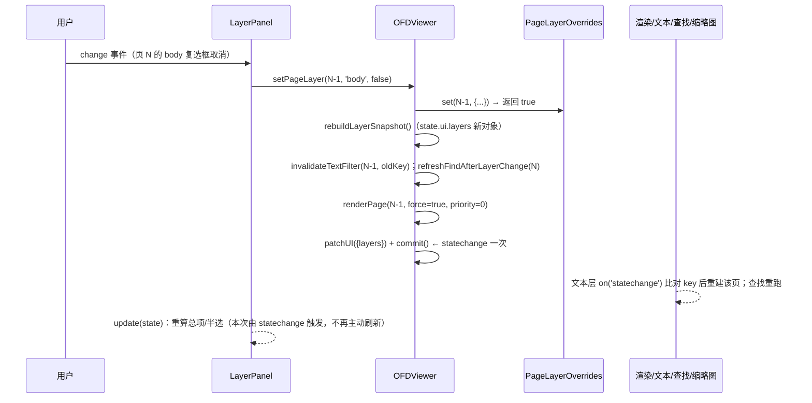

# 图层控制与侧栏图标设计方案

> 状态：已确认（需求结论以任务描述为准，本文是实现的**唯一事实来源**）。
> 范围：`packages/ofdrw-viewer-ui` 源码、样式、i18n、测试与 `skills/` 文档；**不修改** `packages/ofdrw-viewer-engine`。
> 目标读者：实现者（照本文直接落代码）、验证者（按 §H 写用例）、文档维护者（按 §G.7 同步 skills）。

---

## 0. 需求回顾（不可更改）

| # | 需求 | 本文落点 |
| --- | --- | --- |
| 1 | 侧栏 5 个现有 tab 各加 16×16 内联 SVG 图标，风格沿用 `ui/icons.ts` | §D.1、§D.2 |
| 2 | tab 溢出：宽度放不下全部“图标+文字”时**全部** tab 切成仅图标；`title`/`aria-label` 保留完整名称；宽度恢复自动切回；`ResizeObserver` 重判，`destroy` 断开 | §D.3、§D.4 |
| 3 | 新增“图层”tab，顺序为 缩略图/大纲/书签/签章/附件/图层（末位） | §A、§B.1 |
| 4 | 图层树：顶部“全部页面”总项（默认收起、半选、勾选框=全部显示/隐藏）+ 每页一行可展开六项；当前页自动展开；页面行全建、子项按需生成；六项顺序 签章→注释→自定义→前景→正文→背景；面板右上“恢复默认”按钮（保持展开状态） | §E |
| 5 | 每页布尔状态 → `PageContentFilter`（四层各 `{page:v,templates:v}`，`annotations`/`signatures` 直映射，六项全 true = 全画 / 规范化 key `all`）；取消勾选只重绘该页，并同步主画布 `renderKey`、文本层、查找、选区、缩略图、导出、打印 | §F |
| 6 | `layerPanel: { enabled?, disabled?, defaultVisibility? }` 并入 `OFDViewerOptions`；`enabled` 默认 true，false 时 tab 不渲染；`disabled=true` 时 tab 保留但禁用并带原因提示；`defaultVisibility` 只接受六项布尔、缺省全 true、重开文档回到默认值；不新增 `ViewerFeature` | §C |
| 7 | 状态范围仅当前文档会话，不做 localStorage / URL hash 持久化 | §C.5、§G.4 |
| 8 | 明确不做：对象级可见性；engine 包任何改动 | §G.6、§G.7 |

---

## A. 命名与文件级改动清单

路径均相对 `packages/ofdrw-viewer-ui/`。`[新增]` 为新文件，`[修改]` 为改动文件。

### A.1 新增文件

| 文件 | 责任 | 新增导出/符号 |
| --- | --- | --- |
| `src/layers/content-filter.ts` | 六项可见性模型、归一化、`PageContentFilter` 构造、稳定 key、每页覆盖表、`layerPanel` 解析（见 §B、§C） | `LayerKey`、`LayerVisibility`、`PAGE_LAYER_KEYS`、`createDefaultVisibility()`、`normalizeLayerVisibility()`、`toPageContentFilter()`、`contentFilterKey()`、`PageLayerOverrides`（类）、`PageLayerState`、`resolveLayerPanelOptions()`、`LayerPanelOptions`、`ResolvedLayerPanelOptions`、`LayerSummary`（`PageLayerState` 由 `state.ts` 再导出） |
| `src/layers/layer-panel.ts` | “图层”侧栏面板 DOM/ARIA 与事件流（依赖注入，不 import `viewer.ts`） | `LayerPanel`、`LayerPanelOptions`、`LayerPanelHost` |
| `test/unit/layers/content-filter.test.ts` | 模型/映射/签名/归一化单测 | — |
| `test/unit/ui/sidebar-layer-panel.test.ts` | 面板 DOM/ARIA/交互（假宿主）单测 | — |
| `test/unit/ui/sidebar-tabs.test.ts` | 图标与溢出模式单测 | — |
| `test/integration/layer-visibility.test.ts` | 主画布/文本层/查找/缩略图/导出/打印联动集成测试（内存引擎） | — |

### A.2 修改文件

| 文件 | 改什么 | 新增/修改的导出或符号 |
| --- | --- | --- |
| `src/state.ts` | `SIDEBAR_VIEWS` 追加 `'layers'`（末位）；`UIState` 新增 `layers: PageLayerState`；`InitialViewerStateOptions` 新增 `layerVisibility?: PageLayerState`；`createInitialViewerState()` 写入 | `SidebarView` 自动含 `'layers'`；再导出 `PageLayerState` |
| `src/options.ts` | `OFDViewerOptions`/`ResolvedViewerOptions` 新增 `layerPanel`；`resolveViewerOptions` 解析 | 不新增公共类型（`LayerPanelOptions` 从 `./layers/content-filter` 以 type 导出到 `index.ts`） |
| `src/index.ts` | 多导出四个类型 | `export type { LayerKey, LayerPanelOptions, LayerVisibility, PageLayerState }` |
| `src/ui/icons.ts` | 新增 5 个 tab 图标与 2 个动作图标，并导出 `TAB_ICONS` | `IconName` 增 `'thumbnail'`、`'outline'`、`'bookmark-ribbon'`、`'attachments'`、`'layers'`、`'restore'`、`'chevron-right'`；新增 `TAB_ICONS` |
| `src/ui/feature-control.ts` | `sidebarViewFeature(view)` → `SidebarViewGate`；新增 `resolveSidebarViewGate()` | `SidebarViewGate`、`resolveSidebarViewGate()`（`sidebarViewFeature` 签名改为返回 `SidebarViewGate`） |
| `src/ui/types.ts` | `UIShellViewState` 新增可选 `layerPanel?: { enabled: boolean; disabled: boolean }`（面板渲染时读取可用性） | — |
| `src/ui/ui-shell.ts` | `pickSidebarView()` 用新 gate 助手 | — |
| `src/ui/index.ts` | `toShellState()` 透传 `layerPanel`（来自 `viewer.getLayerPanelAvailability?.()`） | — |
| `src/ui/sidebar.ts` | tab 图标 + 溢出模式 + 图层禁用原因 | 不新增公共导出（内部方法） |
| `src/viewer.ts` | 图层状态与实例方法、面板注册、`renderKey` 与 `page.render`、缩略图/输出/文本层宿主方法、打开/关闭时重置 | 实例方法 `getLayerPanelState`、`getLayerVisibility`、`setLayerVisibility`、`resetLayerVisibility`，以及 `@internal` 宿主方法（见 §F.1/F.2） |
| `src/text/viewer-bridge.ts` | `textContentOptions` 增加 `contentFilter` 参数；新增可选宿主方法 | `LayerFilterHost` |
| `src/text/text-layer.ts` | 传入过滤、按页记签名、签名变化时失效该页 | 内部 `PageTextState.filterKey`；新增公共 `invalidateLayerFilter(pageNumber)` |
| `src/text/find-controller.ts` | 传入过滤、缓存按页带签名、状态变更时失效并按需重跑 | 新增公共方法 `refreshLayerVisibility()`；内部 `cacheKeys` 映射 |
| `src/text/index.ts` | 新增 `refreshLayerVisibility()` 并加进 `ViewerFindService` 适配 | — |
| `src/views/shared.ts` | `NavigationViewer` 新增可选 `getPageContentFilter?`、`getLayerFilterKey?` | 可选成员，测试替身可省略 |
| `src/views/thumbnails.ts` | 按页过滤渲染、缓存按页带签名、过滤变化失效重绘 | 内部 `ThumbnailEntry.filterKey` |
| `src/export/host.ts` | `OutputHost` 新增可选 `getPageContentFilter?` | 可选成员，不破坏既有宿主 |
| `src/export/image.ts` | `PageImageRequest` 新增可选 `contentFilter`；`renderPageImage` 透传 | — |
| `src/export/export-service.ts` | 单页/多页导出按页取过滤并传入 | — |
| `src/print/print-document.ts` | 打印逐页取过滤并传入 | — |
| `src/component/support.ts` | 新增 `readLayerPanelAttribute()` | `LayerPanelOptions`（re-export 类型） |
| `src/component/ofd-viewer-element.ts` | 观察 `layer-panel` 属性并传入构造选项 | — |
| `src/react/index.ts`、`src/vue/index.ts` | 再导出 `LayerPanelOptions` | — |
| `src/views/nav.ts` | 注册 `registerPanel('layers', …)`：构造 `LayerPanel({ host, viewer })`，用 `getNavigationServices().layers` 缓存，`destroy()` 时 `panel.destroy()` | `NavigationServices.layers?: LayerPanel` |
| `src/i18n/locales/zh-CN.ts`、`en-US.ts` | 新增文案键（只增不改，§B.4） | — |
| `src/style.css` | tab 图标/仅图标模式、图层面板样式（追加在文件末尾，不改既有规则语义） | — |
| `skills/API.md`、`skills/SKILL.md` | 按 §G.7 同步 | — |

> `src/viewer.ts` 的 `SidebarView` 断言列表（`openSidebar` 里的 `if/else if` 链与 `toggleSidebar` 的数组）必须一并更新（见 §A.3）。

### A.3 必须同步的“清单式”位置（漏一处就会 typecheck 失败或行为不一致）

1. `src/state.ts` `SIDEBAR_VIEWS`（唯一来源；`SidebarView` 由它派生）。
2. `src/ui/sidebar.ts` 的 `TAB_LABEL_KEYS`、`EMPTY_LABEL_KEYS`（`Record<SidebarView, MessageKey>`，由 `src/ui/icons.ts` 的 `TAB_ICONS: Record<SidebarView, IconName>` 再补一份）。
3. `src/viewer.ts` `openSidebar()` 的 `view === '…'` 断言链：新增 `else if (view === 'layers') this.assertLayerPanelEnabled();`。
4. `src/viewer.ts` `toggleSidebar()` 的首个可见视图数组：`['thumbnails','outline','bookmarks','signatures','attachments','layers']`。
5. `src/views/nav.ts` `closeDisabledSidebar()`：由 `viewer.isFeatureEnabled(view)` 改为 `viewer.isFeatureEnabled('sidebar')`（见 §C.3）。
6. `src/ui/ui-shell.ts` `pickSidebarView()`：改用 `resolveSidebarViewGate()`（见 §C.3）。

---

## B. 数据模型：每页过滤状态与对外类型

### B.1 六项键名与 i18n 对照表（顺序即 UI 顺序，自上而下）

| 序 | 英文键 `LayerKey` | engine `PageContentFilter` 映射 | 视觉层级 | i18n key | zh-CN | en-US |
| --- | --- | --- | --- | --- | --- | --- |
| 0 | `signatures` | `signatures: v`（**不做类型拆分**，单一布尔） | 签章（最上） | `layers.signatures` | 签章 | Signatures |
| 1 | `annotations` | 总开关 + 类型白名单，见 §B.1.1 | 注释 | `layers.annotations` | 注释 | Annotations |
| 2 | `custom` | `layers.custom = { page: v, templates: v }` | 自定义 | `layers.custom` | 自定义 | Custom |
| 3 | `foreground` | `layers.foreground = { page: v, templates: v }` | 前景 | `layers.foreground` | 前景 | Foreground |
| 4 | `body` | `layers.body = { page: v, templates: v }` | 正文 | `layers.body` | 正文 | Body |
| 5 | `background` | `layers.background = { page: v, templates: v }` | 背景（最下） | `layers.background` | 背景 | Background |

设计约束：**顺序常数只允许出现在 `PAGE_LAYER_KEYS`**，面板、批量控制、`resetLayerVisibility`、`defaultVisibility` 解析都必须遍历它，不得各自写死数组。

#### B.1.1 `annotations` 是“总开关 + 类型表”复合项（本版扩展，详见 §I）

`annotations` 不再是纯布尔：它有一个布尔总开关（`enabled`，映射到引擎 `annotations`）和若干可勾选的注释类型（映射到引擎 `annotationTypes`）。其余五项仍是纯布尔。

| 子项 | 引擎字段 | 备注 |
| --- | --- | --- |
| 总开关 `enabled` | `annotations` | 关闭时**不写** `annotationTypes` |
| 类型 `types[type]` | `annotationTypes` | 只在总开关打开且**未全勾**时写入（§I.4） |

- 类型名使用引擎的**原值**（`Annotation.type`，区分大小写），不翻译；界面只对常见五类做本地化显示（§I.6）。
- 常见五类固定来自 `KNOWN_ANNOTATION_TYPES`（`Link`/`Path`/`Highlight`/`Stamp`/`Watermark`，顺序即其常量顺序）；不在其中的类型称为“追加类型”。
- 签章不是注释（引擎 `signatures` 独立），因此 `Stamp` 类型只管 Stamp 注释外观，与签章开关互不影响。

### B.2 内部数据结构

```ts
// src/layers/content-filter.ts
/** 图层可见性键；顺序即界面自上而下的视觉层级。 */
export const PAGE_LAYER_KEYS = [
  'signatures',
  'annotations',
  'custom',
  'foreground',
  'body',
  'background',
] as const;
export type LayerKey = (typeof PAGE_LAYER_KEYS)[number];

/**
 * 注释项的可见性：总开关 + 类型勾选表。
 *
 * 类型键使用引擎 `Annotation.type` 原值；缺失类型按 true（勾选）处理。
 */
export interface LayerAnnotationVisibility {
  /** 注释总开关；缺省（含整个 annotations 字段缺失）为 true。 */
  readonly enabled?: boolean;
  /** 类型勾选表；缺省为“全部类型勾选”。 */
  readonly types?: Partial<Record<AnnotationType, boolean>>;
}

/**
 * 六项可见性（对外入参形状）。
 *
 * - `signatures` / `custom` / `foreground` / `body` / `background`：布尔；
 * - `annotations`：布尔（`false` ≡ `{ enabled: false }`，`true` ≡ `{ enabled: true }`）或
 *   `LayerAnnotationVisibility`。
 * 缺失项按可见处理。
 */
export interface LayerVisibility {
  readonly signatures?: boolean;
  readonly annotations?: boolean | LayerAnnotationVisibility;
  readonly custom?: boolean;
  readonly foreground?: boolean;
  readonly body?: boolean;
  readonly background?: boolean;
}

/**
 * 归一化后的六项可见性（内部/对外快照形状）：`annotations` 一定展开为对象，
 * 总开关一定给出，类型表保留调用方给出的差异项（未给 = 勾选）。
 */
export interface ResolvedLayerVisibility {
  readonly signatures: boolean;
  readonly annotations: Readonly<{ enabled: boolean; types: Readonly<Record<string, boolean>> }>;
  readonly custom: boolean;
  readonly foreground: boolean;
  readonly body: boolean;
  readonly background: boolean;
}

/**
 * 每页覆盖快照（`state.ui.layers` 的类型）。
 *
 * 只保存“与默认可见性不同”的页：未出现的页 = 默认值。
 * identity（对象引用）在内容变化时才改变，保证 statechange 引用稳定。
 */
export interface PageLayerState {
  /** 文档会话标识；每次 open/close 递增，用于丢弃迟到写入。 */
  readonly sessionId: number;
  /** 归一化后的默认可见性（来自 layerPanel.defaultVisibility）。 */
  readonly defaults: ResolvedLayerVisibility;
  /** 页索引（0-based）→ 该页可见性（至少一项与 defaults 不同）。 */
  readonly pages: Readonly<Record<number, ResolvedLayerVisibility>>;
}
```

归一化规则（`normalizeLayerVisibility()`，§B.3）：

| 输入 | 归一化结果 |
| --- | --- |
| `annotations` 缺失 / `undefined` | `{ enabled: true, types: {} }`（`types:{}` 表示“全部勾选”） |
| `annotations: true` | 同上 |
| `annotations: false` | `{ enabled: false, types: {} }` |
| `annotations: { enabled: false }` | `{ enabled: false, types: {} }` |
| `annotations: { types: { Link: false } }` | `{ enabled: true, types: { Link: false } }` |
| `annotations: { enabled: false, types: { Link: false } }` | `{ enabled: false, types: { Link: false } }`（**类型表在总开关关闭时保留**，重新打开时恢复） |
| `types` 里非布尔 / 空字符串键 / 非对象 | 该键丢弃（按勾选处理）；未知类型名**保留**（引擎按白名单判定，未知类型永远不会出现，等价于无影响） |

其余五项：非布尔按 `true`；未知键忽略。

```ts
/** 页索引 → `contentFilter` 签名；未出现的页等于默认签名。 */
export class PageLayerOverrides {
  constructor(defaults: LayerVisibility, defaultKey?: string);
  /** 默认签名。 */
  readonly defaultKey: string;
  /** 默认可见性（归一化后）。 */
  get defaults(): ResolvedLayerVisibility;
  /** 第 index 页（0-based）的过滤签名；未覆盖时返回 `defaultKey`。 */
  keyAt(index: number): string;
  /** 第 index 页的 `PageContentFilter`；等价全画时为 `undefined`。 */
  filterAt(index: number): PageContentFilter | undefined;
  /** 第 index 页的签名；写入时必须同时提供该页“列出的注释类型”（§I.4）。 */
  keyWith(index: number, types: readonly string[]): string;
  /** 第 index 页的过滤配置；`types` 为该页图层面板当前列出的类型（§I.4）。 */
  filterWith(index: number, types: readonly string[]): PageContentFilter | undefined;
  /** 写入/移除一页覆盖（没给 `types` = 该页未列出任何类型）；返回签名是否变化。 */
  set(index: number, visibility: LayerVisibility, types?: readonly string[]): boolean;
  /** 删除一页覆盖。 */
  delete(index: number): boolean;
  /** 全部覆盖页索引（升序）。 */
  indices(): number[];
  /** 与指定签名不一致的覆盖页索引（升序）。 */
  indicesWhereKeyDiffers(key: string): number[];
  /** 替换默认可见性；与默认值相同的覆盖页被删除；返回是否有页签名变化。 */
  setDefaults(defaults: LayerVisibility): boolean;
  /** 清空全部覆盖。 */
  clear(): boolean;
  /** 克隆（用于生成对外快照）。 */
  clone(sessionId?: number): PageLayerState;
}
```

> **实现差异（以 `src/layers/content-filter.ts` 为准）**：`constructor` 只接收 `defaults`；`defaultKey` 是 getter（按 `contentFilterKey(defaults)` 实时计算，不接受外部传入的 key）；`keyAt`/`filterAt`/`set`/`delete`/`indicesWhereKeyDiffers`/`setDefaults` 都多一个可选 `types`（默认 `knownAnnotationTypes()`），因为签名依赖“该页列出的注释类型”（§I.4）；另外提供 `visibilityAt(index)`（未覆盖返回冻结的默认值）与 `keyWith`/`filterWith` 两个语义别名。

要点：

- `filterAt()` / `filterWith()` 内部用 `toPageContentFilter()` 生成；**等价全画时返回 `undefined`**（六项全开且注释类型全勾），对应 engine 的“不传 = 全画”，规范化 key 为 `'all'`。
- `keyAt()` **不调用 engine 内部实现**：`resolveContentFilter()` 未从 engine 包入口导出，UI 不能依赖内部路径；因此本模块按 §B.3 的规则自行计算签名，并用单测与 engine 的 `resolveContentFilter().key` 逐一对拍，保证语义一致。
- 签名依赖“本页列出的注释类型”（`types`）：同一份勾选状态，若本页新增一个未勾选的追加类型，签名/过滤会变化（需要重绘）。因此 `PageLayerOverrides` 不缓存签名，`keyAt/filterAt/filterWith` 每次按调用方给出的 `types` 现算。
- 只重绘“变化的页”：`set()` 内部记录“写入前后 `keyAt(index)` 是否不同”，核心从 `commitLayerWrites()` 汇总出 `changedIndices`；`indicesWhereKeyDiffers(key)` 用于整体替换默认值（如 `resetLayerVisibility()` 之后）时批量求差。
- 改回默认值的页会被 `set()` 直接从 `pages` 删除（覆盖表只保存差异，比较时用 `layerVisibilityEquals()` 深比较注释类型表），保证 `clear()`/`setDefaults()` 与“逐页改回默认”结果一致。

### B.3 `PageContentFilter` 构造与稳定 key（必须逐字实现）

```ts
import type { AnnotationType, PageContentFilter } from '@ofdrw/ofdrw-viewer-engine';

/**
 * 可见性 → 引擎过滤白名单。
 *
 * @param visibility 六项可见性（`annotations` 可为布尔或对象），缺失按可见。
 * @param types 该页**列出的**注释类型（常见五类 + 该页追加类型，§I.1）；省略按 `[]`。
 * @returns 过滤配置；与“全画”等价时返回 undefined（不传过滤）。
 */
export function toPageContentFilter(
  visibility: LayerVisibility,
  types?: readonly AnnotationType[],
): PageContentFilter | undefined;

/**
 * 过滤签名（与 engine `resolveContentFilter().key` 同规则）。
 *
 * 形如 `all` / `none` / `layers=b:11,o:11,f:00,c:00;annotations=1;types=Link,Stamp;signatures=0`。
 * 层顺序固定 background/body/foreground/custom（b/o/f/c），每层两位 page/templates
 * （custom 的 templates 恒为 0）；`types=` 为空串表示“全部类型”。
 */
export function contentFilterKey(
  visibility: LayerVisibility,
  types?: readonly AnnotationType[],
): string;

/** 该页勾选的注释类型（未勾选的排除；总开关关闭时返回空数组）。 */
export function selectedAnnotationTypes(
  visibility: LayerVisibility,
  types: readonly AnnotationType[],
): AnnotationType[];
```

规则细节（与 `packages/ofdrw-viewer-engine/src/render/content-filter.ts` 对齐）：

- `templates`：`background`/`body`/`foreground` 与 `page` 同值；`custom` 的 templates 引擎恒忽略，本地也按 `false` 计算，保证 key 一致。
- `signatures` 直映射；签章**不做类型拆分**。
- 注释按 §I.4 的判定生成（关闭 / 全勾 / 部分勾；**零勾选合并为“关闭”**，§I.4.1），判定函数只写一份，`toPageContentFilter()` 与 `contentFilterKey()` 共用。
- 零勾选语义（固定）：`annotations: false` 且**不写** `annotationTypes`——禁止用 `annotationTypes: []` 表达零勾选（§I.4.1 给出理由）。
- **全画**（返回 `undefined`、key 为 `'all'`）的完整条件：五项布尔全 `true` **且** 注释等价于“全画”（`enabled: true` 且 `types` 无 `false` 项，即 UI 侧的注释类型全勾）。只勾选 `Link` 这类部分类型**不是**全画。
- 六项全 false → 为语义清楚返回完整对象（四层 `{page:false,templates:false}` + `annotations:false` + `signatures:false`），引擎规范化 key 为 `'none'`。
- `types` 只影响注释类型白名单，且**只在“总开关打开且存在显式取消”时进入过滤与签名**（§I.4.2）；因此“默认可见性 + 没有任何取消”的 key 仍为 `'all'`，`renderKey` 追加 `:all` 后不产生升级重绘。
- `annotationTypes` 数组顺序 = `types` 入参顺序（去重后保持首次出现），与 UI 展示顺序一致；引擎规范化后的 `types=` 段就是这个顺序用 `,` 拼接。
- `defaultVisibility` 缺省时为六项全 true、类型全勾，因此**默认签名恒为 `'all'`**。

### B.4 新增 i18n 文案键（只增不改；zh-CN 与 en-US 同构增加）

| key | zh-CN | en-US | 用途 |
| --- | --- | --- | --- |
| `sidebar.layers` | 图层 | Layers | tab 标题 / `title` / `aria-label` |
| `layers.title` | 图层 | Layers | 面板 `role=tree` 的 `aria-label` |
| `layers.allPages` | 全部页面 | All pages | 总项行名称 |
| `layers.page` | 第 {page} 页 | Page {page} | 每页行名称（`{page}` 走 `translator.formatNumber`） |
| `layers.restoreDefault` | 恢复默认 | Restore defaults | 顶部右侧按钮 `title` + `aria-label` |
| `layers.signatures` | 签章 | Signatures | 六项 |
| `layers.annotations` | 注释 | Annotations | 六项 |
| `layers.custom` | 自定义 | Custom | 六项 |
| `layers.foreground` | 前景 | Foreground | 六项 |
| `layers.body` | 正文 | Body | 六项 |
| `layers.background` | 背景 | Background | 六项 |
| `layers.annotationTypes` | 注释类型 | Annotation types | 注释项展开后的分组 `aria-label` |
| `layers.type.link` | 链接 | Link | 常见五类显示名 |
| `layers.type.path` | 路径 | Path | 常见五类显示名 |
| `layers.type.highlight` | 高亮 | Highlight | 常见五类显示名 |
| `layers.type.stamp` | 印章 | Stamp | 常见五类显示名 |
| `layers.type.watermark` | 水印 | Watermark | 常见五类显示名 |
| `layers.empty` | 本文档没有页面 | This document has no pages | 页数 0 空态 |
| `layers.noDocument` | 打开文档后可控制图层显示 | Open a document to control layers | 未打开文档空态 |
| `layers.disabled` | 宿主已禁用图层控制 | Layer control is disabled by the host | `disabled=true` 的原因提示（`title`） |

注释类型命名规则（完整规则见 §I.6）：

- 常见五类用上表 `layers.type.<小写类型名>` 本地化显示名；`layers.type.<n>` 的键**按类型名小写**，实现里用一张 `Record<KnownAnnotationType, MessageKey>` 常量映射（`'Link' → 'layers.type.link'` …），不得用字符串拼接动态生成 MessageKey。
- 追加类型（引擎原值）**不翻译**：显示名就是 `Annotation.type` 原值；其 `aria-label` 与 `title` 都是原值。
- 类型复选框的可读名：`aria-label = <显示名>`；若同一页同时有常见类型和追加类型，直接并列即可（无需前缀）。

`restore`/`chevron-right` 是纯图标按钮（`aria-hidden` 的 SVG + 按钮自身的 `title`/`aria-label`），不进入文案表；`layers.disabled` 是 tab 禁用原因与面板禁用提示共用的文案，`resolveSidebarViewGate()` 把它作为 `tooltip` 写入（`applyFeatureGate` 会把它写到 `title` 上），不经过 `featureDisabledTooltip()`。

---

## C. `layerPanel` 配置：类型、默认值、解析与门控

### C.1 类型（公共）

```ts
/** 图层侧栏配置（`OFDViewerOptions.layerPanel`）。 */
export interface LayerPanelOptions {
  /** 是否渲染“图层”tab；默认 true。false 时 tab 不渲染，`openSidebar('layers')` 抛 `OFD_FEATURE_DISABLED`。 */
  readonly enabled?: boolean;
  /** 是否禁用（保留 tab、禁用交互并给出原因提示）；默认 false。 */
  readonly disabled?: boolean;
  /** 每页六项可见性的默认值；缺省为六项全 true（全部显示）。 */
  readonly defaultVisibility?: LayerVisibility;
}

/** 解析后的配置。 */
export interface ResolvedLayerPanelOptions {
  readonly enabled: boolean;
  readonly disabled: boolean;
  /** 归一化后的默认可见性；`annotations` 已展开为 `{ enabled, types }`。 */
  readonly defaultVisibility: ResolvedLayerVisibility;
}

/**
 * 解析并校验 `layerPanel`：非法输入按默认值处理，不抛错。
 *
 * enabled/disabled 同时为 true 时 disabled 优先（tab 可见但禁用）。
 * defaultVisibility 中五项只接受布尔（非布尔回落 true）；`annotations` 接受布尔或
 * `{ enabled?, types? }`（见 §C.2 表格与 §I.2）。
 */
export function resolveLayerPanelOptions(options?: LayerPanelOptions): ResolvedLayerPanelOptions;
```

**明确不做**：不提供 `layerPanel.annotationTypes` 之类的宿主自定义类型列表选项（需求 4）。类型列表完全由“常见五类 + 该页实际出现的追加类型”决定（§I.1）。

### C.2 默认值与解析规则

| 字段 | 默认 | 非法输入 |
| --- | --- | --- |
| `enabled` | `true` | 非布尔 → `true` |
| `disabled` | `false` | 非布尔 → `false` |
| `defaultVisibility` | 六项全 `true` 且注释类型全勾 | 非对象 → 全 true；五项非布尔 → 该项 true；未知键忽略；缺失键 true |
| `defaultVisibility.annotations` | `{ enabled: true, types: {} }` | 见下 |
| `enabled && disabled` | — | `disabled` 优先：`{enabled:true, disabled:true}` |

`defaultVisibility.annotations` 的解析（把宿主写法统一成 `{ enabled, types }`）：

| 写法 | 解析结果 | 说明 |
| --- | --- | --- |
| 省略 / `undefined` | `{ enabled: true, types: {} }` | 注释开、类型全勾 |
| `true` | `{ enabled: true, types: {} }` | 与省略等价 |
| `false` | `{ enabled: false, types: {} }` | 与 `{ enabled: false }` 等价（需求 5） |
| `{ enabled?: boolean }` | 缺省 `enabled` 按 `true`；非布尔按 `true` | |
| `{ types?: Record<AnnotationType, boolean> }` | 只保留布尔项；其余丢弃 | 空对象 `{}` 等价于“全勾” |
| 非对象非布尔（字符串/数字/数组/`null`） | `{ enabled: true, types: {} }` | 不抛错 |

> 类型表语义是“**只记录与默认勾选不同的类型**”：未出现的类型名一律按勾选处理，`types: {}` 表示全勾。这样宿主不必把所有类型都写一遍。

`resolveViewerOptions()` 中：`layerPanel: resolveLayerPanelOptions(options.layerPanel)`（`ResolvedViewerOptions.layerPanel: ResolvedLayerPanelOptions`，必填）。只在**构造时**生效，与 `fonts`/`supersample` 一致。

### C.3 从“功能键映射”改为“视图门控”的原因与做法

现状问题：`sidebarViewFeature(view)` 直接把 `view` 当 `ViewerFeature` 返回，而 `ViewerFeature` 没有 `'layers'`；`nav.ts` 的 `closeDisabledSidebar()` 用 `viewer.isFeatureEnabled(view)` 判断，`ui-shell.ts` 的 `pickSidebarView()` 用 `getFeatureState(states, sidebarViewFeature(view))`。直接加元素会让这两处拿到 `undefined`（`getFeatureState` 对未知键返回“开启”，`isFeatureEnabled('layers')` 抛错或返回 false）。

新设计（**不新增 `ViewerFeature`**）：

```ts
// src/ui/feature-control.ts
/** 侧栏视图门控：可以是功能键，或由视图专属配置决定。 */
export type SidebarViewGate =
  | { readonly kind: 'feature'; readonly feature: ViewerFeature }
  | { readonly kind: 'custom'; readonly visible: boolean; readonly disabled: boolean; readonly reason?: FeatureReason };

/** 视图对应的门控来源。 */
export function sidebarViewFeature(view: SidebarView): SidebarViewGate;

/** 计算侧栏视图的门控结果（含禁用原因文案）。 */
export function resolveSidebarViewGate(
  states: ViewerFeatureStates,
  view: SidebarView,
  t: Translator,
  layerPanel?: { readonly enabled: boolean; readonly disabled: boolean },
): FeatureGate;
```

| 视图 | 门控来源 | 结果 |
| --- | --- | --- |
| `thumbnails`/`outline`/`bookmarks`/`signatures`/`attachments` | `{kind:'feature', feature:view}` | 与现状完全一致 |
| `layers` | `{kind:'custom', visible: layerPanel.enabled !== false, disabled: layerPanel.disabled === true, reason: 'host'}` | `enabled=false` → 不渲染（`hidden`）且 `openSidebar` 抛错；`disabled=true` → `hidden=false`、`disabled`、`title=layers.disabled`、`aria-disabled=true` |

`resolveSidebarViewGate()` 实现：`kind==='feature'` 时委托 `resolveFeatureGate(states, gate.feature, t)`；`kind==='custom'` 时返回 `{ visible, disabled, reason, tooltip: disabled ? t('layers.disabled') : undefined }`（`tooltip` 用 `t('layers.disabled')` 包装，保持与 `applyFeatureGate` 一致）。

调用点改造：

1. `src/ui/sidebar.ts` `applyFeatureStates()`：改为 `resolveSidebarViewGate(this.featureStates, view, this.translator, this.options.layerPanel)`；`SidebarOptions` 新增 `readonly layerPanel: { enabled: boolean; disabled: boolean }`。
2. `src/ui/ui-shell.ts` `pickSidebarView()`：改用
   ```ts
   const gate = resolveSidebarViewGate(this.featureStates, view, this.translator, this.layerPanel);
   return gate.visible && !gate.disabled;
   ```
   同时 `UIShell` 新增构造选项 `layerPanel?: { enabled: boolean; disabled: boolean }`（由 `attachUIShell` 从 `viewer` 的 `getLayerPanelAvailability?.()` 读取后传入，缺省 `{enabled:true,disabled:false}`）。
3. `src/views/nav.ts` `closeDisabledSidebar()`：**不再使用视图→功能映射**，改为 `const view = viewer.getSidebarView(); if (view && !viewer.isFeatureEnabled('sidebar')) viewer.closeSidebar();`（侧栏整体关闭时的既有行为不变）。`layers` 不可用（`enabled=false` 或 `disabled=true`）时：`openSidebar('layers')` 抛 `OFD_FEATURE_DISABLED`（见 §C.3 末尾 `assertSidebarViewUsable()`）；若侧栏已打开在 `layers` 上，之后的 `statechange → sync() → sidebar.setFeatureStates()` 会因该视图 `hidden`/`disabled` 自动 `setView(null)` 收起。
4. `src/viewer.ts`：`assertSidebarViewUsable(view)` 内部方法：

```ts
/** 断言侧栏视图当前可用；不可见/禁用时抛 OFD_FEATURE_DISABLED。 */
private assertSidebarViewUsable(view: SidebarView): void;
/** 图层面板可用性：隐藏或禁用时抛出禁用错误（视同功能不可用）。 */
private assertLayerPanelEnabled(): void;
```

`openSidebar(view)` 首行仍 `assertFeature('sidebar')`，`layers` 分支调用 `this.assertLayerPanelEnabled()` —— 与“其他被关闭的 tab 行为一致”。

### C.4 面板内容的禁用态

- `disabled=true`：tab 保留（`hidden=false`），带 `disabled` + `aria-disabled="true"` + `data-feature-disabled="true"`，`title`/`tooltip` 为 `layers.disabled` 文案；点击无效（`disabled` 原生语义），`openSidebar('layers')` 抛 `OFD_FEATURE_DISABLED`。面板的禁用渲染（首行 `role="note"` 提示、复选框与恢复按钮 `disabled`）仅为防御性实现，正常 UI 流程不可达。
- `enabled=false`：tab 不渲染（`hidden`），`openSidebar('layers')` 抛 `OFD_FEATURE_DISABLED`（`code` 与其它被关闭功能一致）。`disabled=true` 时同一条错误码抛出，`message` 复用 `layers.disabled` 文案，以便宿主区分原因。
- 运行时无法修改 `layerPanel`（构造时生效）；如需修改，宿主重建实例或重新构造（文档说明写在 §G.7）。

### C.5 状态范围

- 每页过滤状态只存在内存：`OFDViewer` 私有字段 `layerOverrides: PageLayerOverrides` + `state.ui.layers`（只读快照）。
- **不写 localStorage / sessionStorage / URL hash**：`history.sync()` 的键集合（`page`/`zoom`/`rotation`/`sidebar`）不变。
- 重新打开文档（`open()` 成功、`close()`、`destroy()`）→ `layerOverrides.setDefaults(options.layerPanel.defaultVisibility)` + `clear()`，即回到 `defaultVisibility`。
- 当前 UI 实现的“本机字体补注入重开”路径（§G.1）里 `open()` 会被调用两次，视觉上用户看不到中间态，因此不影响“仅会话内保留”的语义。

---

## D. 侧栏 tab 图标与溢出

### D.1 图标风格约束（沿用 `src/ui/icons.ts`）

- 每个图标是 `createIcon(name)` 生成的内联 SVG：`viewBox="0 0 24 24"`、`width/height=16`、`fill="none"`、`stroke="currentColor"`、`stroke-width=2`、`stroke-linecap/linejoin=round`、`aria-hidden="true"`、`focusable="false"`，可读名称一律由按钮 `aria-label` 提供。
- 只使用 `paths` / `circles` / `lines` / `polylines` 四种图元，不引入文本、渐变或内联样式。
- 颜色完全来自 `currentColor`（选中态是 `--ofd-accent`，未选中是 `--ofd-text-secondary`），因此明暗主题与高对比度主题无需额外规则。

### D.2 图标几何（实现者逐字抄入 `ICONS`）

下表中路径均按 24×24 画布、2px 描边设计，视觉重量与现有 `sidebar`/`close`/`print` 一致。

| `IconName` | 用于 | `paths` | `circles` | `lines` | `polylines` |
| --- | --- | --- | --- | --- | --- |
| `thumbnail` | 缩略图 tab | `M4 4h16v16H4z`、`M8 8h8v8H8z` | — | — | — |
| `outline` | 大纲 tab | — | — | `[4,6,20,6]`、`[8,12,20,12]`、`[12,18,20,18]` | — |
| `bookmark-ribbon` | 书签 tab | `M7 3h10a1 1 0 0 1 1 1v17l-6-4-6 4V4a1 1 0 0 1 1-1z` | — | — | — |
| `attachments` | 附件 tab | `M20 11l-8.2 8.2a5 5 0 0 1-7.1-7.1L13 4a3.5 3.5 0 0 1 5 5l-8.5 8.5a2 2 0 0 1-2.8-2.8L14 7.5` | — | — | — |
| `layers` | 图层 tab | `M12 3l9 5-9 5-9-5z`、`M3 13l9 5 9-5` | — | — | — |
| `restore` | 恢复默认按钮 | `M4 4v6h6`、`M3.5 13a8.5 8.5 0 1 0 2.6-6.6L4 10` | — | — | — |
| `chevron-right` | 树节点展开箭头 | — | — | — | `9 6 15 12 9 18` |

命名冲突说明：`thumbnail`（单数）、`bookmark-ribbon`、`outline`、`attachments`、`layers`、`restore`、`chevron-right` 均不与现有 `IconName` 重名（现有为 `sidebar`/`previous`/`next`/`zoom-in`/`zoom-out`/`rotate`/`search`/`print`/`export`/`signature`/`shield`/`fullscreen`/`fullscreen-exit`/`info`/`more`/`close`）。**不使用 `bookmarks` 作为图标名**（视图名与图标名区分，避免阅读歧义）。

`src/ui/icons.ts` 追加：

```ts
/** 侧栏 tab 图标；`Record<SidebarView, IconName>` 保证新增视图必须补图标。 */
export const TAB_ICONS: Readonly<Record<SidebarView, IconName>> = Object.freeze({
  thumbnails: 'thumbnail',
  outline: 'outline',
  bookmarks: 'bookmark-ribbon',
  signatures: 'signature',
  attachments: 'attachments',
  layers: 'layers',
});
```

### D.3 DOM 结构

```html
<div class="ofd-sidebar__header">
  <div class="ofd-sidebar__tabs" role="tablist" aria-label="侧栏标签" data-mode="full">
    <button type="button" class="ofd-sidebar__tab" role="tab" id="…-tab-thumbnails"
            aria-controls="…-panel-thumbnails" aria-selected="false" tabindex="-1"
            data-view="thumbnails" title="缩略图" aria-label="缩略图">
      <svg class="ofd-icon" … aria-hidden="true"></svg>
      <span class="ofd-sidebar__tab-label">缩略图</span>
    </button>
    <!-- … 其余 tab … -->
  </div>
  <button class="ofd-button ofd-sidebar__close" aria-label="关闭侧栏"><svg …></svg></button>
</div>
```

规则：

- 每个 tab 的**可读名称只有一个来源**：`button.textContent` 不再直接写字；按钮内部是 `<svg>` + `<span class="ofd-sidebar__tab-label">`。`aria-label` 与 `title` 都写完整名称（两处必须相同，语言切换时同步）。
- `data-mode="full"`（图标+文字）或 `data-mode="icons"`（仅图标）挂在 `.ofd-sidebar__tabs` 上；**不看单个 tab 的可见性**，因为要求是“宽度放不下全部 tab 的图标+文字时，全部 tab 切成仅图标”。不可见（`hidden`，例如附件 tab 因文档无附件而隐藏）的 tab 不参与测量与判断。
- 仅图标模式下 `<span class="ofd-sidebar__tab-label">` 用 CSS 隐藏（`display:none`），不删除节点——恢复时无需重建 DOM，且 `button.querySelector('.ofd-sidebar__tab-label').textContent` 在两种模式下都可读。**注意**：`display:none` 的文本不进入无障碍树，因此可读名称必须由按钮 `aria-label` 提供（这是本方案强制"`aria-label` + `title` 双写完整名称"的原因）；`button.textContent` 在两种模式下都包含图标后紧跟的文字。

### D.4 测量与切换算法

```ts
/** 重新判断 tab 是否溢出，并在“图标+文字 / 仅图标”之间切换；幂等。 */
private updateTabOverflow(): void {
  const tabs = [...this.tabs.values()].filter((entry) => !entry.button.hidden);
  if (tabs.length === 0) return;
  const width = this.tabListWidth();
  // 测量必须在“图标+文字”下进行：文字 span 被 display:none 时量不到 max-content。
  const previous = this.tablist.dataset.mode;
  this.tablist.dataset.mode = 'full';
  const overflowing = this.isTabRowOverflowing(tabs, width);
  this.tablist.dataset.mode = overflowing ? 'icons' : 'full';
  if (previous !== this.tablist.dataset.mode && this.options.onTabOverflowChange) {
    this.options.onTabOverflowChange(this.tablist.dataset.mode === 'icons');
  }
}

/** 可用宽度，单位 px：优先测试注入，其次 clientWidth，最后按常量估算。 */
private tabListWidth(): number {
  const injected = this.options.readTabListWidth?.();
  if (typeof injected === 'number' && Number.isFinite(injected) && injected >= 0) return injected;
  const measured = this.tablist.clientWidth;
  if (measured > 0) return measured;
  // jsdom / 未布局：退化为最小宽度基准，保证结果确定（只用于测试与极端环境）。
  return SIDEBAR_DEFAULT_WIDTH;
}

/**
 * 当前是否溢出。
 *
 * @param tabs 参与判定的可见 tab。
 * @param width 可用宽度，单位 px。
 */
private isTabRowOverflowing(tabs: readonly TabEntry[], width: number): boolean {
  if (width <= 0) return false;
  // 内容宽度恒可度量（Canvas 度量文字，见 measureLabelWidth），直接与可用宽度比较。
  return this.measureTabContentWidth(tabs) > width + TAB_OVERFLOW_TOLERANCE_PX;
}

/** 各 tab 在“图标+文字”下的内容宽度之和，单位 px。 */
private measureTabContentWidth(tabs: readonly TabEntry[]): number {
  let total = 0;
  for (const entry of tabs) {
    total += TAB_ICON_WIDTH + TAB_ICON_GAP + TAB_H_PADDING * 2 + this.measureLabelWidth(entry);
  }
  return total;
}

/**
 * 标签文字宽度（“图标+文字”下），单位 px。
 *
 * 不用 `label.scrollWidth`：侧栏收起或已处于仅图标模式时文字节点不参与布局，
 * 实测恒为 0，会让判定永远停在“仅图标”。这里按标签的计算字体用 Canvas 度量，
 * 与当前布局状态无关；无法度量（jsdom）时按字数 × 14 估算。
 */
private measureLabelWidth(entry: TabEntry): number {
  const text = entry.label.textContent ?? '';
  if (text === '') return 0;
  const cached = this.tabLabelWidths.get(text);
  if (cached !== undefined) return cached;
  let width = 0;
  const doc = this.element.ownerDocument;
  const win = doc.defaultView;
  const style = win ? win.getComputedStyle(entry.label) : null;
  const context = doc.createElement('canvas').getContext('2d');
  if (context && style) {
    const font = style.font || `${style.fontStyle} ${style.fontWeight} ${style.fontSize} ${style.fontFamily}`;
    context.font = font;
    width = typeof context.measureText === 'function' ? context.measureText(text).width : 0;
  }
  if (!(width > 0)) width = text.length * FALLBACK_CJK_CHAR_WIDTH;
  this.tabLabelWidths.set(text, width);
  return width;
}
```

常量（`src/ui/sidebar.ts` 内部，不导出）：`TAB_ICON_WIDTH = 16`、`TAB_ICON_GAP = 4`、`TAB_H_PADDING = 6`、`FALLBACK_CJK_CHAR_WIDTH = 14`、`TAB_OVERFLOW_TOLERANCE_PX = 1`。

观察器与生命周期：

1. 构造函数 `build()` 之后：`this.tablist.dataset.mode = 'full'`，然后 `this.observeTabOverflow()`：

```ts
private resizeObserver: ResizeObserver | null = null;

private observeTabOverflow(): void {
  if (typeof ResizeObserver === 'function') {
    // 侧栏宽度（拖拽 resizer / 断点切换）与 tab 内容宽度变化都会触发。
    this.resizeObserver = new ResizeObserver(() => this.updateTabOverflow());
    this.resizeObserver.observe(this.tablist);
    this.resizeObserver.observe(this.element); // 侧栏整体宽度（overlay/drawer 时也变）
    for (const entry of this.tabs.values()) this.resizeObserver.observe(entry.button);
  } else {
    // 降级：窗口尺寸变化；侧栏拖拽由 setWidth() 主动重判。
    this.element.ownerDocument.defaultView?.addEventListener('resize', this.handleWindowResize);
  }
  this.updateTabOverflow();
}

/** 侧栏打开期间的宽度复核（250 ms）：兜住纯 CSS 改宽等不派发事件的情况。 */
private startTabOverflowWatch(): void {
  const win = this.element.ownerDocument.defaultView;
  if (this.layoutTimer !== null || !win) return;
  this.layoutTimer = win.setInterval(() => {
    if (this.view !== null) this.updateTabOverflow();
  }, TAB_OVERFLOW_POLL_MS);
}

private stopTabOverflowWatch(): void {
  if (this.layoutTimer === null) return;
  this.element.ownerDocument.defaultView?.clearInterval(this.layoutTimer);
  this.layoutTimer = null;
}
```

2. `setWidth(width)`（拖拽 resizer / 键盘调整）末尾调用 `this.updateTabOverflow()`（无 ResizeObserver 时也能即时切换；有 ResizeObserver 时是幂等的提前判断）。
3. `setLocale()`：更新 `aria-label`/`title`/label 文本后调用 `this.updateTabOverflow()`（文案长度可能变化）。
4. `setFeatureStates()`/`applyFeatureStates()` 改变可见 tab 集合后调用 `this.updateTabOverflow()`。
5. `setMode()` 后调用 `this.updateTabOverflow()`（overlay/drawer 宽度不同）。
6. `destroy()`：`this.resizeObserver?.disconnect(); this.resizeObserver = null;`、`this.tabLabelWidths.clear()`，并移除 `resize` 监听；**先断开再 `replaceChildren(this.element)`**。
7. 无 `ResizeObserver` 的降级路径：`resize` 监听器指向 `private readonly handleWindowResize = () => this.updateTabOverflow()`；`ResizeObserver` 存在时**不**挂 `resize`（避免双路径），两者互斥。

CSS（**唯一版本**，追加在 `src/style.css` 末尾，不改既有规则语义）：

```css
/* 侧栏 tab：图标 + 文字。不用 flex gap（Chrome 67 不支持），间距用 margin。 */
.ofd-sidebar__tab { display: inline-flex; align-items: center; justify-content: center; }
.ofd-sidebar__tab-label { white-space: nowrap; margin-left: 4px; }

/* 仅图标模式：隐藏文字节点，但保留 title / aria-label */
.ofd-sidebar__tabs[data-mode='icons'] .ofd-sidebar__tab-label { display: none; }
.ofd-sidebar__tabs[data-mode='icons'] .ofd-sidebar__tab { padding-left: 6px; padding-right: 6px; }

/* 图层面板（§E），颜色全部走变量，明暗/高对比度自动生效 */
.ofd-layers { display: flex; flex-direction: column; min-height: 0; }
.ofd-layers__toolbar { display: flex; align-items: center; justify-content: space-between; padding: 0 0 4px; }
.ofd-layers__title { font-weight: 600; color: var(--ofd-text); }
.ofd-layers__restore { color: var(--ofd-text-secondary); }
.ofd-layers__restore:hover { background: var(--ofd-hover-bg); }
.ofd-layers__tree { display: block; }
.ofd-layers__row { display: flex; align-items: center; min-height: 28px; padding: 0 4px; border-radius: 2px; cursor: default; }
.ofd-layers__row--all { font-weight: 600; }
.ofd-layers__row:hover { background: var(--ofd-hover-bg); }
/* chrome67: focus fallback（67 无 :focus-visible，改用 :focus 提供焦点环） */
.ofd-layers__row:focus { outline: var(--ofd-focus-width) solid var(--ofd-accent); outline-offset: -2px; }
.ofd-layers__row:focus-visible { outline: var(--ofd-focus-width) solid var(--ofd-accent); outline-offset: -2px; }
.ofd-layers__twisty { display: inline-flex; align-items: center; justify-content: center; width: 20px; height: 20px; padding: 0; border: 0; background: transparent; color: var(--ofd-text-secondary); }
.ofd-layers__twisty--placeholder { visibility: hidden; }
.ofd-layers__row[aria-expanded='true'] .ofd-layers__chevron { transform: rotate(90deg); }
.ofd-layers__checkbox { width: 14px; height: 14px; margin: 0 6px 0 0; }
.ofd-layers__label { white-space: nowrap; overflow: hidden; text-overflow: ellipsis; }
.ofd-layers__group[hidden] { display: none; }
.ofd-layers__row--layer { padding-left: 20px; }
.ofd-layers__notice { margin: 0 0 6px; padding: 4px 6px; color: var(--ofd-warning); }
```

说明：现有 `.ofd-sidebar__tab { min-width: max-content; white-space: nowrap }`（约 1708 行）与触摸目标规则（约 2527/2546 行）保留不动；新规则只追加 `display: inline-flex` 与仅图标模式的显隐，不改既有声明的语义。

### D.5 测量策略（最终版，实现者以此为准）

**判断顺序固定为**（`updateTabOverflow()` 内部，代码见 D.4）：

1. 可用宽度来源顺序：`options.readTabListWidth?.()`（测试注入）→ `tablist.clientWidth` → 常量 `SIDEBAR_DEFAULT_WIDTH`（仅 jsdom 等未布局环境兜底）。
2. 内容宽度来源：累加每个可见 tab 的 `TAB_ICON_WIDTH + TAB_ICON_GAP + TAB_H_PADDING*2 + 文字宽度`；文字宽度用 Canvas 按标签计算字体度量（`measureLabelWidth`，按文案缓存），**与当前是 full 还是 icons、侧栏是否收起无关**；无法度量（jsdom）时按字数 × 14 估算。
3. 比较时加 `TAB_OVERFLOW_TOLERANCE_PX = 1`，避免亚像素抖动来回切换。
4. 自动重判触发点：`setWidth()`（拖拽/键盘调宽）、`setLocale()`、`setMode()`（断点）、`setFeatureStates()`（可见 tab 集合变化）、`setView()`（打开时按真实宽度重判）五处主动调用；另有 `ResizeObserver`（观察 `tablist`、`element`、每个 tab 按钮）兜底布局变化，无 `ResizeObserver` 时改用 `window.resize` 监听。**侧栏打开期间每 250 ms 复核一次宽度**（`TAB_OVERFLOW_POLL_MS`），兜住“宿主只改 `--ofd-sidebar-width`、既无事件也无 RO 通知”的情况；关闭时清除定时器。
5. `resize` 监听必须与 `destroy()` 成对，且只在降级路径挂载。

### D.6 测试断言方式（给 verifier）

- DOM：`tab.querySelector('svg.ofd-icon')` 存在且 `width/height === '16'`、`viewBox === '0 0 24 24'`、`stroke === 'currentColor'`、`aria-hidden === 'true'`。
- 名称：`tab.getAttribute('aria-label') === tab.getAttribute('title') === translator.t(labelKey)`；语言切换后两者同步更新。
- 模式：`tablist.dataset.mode` 为 `'full'`/`'icons'`；仅图标模式下 `.ofd-sidebar__tab-label` 仍在 DOM 中（`textContent` 正确），可见性由 CSS 决定（jsdom 不断言 `display`）。
- 溢出判定：测试通过 `readTabListWidth` 注入可用宽度；文字宽度在 jsdom 下走“字数 × 14”兜底，因此 6 个中文标签的内容宽度恒为 374（`content > width + 1` 即 icons）。另需覆盖“侧栏收起 / 仅图标时 `label.scrollWidth` 为 0 仍能切回 full”与“`setView()` 打开时按真实宽度重判”两条回归路径。
- 自动重判：给 `globalThis.ResizeObserver` 安装可控替身（记录回调与 `disconnect`），触发回调后断言 `data-mode` 切换；`destroy()` 后断言 `disconnect()` 被调用一次、`resize` 监听被移除。
- 降级：删除 `globalThis.ResizeObserver` 后构造 `Sidebar`，`window.dispatchEvent(new Event('resize'))` 能切换模式；`setWidth(180)` 立即切换、`setWidth(320)` 立即恢复。


---

## E. 图层树 DOM、ARIA 与事件流

### E.1 DOM 结构

```html
<div class="ofd-layers" data-state="ready">
  <div class="ofd-layers__toolbar">
    <span class="ofd-layers__title" aria-hidden="true">图层</span>
    <button type="button" class="ofd-button ofd-layers__restore"
            title="恢复默认" aria-label="恢复默认"><svg class="ofd-icon"…></svg></button>
  </div>

  <div class="ofd-layers__tree" role="tree" aria-label="图层" aria-multiselectable="false">

    <!-- 总项：全部页面 -->
    <div class="ofd-layers__row ofd-layers__row--all" role="treeitem"
         aria-level="1" aria-expanded="false" aria-selected="false" tabindex="0" data-role="all">
      <button type="button" class="ofd-layers__twisty" tabindex="-1" aria-hidden="true">
        <svg class="ofd-icon ofd-layers__chevron"…></svg>
      </button>
      <input type="checkbox" class="ofd-layers__checkbox" data-key="all" tabindex="-1">
      <span class="ofd-layers__label" aria-hidden="true">全部页面</span>
    </div>
    <div class="ofd-layers__group" role="group" aria-level="2" hidden>  <!-- 子项首次展开时生成 -->
      <!-- 六项，顺序见 §B.1；每项结构同下 -->
    </div>

    <!-- 每页一行 -->
    <div class="ofd-layers__row ofd-layers__row--page" role="treeitem"
         aria-level="1" aria-expanded="false" data-role="page" data-page="1" data-page-index="0" tabindex="-1">
      <button type="button" class="ofd-layers__twisty" tabindex="-1" aria-hidden="true"><svg …/></button>
      <span class="ofd-layers__label" aria-hidden="true">第 1 页</span>
    </div>
    <div class="ofd-layers__group" role="group" aria-level="2" hidden>
      <!-- 六项，首次展开时生成 -->
    </div>
    <!-- … pages 2..N … -->
  </div>
</div>
```

子项（总项与每页共用同一构建函数；纯布尔项）：

```html
<div class="ofd-layers__row ofd-layers__row--layer" role="treeitem" aria-level="2" aria-selected="false">
  <span class="ofd-layers__twisty ofd-layers__twisty--placeholder" aria-hidden="true"></span>
  <input type="checkbox" class="ofd-layers__checkbox" data-key="body" data-role="layer">
  <span class="ofd-layers__label" aria-hidden="true">正文</span>
</div>
```

`annotations` 是唯一可再展开的子项（§I.1）：它自己带复选框与展开箭头，展开后是注释类型分组：

```html
<div class="ofd-layers__row ofd-layers__row--layer ofd-layers__row--expandable" role="treeitem"
     aria-level="2" aria-expanded="false" aria-selected="false" tabindex="-1"
     data-layer="annotations" data-role="layer">
  <button type="button" class="ofd-layers__twisty ofd-layers__twisty--sub" tabindex="-1" aria-hidden="true">
    <svg class="ofd-icon ofd-layers__chevron"…></svg>
  </button>
  <input type="checkbox" class="ofd-layers__checkbox" data-key="annotations" data-role="layer"
         title="注释" aria-label="注释">
  <span class="ofd-layers__label" aria-hidden="true">注释</span>
</div>
<div class="ofd-layers__group ofd-layers__group--types" role="group" aria-level="3" hidden
     aria-label="注释类型" data-group="annotations">
  <!-- 类型行：常见五类固定顺序 + 该页追加类型（字典序）；首次展开时生成 -->
  <div class="ofd-layers__row ofd-layers__row--type" role="treeitem" aria-level="3"
       aria-selected="false" tabindex="-1" data-type="Link">
    <span class="ofd-layers__twisty ofd-layers__twisty--placeholder" aria-hidden="true"></span>
    <input type="checkbox" class="ofd-layers__checkbox" data-key="annotation-type"
           data-type="Link" data-role="type" title="链接" aria-label="链接">
    <span class="ofd-layers__label" aria-hidden="true">链接</span>
  </div>
  <!-- 追加类型：label 与 aria-label 都是引擎原值（不翻译），并带 data-extra="true" -->
  <div class="ofd-layers__row ofd-layers__row--type" role="treeitem" aria-level="3"
       aria-selected="false" tabindex="-1" data-type="Signature" data-extra="true">
    <span class="ofd-layers__twisty ofd-layers__twisty--placeholder" aria-hidden="true"></span>
    <input type="checkbox" class="ofd-layers__checkbox" data-key="annotation-type"
           data-type="Signature" data-role="type" title="Signature" aria-label="Signature">
    <span class="ofd-layers__label" aria-hidden="true">Signature</span>
  </div>
</div>
```

“该页没有任何该类型的注释”不影响是否列出：**列出的每个类型都渲染复选框**，只是用 `data-empty="true"` + 淡色样式区分（§I.1、§I.7）。
### E.2 ARIA 规则

| 元素 | 属性 | 取值 |
| --- | --- | --- |
| `.ofd-layers__tree` | `role` | `tree` |
| 总项 / 每页行 | `role` | `treeitem`；`aria-level="1"`；`aria-expanded="true|false"`（`aria-expanded` 只在可展开行上） |
| 六项（`annotations` 除外） | `role` | `treeitem`；`aria-level="2"`；`aria-selected="false"`（不含子节点，不写 `aria-expanded`） |
| `annotations` 行 | `role` | `treeitem`；`aria-level="2"`；**`aria-expanded` 必写**（可展开） |
| 注释类型行 | `role` | `treeitem`；`aria-level="3"`；`aria-selected="false"`；不写 `aria-expanded` |
| `role="group"`（六项） | `aria-level="2"`；`hidden` 与父行 `aria-expanded` 同步 | — |
| `role="group"`（类型） | `aria-level="3"`；`aria-label="注释类型"`；`hidden` 与 `annotations` 行 `aria-expanded` 同步 | — |
| 复选框 | `role` | 原生 `<input type="checkbox">`（不覆盖 role） |
| 复选框 | `aria-checked` | 原生 `checked` 已表达 true/false；**半选写 `aria-checked="mixed"` + `indeterminate = true`**（见下） |
| 复选框 | `aria-label` | `layers.<key>` 文案（父行 `aria-hidden` 后，复选框必须有独立可读名） |
| 行 label / twisty | `aria-hidden="true"` | 避免与复选框名称重复播报 |
| 恢复默认按钮 | `title` + `aria-label` | `layers.restoreDefault` |

半选表达（Chrome 67 兼容）：

```ts
/**
 * 写入复选框状态；三态统一入口，禁止调用点直接写 checked/indeterminate。
 *
 * @param box 复选框。
 * @param state 'on' | 'off' | 'mixed'。
 */
function setCheckboxState(box: HTMLInputElement, state: 'on' | 'off' | 'mixed'): void {
  box.indeterminate = state === 'mixed';
  box.checked = state === 'on';
  if (state === 'mixed') {
    box.setAttribute('aria-checked', 'mixed');
  } else {
    // 原生 checkbox 的隐式 aria-checked 会随 checked 变化；显式写回避免读屏缓存。
    box.setAttribute('aria-checked', state === 'on' ? 'true' : 'false');
  }
}
```

注意：设 `indeterminate=true` 时浏览器渲染半选样式，`checked` 仍可为 true/false；点击后 `indeterminate` 自动变 false。**本方案不在事件处理器里读 `box.checked`**，而是在每次 `update()` 时把“点击前的三态”缓存到 `checkedStates: WeakMap<HTMLInputElement, 'on'|'off'|'mixed'>`，`change` 处理器只读该缓存（见 §E.4），从根本上避免“点到半选后状态错乱”。

### E.3 构建策略（1000 页只建 1000 个轻量行）

- `build()` 时一次性创建 `1 + pageCount` 个行：总项行 + 每页行。每页行只有 `twisty + label` 两个子节点，无 `<input>`、无子项组。
- 子项 `<input>` 与 `role=group` **按需生成**：第一次展开某行时创建并缓存到 `groups: Map<GroupId, GroupView>`。`GroupId = 'all' | number`（页索引 0-based）。
- 注释类型行**更迟**：只有在 `annotations` 项所在分组已被生成、**且**该 `annotations` 行被展开时才生成（`typeGroups: Map<GroupId, RowView[]>`）。类型行数量 = 5 + 本页追加类型数，首次展开后缓存，二次展开不重建（只在类型集合变化时重建，见下）。
- **当前页自动展开**：面板首次构建时展开 `pageNumber-1`（每页导航到未展开页时，面板 `update()` 也会展开该页）；总项默认收起。`annotations` 子行在分组生成时**默认收起**（不自动展开）。
- 展开/收起：`aria-expanded` 写在行上，`group.hidden` 同步；chevron 通过 `.ofd-layers__row[aria-expanded='true'] .ofd-layers__chevron { transform: rotate(90deg) }` 旋转（`transform` 在 Chrome 67 可用）。
- **类型集合变化时重建类型行**：`update()` 里比较“该组当前列出的类型签名”（常见五类 + 追加类型，用 `,` 连接）；不同则对已生成的类型组执行 `rebuildTypeRows()`：先按 `data-type` 记录旧的展开态与焦点，重建行，再恢复。只有加载完成/追加类型变化的页会重建，未展开的组不受影响。
- 面板销毁时不复用 DOM，直接把 `host` 内元素移除并解绑事件。

### E.4 三态复选框：“点击后变成什么”的确定性规则（反推结果，不依赖浏览器默认值）

浏览器点击三态复选框时会把 `indeterminate` 清零再按 `checked` 切换，且各内核细则不同；因此面板**不读点击后的 `box.checked`**，而是按点击前的三态反推目标值，统一交给宿主写状态：

| 被点击的复选框 | 点击前三态 | 目标值 | 调用 |
| --- | --- | --- | --- |
| 总项自身（`data-key="all"`） | `on` | `false`（全部隐藏） | `setAllLayersVisible(false)` |
| 总项自身 | `off` | `true`（全部显示） | `setAllLayersVisible(true)` |
| 总项自身 | `mixed` | `true`（全部显示） | `setAllLayersVisible(true)` |
| 总项子项（`data-key="<layer>"`） | `on` | `false` | `setLayerForAllPages(key, false)` |
| 总项子项 | `off` / `mixed` | `true` | `setLayerForAllPages(key, true)` |
| 页面行复选框（`data-key="all"`，`data-page-index`） | 六项全开（`annotations` 按“`enabled` 且至少勾选一个类型”记开，§I.4.1） | 六项全关（`annotations` 关闭总开关，**类型表保留**） | `setAllLayersVisibleForPage(i, false)`（内部写六项，只 commit 一次） |
| 页面行复选框 | 非全开 | 六项全开（`annotations` 只打开总开关，不回写类型表 → 恢复之前的类型勾选，§I.5） | `setAllLayersVisibleForPage(i, true)` |
| 六项复选框 | `on` | `false` | `setPageLayer(i, key, false)` |
| 六项复选框 | `off` / `mixed` | `true` | `setPageLayer(i, key, true)` |
| 注释类型复选框（`data-role="type"`，页面组） | `on` | `false`（取消该页该类型） | `setAnnotationTypeForPage(i, type, false)` |
| 注释类型复选框（页面组） | `off` | `true` | `setAnnotationTypeForPage(i, type, true)` |
| `annotations` 行自身展开箭头 / 点击行非复选框区域 | — | 只切换 `aria-expanded` | `toggleExpandedTypeGroup(id)`，不写状态、不 commit |

**总项组没有注释类型复选框**（用户决定，优先级最高）：类型只在每页显示，总项仍只有六项总开关，不做跨页类型并集与三态批量写；确需批量写类型时用 API `setAnnotationTypeForAllPages(type, value)`。

**注释总开关 `annotations` 复选框本身**沿用“六项复选框”两行规则（`setPageLayer(i,'annotations',v)` / `setLayerForAllPages('annotations', v)`）；类型表不受影响，重新打开时按之前的类型勾选恢复（§I.2）。

实现细节：所有复选框（含注释类型复选框）共用**一个**委托 `change` 监听（挂在 `tree` 上）。处理器顺序固定为：① 从 `checkedStates` 取点击前三态并算出目标值；② 立即 `setCheckboxState(box, 点击前三态)` 还原视觉（浏览器已把原生勾选切走）；③ 按 `data-role`（`layer` / `type`）与 `data-page-index` 是否存在，调用上表对应的宿主方法；④ 等宿主 `statechange → update()` 落最终三态。这样即使宿主拒绝（禁用、无实际变化）也不会出现错误的“已勾选”视觉，且 1000 页 × 6 项共用一个监听器，不随页数增长。

### E.5 面板接口（依赖注入，不 import `viewer.ts`）

```ts
// src/layers/layer-panel.ts
/** 图层面板依赖的宿主能力；`OFDViewer` 结构兼容，测试可注入假宿主。 */
export interface LayerPanelHost {
  /** 读取最新状态（`state.document.pageCount`、`state.view.pageNumber`、`state.ui.locale`）。 */
  getState(): ViewerState;
  /** 读取“全部页面”总项状态（全部显示 / 全部隐藏 / 混合）。 */
  readAllState(): LayerSummary;
  /** 读取某页六项可见性（页索引 0-based；`annotations` 为 `{ enabled, types }`）。 */
  readPageState(pageIndex: number): ResolvedLayerVisibility;
  /** 设置某页一项（六项复选框使用）。 */
  setPageLayer(pageIndex: number, key: LayerKey, value: boolean): void;
  /** 批量：把所有页的某项设为 value（总项子项使用）。 */
  setLayerForAllPages(key: LayerKey, value: boolean): void;
  /** 批量：所有页六项一起显示（true）/ 隐藏（false）（总项自身复选框使用）；只提交一次 statechange。 */
  setAllLayersVisible(visible: boolean): void;
  /** 单页：把该页六项一起显示（true）/ 隐藏（false）（页面行复选框使用）；只提交一次 statechange。 */
  setAllLayersVisibleForPage(pageIndex: number, visible: boolean): void;
  /** 恢复默认可见性，保持树的展开状态。 */
  resetLayerVisibility(): void;
  /** 订阅状态变化；返回退订函数。 */
  onStateChange(handler: (state: ViewerState) => void): () => void;
  /** 是否被宿主禁用；禁用时不响应任何交互。 */
  isDisabled(): boolean;
  /** 禁用原因文案。 */
  getDisabledReason(): string;
  /** 读取当前翻译器（语言切换后可取到新实例）。 */
  getTranslator(): Translator;
  /** 读取六项之一的界面名称（i18n 只在宿主侧解析）。 */
  getLayerLabel(key: LayerKey): string;
  /** 读取注释类型的显示名：常见五类本地化，追加类型返回引擎原值（§I.6）。 */
  getAnnotationTypeLabel(type: string): string;
  /** 读取某组（`'all'` 或页索引 0-based）应列出的注释类型：常见五类 + 该组追加类型（§I.1；`'all'` 为已探测页并集）。 */
  readAnnotationTypes(group: GroupId): readonly string[];
  /** 该组里“实际出现过”的类型集合，用于淡色区分（§I.7）。 */
  readAnnotationTypesInUse(group: GroupId): ReadonlySet<string>;
  /** 写入某页某注释类型的勾选（`types[type] = value`）。 */
  setAnnotationTypeForPage(pageIndex: number, type: string, value: boolean): void;
  /** 写入所有页某注释类型的勾选。 */
  setAnnotationTypeForAllPages(type: string, value: boolean): void;
}

/** 子项组标识：总项或页索引（0-based）。 */
export type GroupId = 'all' | number;

/** 面板选项。 */
export interface LayerPanelOptions {
  /** 面板容器（`Sidebar` 提供的 `.ofd-sidebar__panel`）。 */
  readonly host: HTMLElement;
  /** 宿主能力。 */
  readonly viewer: LayerPanelHost;
}

/** 总项状态汇总。 */
export interface LayerSummary {
  /** 六项各自是否“所有页都开”（`annotations` 为注释总开关的跨页汇总）。 */
  readonly allKeysOn: Readonly<Record<LayerKey, boolean>>;
  /** 六项各自是否“所有页都关”（用于半选判定）。 */
  readonly allKeysOff: Readonly<Record<LayerKey, boolean>>;
  /** 总项自身复选框：'on' 全部页六项全开；'off' 全部页六项全关；'mixed' 其余。 */
  readonly state: 'on' | 'off' | 'mixed';
}

/** 图层面板。 */
export class LayerPanel {
  constructor(options: LayerPanelOptions);
  /** 状态变化后调用：刷新三态、页数变化时重建列表。 */
  update(state: ViewerState): void;
  /** 语言切换：原地更新全部文案与 `aria-label`（不重建、不清展开状态）。 */
  setLocale(translator: Translator): void;
  /** 销毁监听与 DOM。 */
  destroy(): void;
}
```

### E.6 事件流（勾选 → 更新 → 只重绘该页 → 面板重算）



实现细则：

1. **一次交互只派发一次 `statechange`**：总项子项（批量 n 页）逐页写 `layerOverrides`，全部写完再统一 `patchUI` + `commit()`；不允许每页 commit。
2. 页面级渲染不经过 `renderVisible()`：`layerOverrides.set()` 返回 `changedIndices`（签名变化的页），仅对这些页调用 `this.queue.cancel('page:' + i)` + `this.renderPage(i, true, 0)`。合并了该页过滤的任务只重画该页；其它页 `renderedKey` 不变，命中缓存不重绘。
3. 文本层/查找由 `statechange` 驱动（文本层本来订阅 `statechange`；查找用 `cleanups` 订阅），面板不直接调用它们，保持单向数据流。
4. 面板自身只通过 `viewer.onStateChange()` 收到新快照后调用 `update()`；不在点击处理器里手工刷新（避免双触）。
5. 若 `layerOverrides.set()` 返回 `false`（值未变），`setPageLayer` 直接返回，不 commit、不重绘。
6. **面板刷新成本**：`state.ui.layers` 引用稳定（§E.6 表、§E.5），`update()` 用它判断可见性是否变化——引用相同（滚动、翻页、缩放等 statechange）时跳过 `refreshStates()` 的 O(页数) 全量刷新；文案只在语言、页数、文档状态变化时重刷；`aria-current` 只改新旧两行；翻页自动展开的分组按页局部刷新（只读当前页）。图层写入/探测补齐会产生新快照，仍全量刷新一次（必须，因为三态可能全变）。

### E.7 键盘与可访问性

| 键 | 行为（焦点在行 `treeitem` 上） |
| --- | --- |
| `ArrowDown` / `ArrowUp` | 在**可见行**序列里移动焦点（包含已展开的六项与已展开的注释类型行；不展开折叠行的子项） |
| `ArrowRight` | 折叠行 → 展开；已展开行 → 焦点进入第一个子项（`annotations` 行展开后进入第一个注释类型行） |
| `ArrowLeft` | 已展开行 → 收起；子项 → 焦点回到父行 |
| `Home` / `End` | 首个/末个可见行 |
| `Space` | 切换当前行复选框（总项行=全部显示/隐藏；页面行=六项全开/全关；六项行=该项开关；注释类型行=该类型在该页的勾选）；`event.preventDefault()` 防止页面滚动 |
| 原生 `Tab` | 树只有**一个** tab stop（`tabindex="0"` 在最近聚焦行，其余行 `-1`）；复选框 `tabindex="-1"`，只通过行上的 Space 操作 |
| Roving tabindex | `focusedRowIndex` 记录最后一次聚焦行；`update()` 后若该行仍存在则保持 |

只有一个 tab stop 的原因：原生 checkbox 自带 tabindex=0，若 1000 页 × 6 项都进 Tab 序列会瘫痪键盘导航；因此复选框统一 `tabindex="-1"`，语义由 `role=treeitem` 行承担（WAI-ARIA tree 模式）。

### E.8 当前页自动展开与滚动

- `update(state)` 时若 `state.view.pageNumber - 1` 与上次不同：展开新当前页（`ensureGroup(index)`），并 `scrollIntoView({ block: 'nearest' })`（jsdom 下无该方法则跳过）。
- 面板在侧栏未打开时不挂载（`registerPanel` 懒挂载），因此“自动展开当前页”时机是“首次打开图层面板”和“面板已打开时切换页”。

---

## F. 数据流：从 UI 勾选到六条消费链路

### F.1 `OFDViewer` 新增的内部状态与实例方法

| 符号 | 类别 | 签名 |
| --- | --- | --- |
| `layerOverrides` | 私有字段 | `private readonly layerOverrides: PageLayerOverrides` |
| `layerSession` | 私有字段 | `private layerSession = 0` |
| `getLayerPanelState()` | **公共** | `(): PageLayerState`（返回 `state.ui.layers`；因 `PageLayerState` 深拷贝并冻结，调用方修改不影响内部） |
| `getLayerVisibility(pageNumber)` | **公共** | `(pageNumber: number) => ResolvedLayerVisibility`；页码 1-based，越界抛 `OFD_INVALID_OPTION`；`annotations` 一定是 `{ enabled, types }` |
| `setLayerVisibility(pageNumber, visibility)` | **公共** | `(pageNumber: number, visibility: LayerVisibility) => void`；未给键保留当前值；`annotations` 可传布尔或 `{ enabled?, types? }`，`types` 与当前表**合并**（只覆盖给出的类型键）；视同 UI 勾选（重绘/失效/commit） |
| `resetLayerVisibility()` | **公共** | `(): void`；恢复 `layerPanel.defaultVisibility` |
| `getPageContentFilter(pageNumber)` | `@internal`（公共方法，但文档标注内部） | `(pageNumber: number) => PageContentFilter \| undefined`；1-based；`undefined` = 全画 |
| `setPageLayer(pageIndex, key, value)` | `@internal` 面板入口 | `(pageIndex: 0-based, key: LayerKey, value: boolean) => void`；`key='annotations'` 时只切总开关，类型表原样保留 |
| `setAnnotationTypeForPage(pageIndex, type, value)` | `@internal` 面板入口 | `(pageIndex: 0-based, type: string, value: boolean) => void`；只写该页 `types[type]`，不动总开关 |
| `setAnnotationTypeForAllPages(type, value)` | `@internal` | `(type: string, value: boolean) => void`；逐页写 `types[type]`，一次 commit |
| `getAnnotationTypes(pageNumber)` | `@internal` | `(pageNumber: number) => readonly string[]`；该页列出的类型 = 常见五类 + 该页追加类型（§I.1） |
| `getExtraAnnotationTypes(pageNumber)` | `@internal` | `(pageNumber: number) => readonly string[]`；只返回追加类型（字典序） |
| `ensureAnnotationTypesLoaded(pageNumbers)` | `@internal` | `(pageNumbers: readonly number[]) => Promise<void>`；懒加载并按页缓存“本页注释类型”（§I.3） |
| `readAnnotationTypesInUse(group)` | `@internal` | `(group: 'all' \| number) => ReadonlySet<string>`；`'all'` 为全部页并集 |
| `setLayerForAllPages(key, value)` | `@internal` | `(key: LayerKey, value: boolean) => void` |
| `setAllLayersVisible(value)` | `@internal` | `(value: boolean) => void`；所有页六项一起写入 |
| `setAllLayersVisibleForPage(pageIndex, visible)` | `@internal` | `(pageIndex: 0-based, visible: boolean) => void`；单页六项一起写入，一次 commit |
| `readLayerSummary()` | `@internal` | `(): LayerSummary`（`allKeysOn` / `allKeysOff` / `state`；不含注释类型汇总，类型只在每页显示，§I.5） |
| `getLayerFilterKey(pageNumber)` | `@internal` | `(pageNumber: number) => string`；1-based，供文本层/缩略图判断过滤签名 |
| `getLayerPanelAvailability()` | `@internal` | `(): { enabled: boolean; disabled: boolean }` |
| `applyLayerChange(indices)` | 私有 | `(changed: readonly number[]) => void`：失效文本/查找 + 重绘 + 快照 + commit |
| `rebuildLayerSnapshot()` | 私有 | `(): PageLayerState`（深拷贝 + 冻结；内容不变时复用旧引用） |
| `resetLayersForDocument()` | 私有 | 打开/关闭时调用：`setDefaults(defaultVisibility)` + `clear()` + `layerSession += 1` + `annotationTypesByPage.clear()` |
| `annotationTypesByPage` | 私有字段 | `Map<number, readonly string[]>`：页索引 → 该页“实际出现的追加类型”（懒加载缓存，§I.3） |
| `loadAnnotationTypesForPage(pageIndex)` | 私有 | `(pageIndex: number) => Promise<readonly string[]>`：按 §I.3 白名单试探法探测并缓存一页追加类型；失败返回 `[]` 并置失败标记（不重试） |
| `ANNOTATION_TYPE_PROBE_CANDIDATES` | 模块常量（`src/layers/content-filter.ts`） | `readonly AnnotationType[]`：探测候选常量（常见五类之外的内置候选名，§I.3） |
| `layerRenderSignature(index)` | 私有 | `(index: 0-based) => string`：`this.layerOverrides.keyAt(index)` |

方法之间的关系：所有批量入口最终都走同一个私有入口 `commitLayerWrites(writes)`：

```ts
/**
 * 批量写入图层覆盖并统一收尾。
 *
 * @param writes 待写入项：页索引（0-based）与六项可见性。
 * @returns 是否有实际变化。
 */
private commitLayerWrites(
  writes: readonly {
    readonly index: number;
    readonly visibility: LayerVisibility;
    /** 该页列出的注释类型；省略时按 `getAnnotationTypes(index + 1)` 现取（§I.4）。 */
    readonly types?: readonly string[];
  }[],
): boolean;
```

`commitLayerWrites()` 内部顺序固定为：逐页 `layerOverrides.set()` 收集 `changedIndices` → 无变化则 `return false` → `this.rebuildLayerSnapshot()` 并 `patchUI({ layers })` → 对 `changedIndices` 调 `this.applyLayerChange(changedIndices)`（失效文本层该页、通知查找、`renderPage(i, true, 0)`）→ `this.commit()` 一次。面板入口（`setPageLayer` 等）只负责把参数翻译成 `writes` 并调用它。

`PageLayerOverrides` 的“引用稳定”要求：`rebuildLayerSnapshot()` 每次生成新的 `pages` 浅拷贝对象与新的 `PageLayerState`，但只在**内容变化时**调用（`set/delete/setDefaults/clear` 返回 `true` 才调用），因此 `statechange` 之间 `state.ui.layers` 的引用稳定；`createInitialViewerState()` 生成的对象在构造时一次，之后只在变化时替换。

### F.2 六条消费链路

#### F.2.1 主画布（`src/viewer.ts`）

```ts
// renderKey() 末尾追加本页过滤签名；签名含注释类型，必须按页现取类型列表（§I.1）
private renderKey(renderScale = this.effectiveRenderScale(), pageIndex = this.state.view.pageNumber - 1): string {
  return `${renderScale.toFixed(4)}:${this.state.view.rotation}:${this.devicePixelRatio()}:${this.layerOverrides.keyWith(pageIndex, this.getAnnotationTypeKeysForPage(pageIndex))}`;
}

/** 该页参与签名/过滤的注释类型（缓存后的追加类型 + 常见五类，§I.1）。 */
private getAnnotationTypeKeysForPage(pageIndex: number): readonly string[] {
  return annotationTypesForPage(this.annotationTypesByPage.get(pageIndex) ?? []);
}
```

- `renderPage(index, force, priority)` 内：`const key = this.renderKey(renderScale, index)`；`pageView.renderedKey === key` 的页不会重绘（未变页零成本）。
- `page.render({...})` 增加 `contentFilter: this.layerOverrides.filterWith(index, this.getAnnotationTypeKeysForPage(index))`（`undefined` 时不写该键，保持旧调用形状——用 `...(filter ? { contentFilter: filter } : {})`）。
- `getLayerFilterKey(pageNumber)` / `getPageContentFilter(pageNumber)`（§I.5 文本层与缩略图读取）同样用 `keyWith/filterWith(index, this.getAnnotationTypeKeysForPage(index))`，保证三条链路的签名完全一致。
- 引擎不清屏（§绘制内容过滤设计 §8），隐藏层后 canvas 会保留旧像素：**主画布必须重绘**（`force=true`）而不是清空，正好满足“只重绘该页”。缩略图/导出/打印用独立 canvas，无此问题。
- 其它 `renderPage(i, false)` 路径（滚动预取）：`force=false` 时签名不变则命中 `renderedKey` 跳过；签名变化的页若在可见区，`renderVisible()` 会因 key 不同而重绘（自愈）。

#### F.2.2 文本层（`src/text/`）

注释类型变化对文本层的影响：`types` 不同 → 签名不同 → 该页 `filterKey` 变化 → 既有“整页释放重建”逻辑生效（见下表 `refresh()` 分支），无需新增机制。`getTextContent` 的 `contentFilter.annotationTypes` 由 `getPageContentFilter()` 提供；UI 的 `textContentOptions()` 固定 `includeAnnotations: false`，因此注释外观文字本就不进文本层，类型过滤主要用于**绘制与导出的一致性**（以及未来开启注释文字时的正确性）。

```ts
// src/text/viewer-bridge.ts
/** 提供页级内容过滤的宿主（可选能力）。 */
export interface LayerFilterHost {
  /**
   * 读取指定页的内容过滤；未实现或返回 undefined 表示全画。
   *
   * @param pageNumber 页码，1-based。
   */
  getPageContentFilter?(pageNumber: number): PageContentFilter | undefined;
  /**
   * 读取指定页的过滤签名（与 `getPageContentFilter` 同步变化）；未实现时按 `'all'`。
   *
   * @param pageNumber 页码，1-based。
   */
  getLayerFilterKey?(pageNumber: number): string;
}

/**
 * 读取文本内容的统一选项；固定 96 DPI，包含字符级几何。
 *
 * @param signal 取消信号。
 * @param contentFilter 页级过滤；undefined 表示全画（不写该键）。
 */
export function textContentOptions(signal: AbortSignal, contentFilter?: PageContentFilter): TextContentOptions {
  return {
    dpi: 96,
    includeChars: true,
    includeAnnotations: false,
    includeInvisible: false,
    signal,
    ...(contentFilter ? { contentFilter } : {}),
  };
}
```

`TextViewerHost extends LayerFilterHost`（两个方法均可选，宿主未实现时按全画处理）。

`TextLayerService`：

| 位置 | 改动 |
| --- | --- |
| `PageTextState` | 新增 `filterKey: string`（构建该页文本时的过滤签名，默认 `'all'`） |
| 私有 `readFilter(pageNumber)` | 返回 `{ filter: this.host.getPageContentFilter?.(pageNumber), key: this.host.getLayerFilterKey?.(pageNumber) ?? 'all' }`。`LayerFilterHost` 同时声明两个可选方法：`getPageContentFilter?`（过滤对象，传给引擎）与 `getLayerFilterKey?`（签名，用于比较是否失效）；`OFDViewer` 分别实现为 `layerOverrides.filterAt(i)` 与 `layerOverrides.keyAt(i)` |
| `loadPage()` / `extractPageText()` | `page.getTextContent(textContentOptions(abort.signal, filter))`；成功后写入 `state.filterKey` |
| `refresh()` 循环 | 在“遍历可见页”分支的最前面插入：`pageState.filterKey !== currentKey` 时先 `this.releasePage(pageNumber)`（整页释放 DOM/span/内容缓存；与既有淘汰路径同源），再从 `this.pages` 删除该页状态并 `void this.loadPage(pageNumber, view)`，然后 `continue`。放在分支最前可避免“旧内容还在 → 走 domBuilt 早退”而跳过重建 |
| 新增公共方法 `invalidateLayerFilter(pageNumber)` | 供核心在“该页可见”时立即重建：等价于上一条的“释放 + 重新加载”，`pageNumber` 1-based |
| `hasTextData()` / `releasePage()` | 语义不变 |

为什么整页释放而不是增量补 span：行划分、分帧构建、选区 pin 都按页状态组织（见 `页面缓存与文本层生命周期设计.md`），整页重建是最小改动且与“页级构建”一致；一次勾选只影响该页，成本可控。

#### F.2.3 查找（`src/text/find-controller.ts`）

- `searchPage()`：`page.getTextContent(textContentOptions(signal, this.filterFor(pageNumber)))`。
- 缓存按页带签名：在 `PageSearchSource` 旁存一个并行 `Map<number, string> filterKeys`，或扩展 `remember(pageNumber, source, key)`。**不改 `search.ts` 的 `PageSearchSource` 类型**：在 `FindController` 内部维护 `cacheKeys: Map<number, string>`，`remember` 时一起写入、淘汰时一起删除。
- `this.cleanups.push(host.on('statechange', (state) => this.handleStateChange(state)))`：

```ts
/** 图层可见性变化：作废旧缓存命中，并按需重跑当前查询。 */
private handleStateChange(state: ViewerState): void {
  if (this.disposed) return;
  // 快照引用变化 = 有页的过滤改变；用引用比较避免每次滚动都全量比对。
  if (state.ui.layers === this.lastLayers) return;
  this.lastLayers = state.ui.layers;
  this.cache.clear();
  this.cacheKeys.clear();
  if (this.query !== '' && !this.searching) {
    // 用同样的查询与选项重跑；隐藏内容必须立即从结果中消失。
    void this.find(this.rawQuery, this.requestOptions);
  }
}
```

  - 需要保存原始查询串（`this.rawQuery`，`find()` 入参原样）与 `FindOptions`（调用方选项，已在 `this.options` 里解析为 `ResolvedFindOptions`，重跑时把 `ResolvedFindOptions` 转回 `FindOptions`）。
  - 重跑是异步的：`findmatches` 会在完成后派发，期间 `findState.searching=true` 与原逻辑一致。
  - `documentopen`/`documentclose` 的 `resetForDocument()` 已清缓存，无需额外处理。

#### F.2.4 选区（`src/text/selection.ts`）

- 选区不直接读文本：`SelectionManager` 通过 `textLayerService.getCharQuads()` 取几何。文本层整页重建后该页缓存清空，选区模型对已隐藏内容取不到 quad，块状高亮自然不会出现在其上；快照文本保持原样（用户已复制的内容不受影响）。
- **额外一步**：`textLayerService.invalidateLayerFilter(page)` 在释放页面前调用 `this.onDomMutation?.(…)`（已有抑制窗口机制），避免 DOM 变动把 `selectionchange` 当成用户改选而清空快照。
- 隐藏页若含选区的**中间页**：快照矩形保留（既有行为），`getSelectedText()` 不变；这是预期行为，写入 §G.4 的边界说明。

#### F.2.5 缩略图（`src/views/thumbnails.ts`）

- `NavigationViewer` 新增两个可选方法：`getPageContentFilter?(pageNumber: number): PageContentFilter | undefined` 与 `getLayerFilterKey?(pageNumber: number): string`。
- `ThumbnailEntry` 新增 `filterKey: string`（渲染该 canvas 时该页的签名，默认 `'all'`）。
- `renderThumbnail()`：`page.render({ canvasContext, viewport, signal, ...(filter ? { contentFilter: filter } : {}) })`；成功后 `entry.filterKey = key`。
- `handleStateChange()` 新增：

```ts
const layers = state.ui.layers;
if (layers !== this.lastLayers) {
  this.lastLayers = layers;
  this.invalidateLayers();
}
```

```ts
/** 过滤变化的页：释放 canvas、回到 idle，并让窗口内该项重新排队。 */
private invalidateLayers(): void {
  for (const entry of this.entries.values()) {
    const key = this.filterKeyOf(entry.pageNumber);
    if (entry.filterKey === key) continue;
    if (this.activeRender?.pageNumber === entry.pageNumber) this.abortActive();
    this.cache.delete(entry.pageNumber);
    this.releaseCanvas(entry);
    this.setEntryState(entry, 'idle');
  }
  this.refreshWindow();
}
```

- 判定 key 用 `viewer.getLayerFilterKey?.(pageNumber)`（与文本层同一签名来源，`NavigationViewer` 也加可选 `getLayerFilterKey?`）；未实现时退化为 `'all'`（测试替身兼容）。

#### F.2.6 导出 / 打印（`src/export/`、`src/print/`）

```ts
// src/export/host.ts —— OutputHost 新增可选成员
/**
 * 读取指定页的内容过滤；省略或返回 undefined 表示全画。
 *
 * @param pageNumber 页码，1-based。
 */
getPageContentFilter?(pageNumber: number): PageContentFilter | undefined;
```

```ts
// src/export/image.ts —— PageImageRequest 新增可选字段
/** 页级内容过滤；省略表示全画。 */
readonly contentFilter?: PageContentFilter;

// renderPageImage()
const contentFilter = request.contentFilter;
const result = await page.exportImage({
  dpi: request.dpi,
  format: request.format,
  quality: request.quality,
  rotation: request.rotation,
  background: request.background,
  signal: request.signal,
  ...(contentFilter ? { contentFilter } : {}),
});
```

调用点：

- `export-service.ts` `exportImage()`：`contentFilter: this.host.getPageContentFilter?.(targetPage)`。
- `export-service.ts` `exportImages()`：循环体内 `contentFilter: this.host.getPageContentFilter?.(pageNumber)`（**逐页**）。
- `print-document.ts` `preparePrintDocument()`：`contentFilter: host.getPageContentFilter?.(pageNumber)`（逐页）。

宿主缺该方法（测试替身/旧宿主）→ 不传过滤 → 全画，与改动前一致。

### F.3 打开 / 关闭 / 销毁时的重置

| 时机 | 动作 |
| --- | --- |
| 构造 | `layerOverrides = new PageLayerOverrides(options.layerPanel.defaultVisibility)`；`createInitialViewerState({ layerVisibility: layerOverrides.clone() })` |
| `open()` 成功（`patchDocument({ status: 'ready', … })` 处，`buildPages()` 之后、`renderVisible(true)` 之前） | `this.resetLayersForDocument()`：`setDefaults(defaultVisibility)` + `clear()` + `layerSession += 1`；`patchUI({ layers: snapshot })`。**注意：默认可见性不随会话变化，因此 `clear()` 后快照与初始一致；不要 `commit()` 额外一次，复用 `open()` 已有的 commit。** |
| `close()` | 同上（文档关闭后 `pages` 为空） |
| `destroy()` | 无需释放（`layerOverrides` 为普通对象） |
| `layerPanel.enabled === false` | tab 不渲染；`getLayerVisibility` 仍返回默认值，`setLayerVisibility` 抛 `OFD_FEATURE_DISABLED` |

### F.4 修改/新增的方法签名汇总（实现者核对清单）

| 文件 | 方法 | 变化 |
| --- | --- | --- |
| `viewer.ts` | `renderKey(renderScale?, pageIndex?)` | 追加 `:${layerKey}` |
| `viewer.ts` | `renderPage(index, force, priority?)` | `render({…, contentFilter})` |
| `viewer.ts` | `openSidebar(view)` | 新增 `layers` 分支 |
| `viewer.ts` | `toggleSidebar()` | 视图数组追加 `'layers'` |
| `viewer.ts` | `open()`/`close()` | 调 `resetLayersForDocument()` |
| `viewer.ts` | 新增 §F.1 各方法 | — |
| `ui/feature-control.ts` | `sidebarViewFeature(view): SidebarViewGate` | 返回类型变化 |
| `ui/feature-control.ts` | `resolveSidebarViewGate(states, view, t, layerPanel?)` | 新增 |
| `ui/sidebar.ts` | `SidebarOptions.layerPanel`、`readTabListWidth?`、`onTabOverflowChange?` | 新增只读字段（后两个可选，供测试注入与观测） |
| `ui/sidebar.ts` | `updateTabOverflow()`、`isTabRowOverflowing()`、`minTabWidth()`、`observeTabOverflow()` | 新增私有 |
| `ui/sidebar.ts` | `setLocale()`、`setFeatureStates()`、`applyFeatureStates()`、`setWidth()`、`setMode()`、`destroy()` | 调用 `updateTabOverflow()` / 断开观察器 |
| `text/viewer-bridge.ts` | `textContentOptions(signal, contentFilter?)` | 新增可选参数 |
| `text/text-layer.ts` | `invalidateLayerFilter(pageNumber)` | 新增公共 |
| `text/find-controller.ts` | 私有 `handleStateChange()`、`filterFor()`、`remember(pageNumber, source, key)` | 新增/扩展 |
| `text/index.ts` | `ViewerFindService.refreshLayerVisibility?()` | 新增可选项（§G.2） |
| `views/thumbnails.ts` | 私有 `invalidateLayers()`、`filterKeyOf()` | 新增 |
| `export/image.ts` | `PageImageRequest.contentFilter` | 新增可选 |
| `export/host.ts` | `OutputHost.getPageContentFilter?` | 新增可选 |
| `print/print-document.ts` | `renderPageImage` 调用 | 传 `contentFilter` |

---

## G. 边界与兼容

### G.1 文档生命周期

| 场景 | 行为 |
| --- | --- |
| 未打开文档（`status` 为 `idle`/`opening`/`closed`/`error`） | 图层 tab 仍可见（`enabled !== false` 时）；面板显示空态 `layers.noDocument`；“恢复默认”按钮禁用；`getLayerVisibility(1)` 抛 `OFD_INVALID_OPTION`（无此页） |
| 文档已就绪但页数为 0（异常文档） | 面板显示 `layers.empty`；无总项、无页行；`resetLayerVisibility()` 无实际变化时不 `commit()` |
| 正在打开（`opening`） | 同“未打开”；`pagesloaded` 后由 `statechange` 触发 `buildList()` 重建 |
| 打开文档 | 重置为 `defaultVisibility`；`pageCount` 变化时面板重建列表（`buildList()`） |
| 关闭文档 | 清空覆盖；面板回到空态 |
| 本机字体重开（`open()` 内嵌套调用一次 `open()`） | 同“打开文档”：回到默认值；用户可见的是“首次打开”的状态，不算丢状态 |
| 销毁 | `Sidebar.destroy()` 断观察器与面板；`LayerPanel.destroy()` 解绑 `onStateChange` |

### G.2 功能开关与已知映射风险

- 不新增 `ViewerFeature`（需求 6）。`features.sidebar=false` 时侧栏整体不可用，图层 tab 与其它 tab 表现一致。
- **已知风险（实现者需处理）**：`src/text/index.ts` 的 `ViewerFindService` 适配对象目前只转发 6 个成员，而 `viewer.ts` 的 `ViewerFindService` 声明了 `refresh?()`。若核心在图层变化时直接调用 `this.services.find.refresh?.()`，在真实组合下不会触发（适配对象上没有 `refresh`）。因此：
  - `ViewerFindService` 新增 **`refreshLayerVisibility?(): void`**；
  - `text/index.ts` 的 `service` 对象增加 `refreshLayerVisibility: () => find.refreshLayerVisibility()`；
  - `FindController` 新增公开方法 `refreshLayerVisibility(): void`（= `handleStateChange(host.getState())` 的内部实现），核心在 `applyLayerChange()` 里调用 `this.services.find?.refreshLayerVisibility?.()`；
  - “不能搜到隐藏内容”**不依赖**这次调用：即使不重跑，下一次 `find()` 会重新抽取；重跑只保证“面板打开时结果立即变化”。验证用例必须覆盖两者（§H.3）。
  - `side-effect` 注册顺序保证真实组合中 `find` 服务在 `attachTextModule` 后可用。

### G.3 禁用态交互

- `disabled=true`：用户无法进入面板（tab 禁用、`openSidebar('layers')` 抛错），见 §C.4。面板渲染函数本身仍实现禁用态（行可聚焦/展开，复选框与恢复按钮 `disabled`，首行提示 `layers.disabled`），属于防御性实现。
- `enabled=false` 或 `disabled=true` 时，`setLayerVisibility()`/`resetLayerVisibility()`/`setPageLayer()` 一律抛 `OFD_FEATURE_DISABLED`（与 UI 行为一致，不静默 no-op）；`getLayerVisibility()`/`getLayerPanelState()` 仍可读（返回默认值）。

### G.4 不做持久化 / 快照语义

- 不写 `localStorage`/`sessionStorage`/`URL hash`；`history.sync()` 参数集不变。
- `state.ui.layers` 是快照的一部分：`statechange` 之间引用稳定；内容不变不产生新对象。
- 选区快照：隐藏某页内容后，已存在的选区快照文本与矩形保持不变（用户已复制的文本不会突变）；该页文本层重建后块状高亮不再覆盖隐藏内容。

### G.5 语言切换

- `Sidebar.setLocale()`：更新 tab 的 `title`/`aria-label`/label 文本，然后 `updateTabOverflow()`。
- `LayerPanel.setLocale()`：原地更新 `tree` 的 `aria-label`、恢复按钮的 `title`/`aria-label`、每个复选框的 `aria-label`、总项与每页行 label；**保留展开状态与焦点**（不重建 DOM）。
- 页标签使用 `layers.page` 模板 + `translator.formatNumber(pageNumber)`。

### G.6 明暗主题、高对比度、Chrome 67

- 颜色全部取自 CSS 变量（`--ofd-text`、`--ofd-text-secondary`、`--ofd-accent`、`--ofd-border`、`--ofd-hover-bg`、`--ofd-accent-soft`），不改 `--ofd-*` 定义；明暗与 `prefers-contrast: more` 自动生效。
- 选中态沿用 `aria-selected='true'` 的既有规则；行 hover 用 `:hover` + `--ofd-hover-bg`（不依赖 `:focus-visible`；焦点环同时写 `:focus`，与文件既有 `/* chrome67: focus fallback */` 写法一致）。
- 语法禁令：不使用 `?.`、`??`、`||=`、`&&=`、`?.()`；缺失 API（`ResizeObserver`、`scrollIntoView` 选项）走特性检测或 `src/compat.ts` 的 helper；`Object.fromEntries` 用 `objectFromEntries`。
- 不使用 `gap`（flex gap 在 Chrome 67 不支持）、不使用 `:where()`/`:is()`、`inset`、`aspect-ratio`、CSS 嵌套。
- 复选框自定义样式用 `appearance` + 前缀 `-webkit-appearance` 时需兜底为原生外观：**本方案不重置原生外观**，仅调整尺寸与 `accent-color`（`accent-color` 在 Chrome 93 起支持——Chrome 67 忽略，退回原生蓝色勾选，可接受）。

### G.7 公开导出面与 skills 文档同步条目（由 docs 任务落地）

公开导出面变化（均为**新增可选字段/可选成员**，向后兼容）：

| 符号 | 变化 |
| --- | --- |
| `OFDViewerOptions.layerPanel?` | 新增可选 |
| `ResolvedViewerOptions.layerPanel` | 新增必填（解析后） |
| `SidebarView` | 联合类型追加 `'layers'`（**破坏性提示**：宿主穷举 switch 会编译报错，需在 API.md 标注） |
| `LayerPanelOptions`、`LayerVisibility`、`LayerKey`、`LayerAnnotationVisibility`、`ResolvedLayerVisibility` | 新增导出（`LayerVisibility.annotations` 从 `boolean` 变为 `boolean \| LayerAnnotationVisibility`，**向后兼容**：传布尔仍合法且语义不变） |
| `PageLayerState` | 新增导出（`state.ui.layers` 的类型；`pages` 值类型改为 `ResolvedLayerVisibility`，`annotations` 为对象） |
| `UIState.layers` | 新增必填字段 |
| `InitialViewerStateOptions.layerVisibility?` | 新增可选 |
| `OFDViewer.getLayerPanelState()` 等 4 个实例方法 | 新增公共方法 |
| `UI_WARNING_CODES` | 不新增（本特性不产生 warning） |

`skills/API.md` 必须同步的具体条目：

1. §构造选项 `### OFDViewerOptions` 表格：新增一行 `layerPanel`（类型 `LayerPanelOptions`，默认 `{ enabled: true, disabled: false, defaultVisibility: 全 true }`，说明“构造时生效；`enabled:false` 不渲染 tab，`disabled:true` 保留但禁用并给出原因提示”）。
2. §`ResolvedViewerOptions`：说明 `layerPanel` 已解析为 `{enabled, disabled, defaultVisibility}`（六项齐全）。
3. 新增小节 `#### 图层侧栏（layerPanel）`：六项键名与中文对照表（§B.1）、状态仅当前文档会话、重开文档回到默认值、不做对象级可见性；与 engine `PageContentFilter` 的映射规则（四层 `{page,templates}` 同值、全画时不传过滤）、对文本层/查找/选区/缩略图/导出/打印的一致影响。
   同时补注释类型：`defaultVisibility.annotations` 的布尔/对象两种写法与等价关系（`false` ≡ `{ enabled:false }`）、`types` 只记录“与全勾不同”的类型、总开关关闭时类型表保留、六项与注释类型的映射表（含零勾选语义，§I.4）、追加类型按名字典序、类型显示名规则（常见五类本地化，追加类型用引擎原值，§I.6）。
4. §公共方法 →“侧栏、全屏与对话框”：`openSidebar(view)` 列表追加 `layers`；新增 4 个方法的签名与语义（含禁用时抛 `OFD_FEATURE_DISABLED`）；`setLayerVisibility(pageNumber, visibility)` 的 `visibility` 形状：五项布尔 + `annotations: boolean | { enabled?, types? }`，`types` 与当前表合并，`getLayerVisibility()` 返回 `{ enabled, types }` 归一化对象。
5. §状态快照 →`UIState` 表格新增 `layers` 行（类型 `PageLayerState`，无文档时 `sessionId` 仍有效、`pages` 为空对象）；`InitialViewerStateOptions` 追加 `layerVisibility`。
6. `### 侧栏、全屏与对话框` 中 `SidebarView` 联合类型改为 6 项，并加一句“侧栏 tab 在标题栏放不下全部「图标+文字」时统一切为仅图标，`title`/`aria-label` 保留完整名称”。
7. §功能开关 →`### 功能键`：明确“图层不是功能键”，由 `layerPanel` 控制；`sidebarViewFeature()` 的内部变化不影响宿主。
8. 附录/导出清单（若文件列出 `LayerPanelOptions` 等类型）补齐 6 个新类型名：`LayerKey`、`LayerVisibility`、`LayerPanelOptions`、`LayerAnnotationVisibility`、`ResolvedLayerVisibility`、`PageLayerState`。
9. 在 `#### 图层侧栏（layerPanel）` 内补“注释类型”子表：常见五类（`Link/Path/Highlight/Stamp/Watermark`，顺序固定）与本地化显示名、追加类型的来源（本页实际出现，**按名称字典序、区分大小写**）、**缺类型仍可切换仅淡色区分**、半选粒度（页面行两态；总项不显示类型，类型只在每页）、**零勾选 = `annotations:false` 且不写 `annotationTypes`（禁止用 `annotationTypes: []`）**、零页/未打开文档不出现类型复选框；并给出一个 `defaultVisibility` 示例（关闭 `Watermark`、关闭整个注释）与一个 `setLayerVisibility` 示例（只关闭某页 `Stamp` 类型）。

`skills/SKILL.md` 必须同步的具体条目：

1. `### 功能开关与展示` 之后新增一节 `### 图层显示控制（layerPanel）`：一段说明 + 代码示例（`layerPanel: { defaultVisibility: { background: false } }`、`layerPanel: { defaultVisibility: { annotations: { enabled: true, types: { Watermark: false } } } }`、`viewer.setLayerVisibility(3, { annotations: false })`、`viewer.setLayerVisibility(3, { annotations: { types: { Stamp: false } } })`、`viewer.resetLayerVisibility()`），并说明“关闭背景只影响该页渲染、文本层/查找/缩略图/导出/打印同步”。
   再补一段“注释类型”：图层 tab 里“注释”可展开出常见五类 + 本页额外类型；关掉某个类型只隐藏该类注释；总开关关闭后类型勾选会被记住；“只看某几类 → 只保留这些类型”；常见五类显示名本地化，其他类型显示引擎原值。
2. `## 已知边界` 追加三条：① 图层只控制内容层/注释（含注释类型）与签章，**不支持对象级可见性**；② 图层状态（含注释类型勾选）仅当前文档会话，重新 `open()` 回到 `defaultVisibility`，不做持久化；③ 注释类型列表不开放宿主自定义（无 `layerPanel.annotationTypes`），常见五类固定，其余类型来自“当前页实际出现”的注释；且**签章不做类型拆分**（`signatures` 仍是单一开关，与被过滤的 `Stamp` 注释类型互不影响）。
3. `## 新增或修改 UI API 时的同步清单`：`Web Component` 行追加 `layer-panel` 属性（构造时生效 → 走销毁重建）。
4. 若 SKILL.md 提到侧栏 tab 行为，补充“溢出时自动切仅图标模式（`title`/`aria-label` 保留完整名称）”。

---

## H. 测试点清单

### H.1 模型与配置（`test/unit/layers/content-filter.test.ts`）

1. `PAGE_LAYER_KEYS` 顺序 = `signatures, annotations, custom, foreground, body, background`。
2. `toPageContentFilter(六项全 true)` 返回 `undefined`；`contentFilterKey(六项全 true) === 'all'`。
3. `toPageContentFilter({background:false})` 的 `layers.background === { page:false, templates:false }`，其余三项 `{page:true,templates:true}`、`annotations/signatures:true`。
4. **与 engine 对齐**：随机/枚举六项组合，`resolveContentFilter(toPageContentFilter(v)).key === contentFilterKey(v)`（直接 import engine 的 `resolveContentFilter`，逐一对拍；包含六项全 false → `'none'`）。
5. `custom` 的 templates 恒 false（key 里 `c:10`）。
6. `PageLayerOverrides`：默认值下 `filterAt()` 为 `undefined`、`keyAt()==='all'`；`set(2, {...})` 后再 `setDefaults(同值)` 删除覆盖页并返回 `true`；`indicesWhereKeyDiffers('all')` 只返回被改且真变的页。
7. `resolveLayerPanelOptions`：空/非对象/非布尔键/未知键/`enabled&&disabled` 的解析结果（§C.2 表格逐行断言）。
8. `clonePageLayerOverrides` 产生新引用且内容相等；`createDefaultVisibility()` 六项全 true。

### H.2 侧栏图标与溢出（`test/unit/ui/sidebar-tabs.test.ts` + `ui-shell.test.ts` 既有用例）

1. 每个 `SIDEBAR_VIEWS` 成员都有 tab 按钮，且按钮内 `svg.ofd-icon`（16×16、`viewBox 0 0 24 24`、`stroke=currentColor`、`aria-hidden=true`）与 `.ofd-sidebar__tab-label` 都存在。
2. tab 顺序 = `['thumbnails','outline','bookmarks','signatures','attachments','layers']`。
3. 初始 `data-mode === 'full'`；`aria-label === title === t('sidebar.layers')`（中文“图层”）。
4. 宽度不足（注入最小宽度总和 > 可用宽度）→ `data-mode === 'icons'`，所有 tab 仍保留 `aria-label`/`title`；宽度恢复 → `data-mode === 'full'`。
5. `ResizeObserver` 抖手替身：构造后 `observe` 被调用；触发回调切换模式；`destroy()` 后 `disconnect` 被调用且无悬挂 `resize` 监听。
6. 无 `ResizeObserver`：`window.dispatchEvent(new Event('resize'))` 能重判；`setWidth(320)` / `setWidth(180)` 立即改变模式。
7. 语言切换后 `aria-label`/`title`/label 同步且模式被重判。
8. `features.attachments=false`（附件 tab 隐藏）时，溢出判定只看可见 tab。

### H.3 图层面板（`test/unit/ui/sidebar-layer-panel.test.ts`，假宿主）

1. DOM：`role=tree`；首个 `treeitem` 是“全部页面”且 `aria-expanded="false"`；随后 `pageCount` 个页面行，标签为“第 N 页”。
2. 六项顺序（总项与每页一致）：签章→注释→自定义→前景→正文→背景（读 `input[data-key]`）。
3. 展开页面行后生成 6 个 `treeitem`（`aria-level="2"`）与 `role=group`（`hidden=false`）；收起后 `hidden=true` 但子项不销毁（第二次展开不重复创建）。
4. 当前页自动展开：`pageNumber=3` 时第 3 页行 `aria-expanded="true"`；切换页后新当前页展开、旧页保持原状。
5. 半选：第 1 页 `body=false`、其余页 `body=true` → 总项 `body` 复选框 `indeterminate===true` 且 `aria-checked==='mixed'`；全部页 `body=false` → `checked===false`、`indeterminate===false`、`aria-checked==='false'`；全部 true → `checked===true`。
6. 总项自身复选框：`off` 时点击 → 调用 `setAllLayersVisible(true)`（假宿主记录）；`mixed` 时点击按“全开”处理（浏览器默认 `checked` 由 indeterminate 清除后的值决定，面板需按“若之前非全开则全开”实现，用例断言其结果而非浏览器默认）。
7. 总项子项点击 → `setLayerForAllPages(key, v)` 且只触发一次 `statechange`（宿主计数）。
8. 点击某页的某项 → `setPageLayer(index, key, v)`，其它页不受影响。
9. “恢复默认”按钮：`title`/`aria-label` 正确；点击调用 `resetLayerVisibility()`；展开状态不变（行 `aria-expanded` 不变）。
10. 防御性禁用渲染：直接给 `LayerPanel` 传入 `isDisabled()=true` 的假宿主时，复选框 `disabled`、按钮 `disabled`、首行显示 `layers.disabled`（正常 UI 流程不可达，仅保证渲染函数自身健壮）。
11. 空态：`pageCount=0` 显示 `layers.empty`；`status='closed'` 显示 `layers.noDocument`。
12. 键盘：`ArrowDown/Up` 在可见行移动焦点；`ArrowRight` 展开/进入子项；`ArrowLeft` 收起/回父行；`Space` 切换当前行复选框；树内只有一个 `tabindex=0`。
13. 语言切换：`setLocale('en-US')` 后文案为英文，展开状态与焦点保持。
14. `destroy()` 后不再响应 `onStateChange`（触发一次状态变化不报错、不更新 DOM）。

### H.4 渲染联动（`test/integration/layer-visibility.test.ts`，内存引擎替身）

基线：3 页文档，`createMockDocument`，并在 mock 页上记录 `render` / `exportImage` / `getTextContent` 的 `contentFilter` 实参。

1. 默认：主画布 `page.render` 不带 `contentFilter` 键；`pageView.element` 的 `data-render-key` 形如 `<scale>:<rotation>:<dpr>:all`（在旧三段后追加 `:all`，默认配置下不产生额外重绘）。
2. 取消第 2 页背景：只有第 2 页重新 `render`（`renderLog` 计数只 +1 且为该页），实参 `contentFilter.layers.background === {page:false,templates:false}`；第 1/3 页不重绘。
3. 六项全关 → 实参为完整白名单对象（引擎 `key==='none'`）；再全部打开 → 实参不带 `contentFilter`（等同 `all`）。
4. 文本层：取消第 1 页正文后，该页 `getTextContent` 被重新调用且带过滤；文本层 span 数变化（正文 span 消失）。
5. 查找：先 `find('hello')` 得到命中数，隐藏含命中的页正文 → 命中数下降且结果中不含该页；搜索新查询时 `getTextContent` 带过滤。
6. 选区：在有文本的页全选得到文本，隐藏正文后该页 `getCharQuads` 返回空（或文本层页被释放），高亮框数量减少。
7. 缩略图：打开缩略图面板（当前页 1），`renderThumbnail` 实参带该页过滤；取消第 1 页背景 → 该缩略图 canvas 被释放并按过滤重绘；其它页缩略图不重绘。
8. 导出：`exportImage({page:2})` → `exportLog` 中第 2 页的 `contentFilter` 等于第 2 页状态；`exportImages({pages:'all'})` 逐页各自过滤。
9. 打印：`print({pages:[1,2]})`（mock `window.print`）→ 逐页 `exportImage` 各自过滤。
10. 打开/关闭：改状态后 `close()` + `open()`，`getLayerVisibility()` 回到 `defaultVisibility`；`defaultVisibility.background=false` 时重开后每页背景仍关闭。
11. 公共方法：`setLayerVisibility(2, {annotations:false})` 只改第 2 页；`resetLayerVisibility()` 恢复且 `statechange` 只有一次；未打开时调用抛 `OFD_INVALID_OPTION`。
12. `state.ui.layers` 引用稳定：连续两次 `statechange`（如翻页两次，未改图层）拿到同一个 `layers` 对象。

### H.5 配置与门控（`test/integration/layer-visibility.test.ts` 或 `ui-shell.test.ts`）

1. `layerPanel.enabled:false`：侧栏 DOM 中无 `[data-view="layers"]`；`viewer.openSidebar('layers')` 抛 `OFD_FEATURE_DISABLED`。
2. `layerPanel.disabled:true`：tab 存在且 `disabled`、`aria-disabled="true"`、`title === '宿主已禁用图层控制'`；拖动侧栏宽度到最窄时该 tab 仍可见（仅图标模式下也保留 `title`）；`openSidebar('layers')` 抛 `OFD_FEATURE_DISABLED`。
3. 未配置 `layerPanel`：tab 正常可见、可用。
4. `defaultVisibility` 非法值（`{body: 'no'}`）→ 该键按 true，其余按传入。
5. `toggleSidebar()` 在只有 `layers` 可用时打开 `layers`。
6. `features.sidebar=false` 时所有 tab（含 `layers`）不可用、侧栏关闭。
7. 其它 5 个视图的门控行为与改动前完全一致（回归用例：`features.thumbnails=false` 隐藏缩略图 tab 等）。

### H.6 实现者完成定义（DoD）

1. `pnpm -C packages/ofdrw-viewer-ui typecheck`（`tsc -p tsconfig.json --noEmit`）通过；`node scripts/check-compat.mjs` 通过（`src/**` 无 `?.`/`??`/`||=`/`&&=` 等禁用语法）。
2. `pnpm -C packages/ofdrw-viewer-ui exec vitest run` 全绿，包含 §H.1–§H.5 全部新增用例；既有 UI 测试无回归。
3. `pnpm -C packages/ofdrw-viewer-ui build`（`tsup`）成功；`dist/index.d.ts` 中可见 `LayerPanelOptions`、`PageLayerState`、`LayerVisibility`、`LayerKey`。
4. 手工快速检查（Chromium）：将侧栏拖到 180px → tab 全为仅图标且悬停显示完整名称；拖回 320px → 恢复图标+文字。
5. 手工快速检查：展开当前页，取消“背景” → 该页立即重绘（其它页不动）且该页文字不可选、查找不到；缩略图中该页同步；导出该页图片不含背景。再点“全部页面”勾选框 → 全部隐藏，再点一次 → 全部显示。
6. `packages/ofdrw-viewer-ui/skills/API.md`、`SKILL.md` 按 §G.7 完成同步；`pnpm test:smoke`（engine 包的 `test/smoke/public-api-doc.test.ts`）仍通过。
7. 不修改 `packages/ofdrw-viewer-engine` 任何文件（`git status` 核对）；不执行 `git push`。
8. 注释类型扩展（§I）落地后：§H.7 全部用例通过；默认配置下 `renderKey` 仍以 `:all` 结尾（无升级重绘）；文本层/查找/缩略图/导出/打印读到的 `annotationTypes` 与主画布一致。

### H.7 注释类型扩展（§I 实现后新增；verifier 逐条断言）

**模型与签名（`test/unit/layers/content-filter.test.ts`）**

| # | 用例 | 断言 |
| --- | --- | --- |
| T1 | 归一化布尔写法 | `normalizeLayerVisibility({ annotations: false }).annotations` 深等于 `{ enabled: false, types: {} }`；`true` / 省略 → `{ enabled: true, types: {} }` |
| T2 | 归一化对象写法 | `{ annotations: { types: { Link: false, X: 'no', '': true } } }` → `{ enabled: true, types: { Link: false } }`（非布尔与空键丢弃） |
| T3 | 总开关关闭时保留类型表 | `{ annotations: { enabled: false, types: { Link: false } } }` → 归一化后仍含 `types.Link === false`；把 `enabled` 改回 true 后 `selectedAnnotationTypes` 不含 `Link` |
| T4 | 全画：全部勾选 | `toPageContentFilter(默认, 常见五类) === undefined`；`contentFilterKey(默认, 常见五类) === 'all'` |
| T5 | 全画：总开关关闭但类型全勾 | `{ annotations: false }` → 过滤 `annotations === false` 且 **无** `annotationTypes` 键；key 非 `'all'` |
| T6 | 部分勾选 | `types: { Watermark: false }` + 五类 → 过滤 `annotations === true` 且 `annotationTypes` 深等于 `['Link','Path','Highlight','Stamp']`；key 含 `types=Link,Path,Highlight,Stamp` |
| T7 | **零勾选语义（固定 `annotations:false`）** | 五类全 `false` → 过滤的 `annotations === false` 且**不含** `annotationTypes` 键；`resolveContentFilter(该过滤).key` 与“总开关关闭”得到**完全相同**的 key（`annotations=0;types=`）；明确断言**不是** `annotations: true` + `annotationTypes: []` |
| T8 | 未勾选的追加类型 | 该页追加类型 `Signature`（未勾选）→ `annotationTypes` 不含 `Signature`；勾选后包含，顺序在五类之后 |
| T9 | 全选包含追加类型 | 五类 + `Signature` 全勾 → 过滤等价全画（该页不写 `contentFilter`，key `'all'`） |
| T10 | **与 engine 对拍** | 枚举 `annotations` 的 6 种形态（`true`/`false`/`{enabled:false}`/`{types:{Watermark:false}}`/`{types:{五类全 false}}`/`{enabled:false,types:{...}}`）× 若干 `types` 列表（空、五类、五类+追加、五类全取消），断言 `resolveContentFilter(toPageContentFilter(v, types)).key === contentFilterKey(v, types)`；并断言默认态（`true` + 五类）`toPageContentFilter` 为 `undefined`、key 为 `'all'`；不传 `contentFilter` 时 engine 仍为全画 |
| T11 | 覆盖表差异 | `set(0, { annotations: { types: { Link: false } } }, 五类)` 后再 `set(0, 默认, 五类)` → 覆盖页被删除、返回 `true`、`indices()` 为空 |
| T12 | 追加类型不改变签名 | 同一份勾选状态，`keyWith(0, 五类)` === `keyWith(0, [...五类, 'Signature'])`（白名单只由显式取消决定）；显式取消 `Signature` 后白名单不再包含它 |
| T13 | 默认解析 | `resolveLayerPanelOptions({ defaultVisibility: { annotations: { types: { Watermark: false } } } }).defaultVisibility.annotations` 深等于 `{ enabled: true, types: { Watermark: false } }`；非法写法（`'x'`、`[]`、`null`）→ `{ enabled: true, types: {} }` |
| T14 | 顺序与去重 | 追加类型排序：`['Signature','Note','Check']` → `['Check','Note','Signature']`；**区分大小写**：`['Note','anchor','Check']` → `['Check','Note','anchor']`（码元序，大写在前）；常见五类顺序恒为 `KNOWN_ANNOTATION_TYPES` 顺序；与五类同名的追加类型去重 |

**面板（`test/unit/ui/sidebar-layer-panel.test.ts`，假宿主）**

| # | 用例 | 断言 |
| --- | --- | --- |
| T15 | 注释项可展开 | `annotations` 行有 `aria-expanded="false"`；点击箭头后 `aria-expanded="true"`、类型组 `hidden=false`、`role=group` 且 `aria-level="3"` |
| T16 | 类型行顺序 | 展开后的 `input[data-role="type"]` 的 `data-type` 序列 = `Link,Path,Highlight,Stamp,Watermark` + 该页追加类型（字典序） |
| T17 | 未出现的类型也列出、可切换、仅淡色 | 某类型 `readAnnotationTypesInUse` 不含它 → 复选框存在、`disabled === false`、无 `aria-disabled` 属性、行 `data-empty="true"`、无额外 `title` 提示；点击仍调用 `setPageLayer`/`setAnnotationTypeForPage` |
| T18 | 类型显示名 | 常见五类 `aria-label` 为本地化名（“链接/路径/高亮/印章/水印”）；追加类型 `aria-label === title === 'Signature'`；切到 `en-US` 后常见五类变成英文、追加类型不变 |
| T19 | 页面行两态 | 第 1 页 `Stamp` 关闭 → 该页 `Stamp` 复选框 `checked=false`、`indeterminate=false`、`aria-checked="false"` |
| T20 | 总项没有类型复选框 | 展开总项组 → `input[data-role="type"]` 数量为 0；`annotations` 子行无 `aria-expanded`；`readLayerSummary()` 不含 `annotationTypes` 字段 |
| T21 | 总开关关闭时类型复选框仍可见 | `annotations` 总开关 off → 类型组仍可展开，类型复选框显示为**未勾选（off）**但仍保留各自的“记住值”（重新打开总开关后回到之前勾选） |
| T22 | 点击类型复选框 | 点页面组 `Watermark`（此前 on）→ 调用 `setAnnotationTypeForPage(i,'Watermark',false)`；宿主计数只在一次交互里 +1 次 commit |
| T23 | 总开关不影响类型表 | 取消 `annotations` 总开关再勾回 → 类型勾选与操作前一致（调用顺序：`setPageLayer(i,'annotations',false)` → `...true`） |
| T24 | 恢复默认 | 改类型后点“恢复默认” → 类型勾选回到 `defaultVisibility.annotations.types`，被展开的类型组保持展开 |
| T25 | 失败降级 | 宿主 `readAnnotationTypes` 抛错 → 面板仍渲染常见五类（不抛到 UI） |

**核心与联动（`test/integration/layer-visibility.test.ts`）**

| # | 用例 | 断言 |
| --- | --- | --- |
| T26 | 类型来源：懒加载 | 打开图层面板并展开第 2 页注释类型；mock 页返回的注释类型为 `['Link','Signature']` → 第 2 页列出 `Link,Path,Highlight,Stamp,Watermark,Signature`；**只有第 2 页**的读取接口被调用（懒加载按需） |
| T27 | 类型来源：加载失败降级 | 读取接口 reject → 该页只列常见五类，无异常抛出、无 `statechange` 抖动 |
| T28 | 只重绘该页 | 第 2 页取消 `Stamp` 类型 → `renderLog` 只在第 2 页 +1；实参 `contentFilter.annotationTypes` 不含 `Stamp`、`annotations === true`；第 1/3 页不重绘 |
| T29 | 零勾选 | 第 2 页取消全部五类 → 实参 `annotations === false` 且**不含** `annotationTypes` 键；该页 `renderKey` 与“关闭注释总开关”时完全一致（证明零勾选不再产生另一套签名） |
| T30 | 总开关 | `setLayerVisibility(2, { annotations: false })` → 实参 `annotations === false` 且实参**不含** `annotationTypes` 键 |
| T31 | 公共 API 形状 | `getLayerVisibility(2)` 返回 `{ annotations: { enabled: true, types: {...} } }`；`setLayerVisibility(2, { annotations: { types: { Link: false } } })` 只改 `Link`，其它类型勾选保持 |
| T32 | 文本层/查找/缩略图/导出/打印一致 | 同一页的 `getTextContent`、缩略图 `page.render`、`exportImage`、打印用的 `exportImage` 实参 `contentFilter` 与主画布 `page.render` 的 `contentFilter` 深相等（同一对象或等值） |
| T33 | 重开文档 | 改类型后 `close()` + `open()` → `getLayerVisibility(n)` 回到 `defaultVisibility`（含类型表）；懒加载缓存被清空（再次展开会重新读取） |
| T34 | 引用稳定 | 未改图层时连续两次 `statechange`（翻页）拿到同一个 `state.ui.layers` 对象；改一次类型只派发一次 `statechange` |
| T35 | 默认不重绘 | 默认配置下任意页 `pageView` 的 `data-render-key` 以 `:all` 结尾；打开文档不因注释类型而额外重绘 |
| T36 | 页面行两态 | 对页面组任一类型复选框，在“部分页勾选、部分页未勾”的状态下断言该页复选框 `indeterminate === false`（只有 `on`/`off`）；总项组不出现类型复选框，因此不存在跨页 `mixed` |
| T37 | 零页 / 未打开文档 | `pageCount = 0` 时面板只有 `layers.empty`，`tree.querySelectorAll('[role="treeitem"]').length === 0`、无 `input[data-role="type"]`；`status !== 'ready'` 时只有 `layers.noDocument`，同样无类型复选框 |
| T38 | 缺类型可批量预设 | 第 3 页没有 `Watermark` 注释：展开该页仍能看到 `Watermark` 复选框（`data-empty="true"`）；在总项取消 `Watermark` 后该页复选框显示 `off`；再在总项勾回后显示 `on` |
| T39 | 大文档刷新短路 | 1000 页面板：三次翻页只读当前页状态各一次（`readPageState` 3 次、`readAnnotationTypes` 3 次），不出现 3×1000 的全表扫描；图层写入后仍全量刷新一次（1000 次） |


---

## I. 注释类型扩展（本版追加）

> 本节是“图层 tab 支持注释类型”的**唯一事实来源**，也是本轮 4 条细化结论（零勾选 `annotations:false`、追加类型字典序、缺类型可切换仅淡色、零页不出现类型复选框）的落点。受影响的前文已同步修订，读前文不会得到与本节冲突的规则：
> §B.1（六项表）、新增 §B.1.1、§B.2（数据结构与归一化）、§B.3（过滤与签名）、§B.4（i18n）、§C.1/§C.2（选项）、§E.1/§E.2/§E.3/§E.4/§E.5/§E.7（DOM/ARIA/构建/交互/宿主接口/键盘）、§F.1（宿主方法）、§F.2.1/§F.2.2（主画布/文本层）、§G.7（公开导出与 skills 同步）、§H.7（测试点 T1–T39）、§H.6 第 8 条、附录决策记录。

### I.0 需求、判定与不做的事

| # | 需求（用户确认，不可更改） | 落点 |
| --- | --- | --- |
| 1 | engine 不改；`PageContentFilter.annotationTypes`、`KNOWN_ANNOTATION_TYPES`、`AnnotationType` 直接从 engine 入口使用 | §I.4、§I.3 |
| 2 | 签章不做类型拆分 | §I.0 非目标 |
| 3 | 注释项可展开；固定列出 `KNOWN_ANNOTATION_TYPES` 五类 + 该页实际出现的追加类型；无内容的类型也列出（淡色）；常见类按常量顺序，追加类**按名称字典序** | §I.1、§I.3 |
| 4 | 不提供宿主自定义类型列表 | §C.1（已写入“明确不做”） |
| 5 | `defaultVisibility.annotations` 接受布尔或 `{ enabled?, types? }`；等价；总开关关闭时类型表保留 | §C.2、§I.2 |
| 6 | 半选粒度：页面行两态；总项只汇总六项，类型只在每页显示（无跨页三态） | §I.5 |
| 6b | 追加类型按名称字典序（区分大小写） | §I.1 |
| 6c | 缺类型仍显示且可切换、仅淡色区分（不加 aria-disabled、不加提示文案） | §I.1、§I.7 |
| 6d | 零页 / 未打开文档不出现类型复选框，只显示既有空态 | §I.9 |
| 7 | 过滤映射 + **零勾选固定为 `annotations:false` 且不写 `annotationTypes`** + 签名与 engine 一致、默认仍 `all` | §I.4、§I.4.1、§B.3 |
| 8 | 数据结构、覆盖表差异、引用稳定、重开回默认值 | §I.2、§B.2 |
| 9 | 公共 API 只增不改 | §I.8 |
| 10 | 类型列表来源与降级（不留待定） | §I.3 |
| 11 | i18n 规则 | §I.6 |
| 12 | skills 同步条目 | §G.7（已修订） |
| 13 | 测试点 + 与 engine `key` 对拍 | §H.7 |

> 会话中用户已确认的 5 条细化结论（优先级高于任何“建议/待定”写法）：① 零勾选 = `annotations:false` 且不写 `annotationTypes`；② 追加类型按名称字典序（区分大小写）；③ 缺类型仍显示且可切换、仅淡色；④ 零页/未打开文档不出现类型复选框；⑤ 注释类型只在每页显示，总项不出现类型复选框、不做跨页三态。分别落在 §I.4.1、§I.1、§I.1+§I.7、§I.9、§I.5。

**非目标**

- 签章类型拆分：`signatures` 恒为单一布尔（需求 2）。`Stamp` 是**注释类型**，与签章开关无关，两者互不影响。
- 对象级可见性、持久化（与 §G 一致）。
- `layerPanel.annotationTypes` 之类的宿主自定义类型列表（需求 4）。
- 逐条注释（按 `annotationId`）勾选；粒度只到“类型”。
- 注释内容预览。

### I.1 类型列表：固定五类 + 每页追加类型

| 项 | 规则 |
| --- | --- |
| 常见五类 | `KNOWN_ANNOTATION_TYPES` = `Link`、`Path`、`Highlight`、`Stamp`、`Watermark`；**顺序恒等于该常量顺序**；从 engine 入口 import，UI 不复制字面量 |
| 追加类型 | 该组里“实际出现”、且不在常见五类中的 `Annotation.type` 原值（`trim()` 后非空）；**按类型名称字典序**排列 |
| 字典序定义（固定） | 直接使用 `Array.prototype.sort()` 的默认比较（UTF-16 码元序），**区分大小写**：`'A' < 'B' < … < 'Z' < 'a' < …`，因此 `['Note','anchor','Check']` → `['Check','Note','anchor']`。不做 `localeCompare`（受宿主语言影响，跨语言不稳定） |
| 总项组 | **不显示类型**：总项只有六项总开关，类型只在每页显示，因此不存在“跨页并集”（用户确认第 5 条） |
| 每页组的类型集 | 常见五类 ∪ **该页**的追加类型（追加部分字典序） |
| 无内容的类型 | 照常渲染**可正常切换**的复选框；行加 `data-empty="true"` 并淡色显示。**不隐藏、不 `disabled`、不加 `aria-disabled`、不加提示文案**——用户可能先在总项批量设置再逐页检查（用户确认第 3 条） |
| 与五类同名 | 视为常见类（只在五类位置出现一次），不重复列出 |
| 类型名规范 | 区分大小写（`stamp` 与 `Stamp` 是两个类型）；空串/纯空白丢弃 |

**为什么固定字典序而不是首次出现顺序**：追加类型的“首次出现”依赖页内 XML 顺序与探测时机，不稳定也不便断言；字典序与探测顺序无关，单测可逐字断言。**本方案固定采用字典序。**

### I.2 状态结构（与 §B.2 一致；这里说明理由与不变量）

每页值里 `annotations` 固定为 `{ enabled: boolean; types: Record<string, boolean> }`（对外快照同形状）：

- `types` **只记录与“勾选”不同的类型**（只出现 `false` 项）；未出现的类型一律按勾选。因此“默认全勾”的 `types` 是 `{}`，快照最小、便于深比较。
- **总开关与类型表互相独立**：`enabled=false` **不清空** `types`；重新打开总开关即恢复之前的类型勾选（需求 5）。
- 归一化后 `ResolvedLayerVisibility.annotations` 一定是对象，`state.ui.layers` 里也是对象，面板与宿主读到同一形状（§B.2 归一化表）。
- `clone()` 深拷贝 + `Object.freeze`，宿主改不到内部表。

必须被单测守护的不变量：

1. 默认可见性 `defaults.annotations` 深等于 `{ enabled: true, types: {} }`，默认签名 `'all'`。
2. 覆盖表只存与默认不同且不等价的页；`layerVisibilityEquals()` 深比较 `enabled` 与 `types` 的键值集合。
3. `state.ui.layers` 只在内容变化时换引用。
4. `open()`/`close()` 后 `defaults` 重置为 `layerPanel.defaultVisibility`（含类型表），覆盖表与类型探测缓存（`annotationTypesByPage`）清空（§I.3、§F.1 `resetLayersForDocument()`）。

### I.3 类型列表来源与降级（确定方案，不留“待定”）

**已复核的引擎事实**（决定了方案）：引擎**没有**“读取本页注释类型列表”的公开接口——`PreparedPage.annotationBlocks[].annotationType` 属内部准备产物（无公共读取方法）；`getTextContent` 只有在 `includeAnnotations: true` 且注释**有 Appearance 文字**时才会产出 `layer: 'annotation'` 的文本项，且 `TextItem` **不含注释类型字段**；没有注释遍历接口或注释相关事件。

**因此 UI 侧的确定方案：类型白名单试探法（不依赖任何未公开接口）**

对某一页 `p`，探测“该页实际出现的注释类型”：

```ts
/**
 * 探测某一页实际出现的注释类型。
 *
 * 对候选类型逐个用“只看该类型”的 contentFilter 收集注释文字：
 * 有任一 layer==='annotation' 的文本项即判定该类型在该页出现。
 * 结果按字典序返回、只含非常见类型。
 *
 * @param page 引擎页（`getTextContent` 可用）。
 * @param candidates 候选类型（常见五类 + 已知追加类型）。
 * @param signal 取消信号。
 * @returns 该页出现的追加类型（字典序）；失败时返回空数组。
 */
async function probeAnnotationTypes(
  page: EnginePage,
  candidates: readonly AnnotationType[],
  signal: AbortSignal,
): Promise<readonly AnnotationType[]>;
```

- **候选集合（固定常量，保证跨页一致）**：`KNOWN_ANNOTATION_TYPES` + `ANNOTATION_TYPE_PROBE_CANDIDATES`（UI 内置的常见扩展名常量，至少包含 `Signature`、`Note`、`Comment`、`FreeText`、`Square`、`Circle`、`Underline`、`StrikeOut`、`Squiggly`、`TextBox`、`Watermark`）。**不使用“跨页累积”**：累积会让先探测的页影响后探测页的结果，破坏“字典序”的可预测性。常量之外的极端自定义类型不会出现在列表里，由 §I.4.2 的“只排除显式取消的类型”兜底不被误隐藏。
- **调用时机**：只在“用户首次展开某页的类型组”时懒加载（`ensureAnnotationTypesLoaded(pageNumbers)`），每页只探测一次并缓存到 `annotationTypesByPage`；探测范围 = **该页 ∪ 当前页**（总项已无类型组，不需要为总项预热）。
- **补齐（勾选不变；仅在签名变化时重绘该页）**：某页首次展开后探测到新追加类型 → 该页已展开的类型组按字典序插入新类型行，并派发一次 `patchUI`（内容变化才换引用），勾选值不变。若追加类型进入白名单使该页签名变化（§I.4.2），只重绘该页并失效其文本层，保证画面、导出、打印读到同一份过滤；签名不变时**不重绘**。
- **成本**：每页 ≤ `候选数` 次 `getTextContent({ dpi: 4, includeAnnotations: true, includeChars: false })`，串行（并发上限 1）、在空闲调度里跑（复用 `scheduleIdle`），单页通常 10～15 次；1000 页文档只会在用户展开时按页发生。
- **降级（确定行为，必须实现）**：
  1. 文档未就绪、页不支持 `getTextContent`、请求抛错/被取消 → 该页**只列常见五类**，不重试、不告警、不派发 `statechange`；
  2. 注释**无 Appearance 文字**（纯图形水印/印章外观）→ 探测不到，同样只列常见五类；这类类型不在白名单依据的候选全集里，部分勾选时无法保留可见（见 §I.4.2 的边界说明），全勾时不受影响；
  3. 探测结果返回后若有**新增**追加类型，只更新对应已展开的类型组（`rebuildTypeRows()`）并写快照（一次 `patchUI`），不改任何勾选值；签名不变 → **不重绘**，签名变化（追加类型进入白名单/零勾选后恢复）→ 只重绘该页。
- **与“未列出类型”的关系**：`annotationTypes` 是白名单，白名单之外的类型一律不画。为了让“探测不到的追加类型”不被误伤，UI 在**部分勾选**时按“只排除用户明确取消的类型”计算白名单（基准 = 候选全集 ∪ 该页列出类型）——见 §I.4.2。这样“看不到的常见/候选类型”默认保持可见，符合最小意外原则。

### I.4 映射到 `PageContentFilter`（唯一实现，`toPageContentFilter()` 与 `contentFilterKey()` 共用）

| # | 条件（按顺序判定） | `annotations` | `annotationTypes` | 对该页的影响 |
| --- | --- | --- | --- | --- |
| A | `annotations.enabled === false`（**含零勾选，见下**） | `false` | **不写** | 全部注释不画 |
| B | 总开关开 且 该页列出的类型**全部勾选** | `true` | **不写** | 等于“全画”分支（其它项也全开时整体 `undefined`，key `'all'`） |
| C | 总开关开 且 至少一个类型被取消（仍至少勾选一个列出类型） | `true` | `候选全集 ∪ 该页列出类型` 中**未被显式取消**的类型（顺序：候选全集在前，追加类型随后） | 只画白名单内类型 |

#### I.4.1 零勾选语义（固定为 `annotations: false`）

“零勾选”= 注释总开关**打开**，但所有列出的类型都被用户取消。**固定映射为 `annotations: false`，且不写 `annotationTypes`**（即与 A 分支完全同一结果）。

推理（实现者按此理解，不要改用 `annotationTypes: []`）：

1. 引擎对两种写法的**规范化结果**确实都等于“不画任何注释”（`annotationTypes` 出现即白名单，空数组 = 不画任何类型；`annotations:false` 也 = 不画），因此行为上等价；
2. 但 `annotations: false` 表达的是**直接意图**——“这一页不画注释”，不依赖“空数组即白名单为空”这条需要另行阅读引擎文档才能确定的约定，最不容易被后续维护者误解；
3. 省掉 `annotationTypes` 字段后，key 的 `types=` 段为空串，与“总开关关闭”得到同一个 key（`annotations=0;types=`），**“零勾选”与“关闭总开关”在引擎层面就是同一件事**，不存在第三种半开半关的中间态；
4. **不改变引擎语义**：不传 `contentFilter` / 默认态仍是全部绘制；“全部类型勾选”仍是 `annotations: true` 且不写 `annotationTypes`（B 分支），因此默认签名仍为 `'all'`（§B.3）。

UI 侧只需在 `enabled` 的判定里合并“零勾选”：`effectiveEnabled = visibility.annotations.enabled && 该页列出的类型里至少一个被勾选` —— 这句话是唯一实现点，`toPageContentFilter()` 与 `contentFilterKey()` 共用它。

> 反例（禁止）：用 `annotationTypes: []` 表达零勾选。它会产出 `annotations=1;types=` 的 key，与“关闭总开关”产生两套等价但不同的签名，既增加 `renderKey` 形态，也让调试时无法一眼判断用户意图。

#### I.4.2 “只排除显式取消的类型”（C 分支）

基准集合 `universe = 候选全集 ∪ 该页列出类型`，其中候选全集 = `KNOWN_ANNOTATION_TYPES` + `ANNOTATION_TYPE_PROBE_CANDIDATES`（顺序固定，常见五类在前）。C 分支的白名单 = `universe` 中所有**未被显式取消**（`types[type] !== false`）的类型。

- 因此“探测失败/尚未探测的追加类型”不会被误隐藏：它们属于候选全集且未被取消，仍在白名单里。
- 白名单顺序固定为候选全集顺序再接该页追加类型，使**签名只取决于“取消了哪些类型”**，与该页列出类型的排列顺序无关。
- 探测时机：候选全集内的追加类型在探测前后都已在白名单里，**签名不变、不重绘**；候选集之外的追加类型一旦被探测到就会进入白名单（未被取消即保留可见），此时该页签名变化，只重绘该页并失效其文本层（§I.3），保证画面/导出/打印一致。
- 零勾选后的补齐：用户把该页列出类型全部取消（A 分支）后，若探测出新的追加类型，该类型默认勾选 → 该页不再属于“零勾选”，恢复 B/C 分支并重绘。这与“未列出的类型尽量保持可见”一致；不希望在补齐后恢复绘制时，应保持注释总开关关闭。
- 边界（明确接受）：既不在候选全集、也没被探测到的极端自定义类型，在**部分勾选**时无法保留（引擎白名单只能“允许”，不能“排除”）；用户保持全部勾选时走 B 分支、不写白名单，该类类型照常绘制。

#### I.4.3 与 engine 签名对齐

`contentFilterKey()` 的 `types=` 段 = 写入 `annotationTypes` 的数组用 `,` 拼接（A/B 分支为空串）。`all` 的判定 = 五项布尔全 `true` **且** 注释在 B 分支。默认配置（六项全开 + 类型全勾）命中 B，故**默认签名仍为 `'all'`**，`renderKey` 追加 `:all` 不产生升级重绘。

### I.5 半选粒度（用户确认，优先级最高）

**结论**：

- **注释类型只在每页显示**：类型复选框只出现在页面行的类型组里，**总项组不出现任何类型复选框**，也不做跨页类型并集/三态（用户确认第 5 条）。
- **半选粒度**：总项（跨页）与六项子项（跨页）在“各页取值不一致”时半选；页面行自身是**该页六项的页内混合**（不是跨页）；注释类型复选框只有开/关两态，**永不 `mixed`**。
- 批量写类型只走 API（`setAnnotationTypeForAllPages`），不在总项提供 UI 入口。

| 复选框 | 三态定义 | 说明 |
| --- | --- | --- |
| 页面组某类型（`data-role="type"` + `data-page-index`） | `on` = 该页该类型勾选；`off` = 未勾选（含“注释总开关关闭”） | 永不 `mixed` |
| 页面行自身复选框 | 沿用 §E.4：六项里按“有效开”计数（`annotations` 的有效开 = `enabled && 至少勾选一个列出类型`，§I.4.1），0 项 → `off`，6 项 → `on`，其余 `mixed` | 与“零勾选 = 关闭注释”保持一致 |
| 总项自身复选框 | 沿用 §E.4：所有页六项全开 → `on`；全关 → `off`；其余 `mixed` | 同上；总项仍是六项跨页三态，与类型无关 |

补充规则：

- **总开关关闭的页**：其类型复选框显示为 `off`，但**不修改存储的类型表**；重新打开总开关即恢复存储值。该显示由面板按“有效可见性”计算，不写回状态（`checkedStates` 缓存同样适用，见 §E.2）。
- **页面组类型单击即取反**（`on → false`，`off → true`），没有 `mixed` 分支。
- 面板刷新统一经 `paint()` 写三态与 `checkedStates` 缓存，不在 `change` 处理器里读 DOM。

### I.6 i18n 规则（新增键见 §B.4）

1. 常见五类**本地化显示名**：`layers.type.link/path/highlight/stamp/watermark`；实现用常量映射 `TYPE_LABEL_KEYS: Record<KnownAnnotationType, MessageKey>`，禁止用字符串拼接动态生成 `MessageKey`。
2. 追加类型**不翻译**：显示名、`title`、`aria-label` 都是引擎原值（如 `Signature`）。理由：类型名是文档自带的数据，翻译表无法穷举，且宿主排查问题时需要看到原值。
3. 类型分组 `aria-label = layers.annotationTypes`（“注释类型”）；`annotations` 行自身的名称仍是 `layers.annotations`。
4. 语言切换只刷新文案：`LayerPanel.setLocale()` 遍历已生成的类型行，按 `getAnnotationTypeLabel(type)` 更新 `label.textContent`、`box.title`、`box.aria-label`；不重建行、保留展开状态与焦点。

### I.7 样式（追加在 `src/style.css` 末尾）

```css
/* 注释类型行：缩进一级；无内容的类型淡色 */
.ofd-layers__row--type { padding-left: 40px; }
.ofd-layers__group--types { display: block; }
.ofd-layers__group--types[hidden] { display: none; }
.ofd-layers__row--type[data-empty='true'] { color: var(--ofd-text-secondary); opacity: 0.6; }
/* 注释行的真实展开箭头与其它行的占位箭头同宽（20px），六项文字左对齐 */
.ofd-layers__twisty--sub { width: 20px; }
```

- 只用 CSS 变量与 `opacity`，明暗/高对比度主题自动生效；不引入 `gap`、`:where()` 等 Chrome 67 不支持的写法。
- 对齐契约：每行第一个子节点固定占 20px（真实箭头，或 `visibility:hidden` 的占位箭头），注释行不得改用更窄的箭头，否则该行复选框与文字会左移 4px、与其余五项错位。
- 淡色不等于禁用：`disabled` / `aria-disabled` 只在 `layerPanel.disabled` 的防御性渲染里出现（§C.4）；`data-empty` 只影响观感，不加 `title` 提示文案，复选框照常可勾选并可被键盘 `Space` 切换。

### I.8 公共 API 形状（只增不改）

```ts
/** 注释项可见性。 */
export interface LayerAnnotationVisibility {
  /** 注释总开关；缺省 true。 */
  readonly enabled?: boolean;
  /** 类型勾选表，只记录 `false` 项；缺省 = 全勾。 */
  readonly types?: Partial<Record<AnnotationType, boolean>>;
}

/** 对外入参：五项布尔 + annotations 可布尔可对象。 */
export interface LayerVisibility {
  readonly signatures?: boolean;
  readonly annotations?: boolean | LayerAnnotationVisibility;
  readonly custom?: boolean;
  readonly foreground?: boolean;
  readonly body?: boolean;
  readonly background?: boolean;
}

/** 对外快照形状（getLayerVisibility() 返回值）。 */
export interface ResolvedLayerVisibility {
  readonly signatures: boolean;
  readonly annotations: Readonly<{ enabled: boolean; types: Readonly<Record<string, boolean>> }>;
  readonly custom: boolean;
  readonly foreground: boolean;
  readonly body: boolean;
  readonly background: boolean;
}
```

| 方法 | 对 `annotations` 的行为 |
| --- | --- |
| `getLayerVisibility(pageNumber)` | 返回 `ResolvedLayerVisibility`；`annotations` 恒为 `{ enabled, types }` |
| `setLayerVisibility(pageNumber, visibility)` | `annotations` 可传 `boolean`（`false` ≡ `{ enabled: false }`）或 `{ enabled?, types? }`；`types` 与当前表**按键合并**（只覆盖给出的类型，`true` 表示从表中删除该键）；不给 `annotations` 时其它五项照旧、注释不动 |
| `resetLayerVisibility()` | 回到 `defaults`（含类型表） |

**兼容性**：`LayerVisibility.annotations` 由 `boolean` 放宽为 `boolean \| LayerAnnotationVisibility`，是**放宽**而非收窄，旧代码（传布尔）继续编译且行为不变。`state.ui.layers.pages[*].annotations` 由布尔变为对象——若宿主直接读过该字段，属于**形状变化**（`UIState.layers` 本身是本版本新增字段，尚无存量用户），在 API.md 明示即可。

### I.9 零页 / 未打开文档（用户确认第 4 条）

| 状态 | 行为 |
| --- | --- |
| 未打开文档（`status` 为 `idle`/`opening`/`closed`/`error`） | 面板只显示既有空态 `layers.noDocument`；**不构建 `role=tree`**，因此没有任何类型复选框（总项也不出现） |
| 文档已就绪但 `pageCount === 0`（异常文档） | 面板只显示既有空态 `layers.empty`；同样不构建总项与页行，不出现类型复选框 |
| 文档就绪且 `pageCount > 0`，但某页未探测过类型 | 该页类型组展开时先显示常见五类，探测完成后按 §I.3 补齐追加类型（不改变勾选；仅当白名单签名变化时重绘该页） |

实现要求：

- `LayerPanel.buildList()` 在 `pageCount <= 0` 或 `document.status !== 'ready'` 时**只渲染空态节点**，并清空 `rows` / `groups` / `typeGroups` 与 `annotationTypesByPage` 的面板侧缓存；此时不调用 `ensureGroup()` / `ensureTypeGroup()`，`tree` 上不出现任何 `treeitem`。
- `update()` 在同一状态下走空态分支（不调用 `readAllState()` / `readAnnotationTypes()`），避免对空树做三态计算。
- 空态文本沿用既有键：`status !== 'ready'` → `layers.noDocument`；`status === 'ready' && pageCount === 0` → `layers.empty`（与 §G.1 一致）。

### I.10 联动影响（仅列出与六项不同的点）

| 链路 | 变化 |
| --- | --- |
| 主画布 `renderKey` | 追加本页签名，签名含注释类型（§F.2.1）——改类型只重绘该页 |
| 文本层 | 签名变化 → 既有“整页释放重建”；`textContentOptions.includeAnnotations` 仍为 `false`（§F.2.2） |
| 查找 | 缓存键含签名；`refreshLayerVisibility()` 后按原查询重跑 |
| 缩略图 | `entry.filterKey` 变化 → 失效重绘（类型变化同样触发） |
| 导出/打印 | `getPageContentFilter(pageNumber)` 已含类型白名单，逐页一致 |
| 状态 | 改一次类型只派发一次 `statechange`；仅“探测出新类型”时额外一次，签名变化时只重绘该页 |

---

## 附录：决策记录（供实现者与评审对齐）

| 决策 | 理由 |
| --- | --- |
| 过滤签名由 UI 自行计算（而非依赖 engine 内部 key） | 不引入 engine 未导出的 API；用对拍测试保证与 engine 一致 |
| 只重绘签名变化的页（不用 `renderVisible(true)`） | 需求 5“取消勾选只重绘该页”；`renderVisible(true)` 会把可见页全部强制重绘 |
| 文本层整页释放重建 | 与既有“页级构建/页级 LRU”一致，最小改动且不会残留旧 span |
| `sidebarViewFeature` 改为返回门控对象而非伪造功能键 | 不新增 `ViewerFeature`（需求 6），同时让 `layers` 的可见/禁用语义显式 |
| tab 溢出统一用 `data-mode` 切整行 | 需求 2 要求“全部 tab 切成仅图标”，不做逐 tab 收纳 |
| 树只有行是 tab stop，复选框 `tabindex=-1` | 1000 页 × 6 项不应进入 Tab 序列；符合 WAI-ARIA tree 模式 |
| 不做对象级可见性与持久化 | 需求 7、需求 8 |
| 注释类型零勾选用 `annotations: false` 且不写 `annotationTypes`（用户确认） | 与“关闭注释”表达一致，不依赖“空数组即白名单为空”的引擎约定；零勾选与关闭总开关得到同一签名 |
| 追加类型用白名单试探法探测（引擎无公开枚举接口） | 只用公开 `getTextContent`；失败固定降级为“只列常见五类”，不留待定 |
| 部分勾选时白名单只排除“显式取消的类型” | 探测不到的追加类型不被误隐藏，符合最小意外原则；签名只取决于取消集合 |
| 追加类型按字典序 | 与探测/XML 顺序无关，便于断言与稳定展示 |
| 常见五类本地化、追加类型用引擎原值 | 常见类可翻译；追加类型无法穷举，且排查问题需要原值 |
