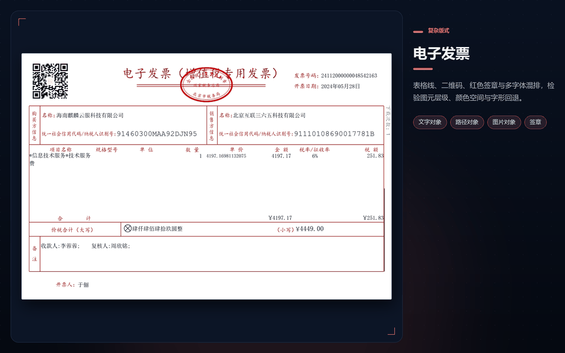

# @ofdrw/ofdrw-viewer-engine

[](https://www.npmjs.com/package/@ofdrw/ofdrw-viewer-engine)
[](https://github.com/ofdrw/ofdrw-viewer/releases)
[](../../LICENSE)
[](https://nodejs.org/)
[](skills/SKILL.md#环境适配)

[](skills/SKILL.md#微信小程序)

## ✨ 功能概述

**ofdrw-viewer-engine** 是符合 GB/T 33190-2016 的跨平台 OFD 渲染引擎：文字、图形、图像、注解等图元，支持底纹填充、字体字形解析与仿射变换；一套稳定 API 同时覆盖浏览器、Node.js、Electron 与微信小程序，多端渲染结果语义一致。




## 📦 安装

### npm 安装

若您的代码采用npm管理您可以直接使用，下面命令安装依赖：

```bash
npm install @ofdrw/ofdrw-viewer-engine
```

### CDN 安装

若您处于浏览器H5开发环境，我们建议您采用cdn 或 release预发布的离线安装，并使用标签引用：

```html
<script src="https://cdn.jsdelivr.net/npm/@ofdrw/ofdrw-viewer-engine@0.1.2/dist/ofdrw-viewer-engine.min.js"></script>
```

脚本加载成功后，引擎注册全局变量 `window.OFDRWViewer`。


## 🚀 快速开始 Quick Start

在浏览器中准备 OFD 文件与 `<canvas>`，即可渲染第一页。文件/URL 由宿主读取，engine 只消费字节：

```ts
import { OFDDocument } from '@ofdrw/ofdrw-viewer-engine';

// file 来自 <input type="file"> 或拖拽；canvas 是页面画布。
// URL 场景：先 await (await fetch(url)).arrayBuffer()，再传 { kind: 'arraybuffer', data }。
const doc = await OFDDocument.open({ source: { kind: 'blob', blob: file } });
const page = await doc.getPage(0);
const viewport = page.getViewport(); // 默认 96 DPI，可传 { dpi: 144 }
canvas.width = Math.ceil(viewport.width);
canvas.height = Math.ceil(viewport.height);
await page.render({ canvasContext: canvas.getContext('2d')!, viewport }).promise;
await doc.close();
```

更多用法见 [ofdrw-viewer-engine SKILL.md 常用任务](skills/SKILL.md#常用任务) 与 [ofdrw-viewer-engine API 文档](skills/API.md)。

## 🌐 开发环境适配


引擎核心不绑定 DOM 与 Node.js，各运行环境的接入方式：

- [H5浏览器](skills/SKILL.md#5-分钟跑通浏览器)
- [Web Worker](skills/SKILL.md#web-worker--offscreencanvas)
- [Node.js](skills/SKILL.md#nodejs)
- [Electron / Tauri](skills/SKILL.md#electron--tauri)
- [微信小程序](skills/SKILL.md#微信小程序)

🧩 示例工程：

- [engine-h5 示例](../../examples/engine-h5/)：单文件 `index.html`，引擎走 jsDelivr CDN，双击即可浏览本地 OFD，适合快速验证浏览器渲染。
- [engine-node 示例](../../examples/engine-node/)：以 `@napi-rs/canvas` 提供 Canvas 与图片解码，逐页导出 144 DPI PNG。

更多示例见 [examples 示例总览](../../examples/README.md)。


## 常见问题

**页面中有文字丢失空白？**


由于**引擎不内置任何字体**，字体由宿主提供，若您文档中的字体无法找到，将尝试您提供的默认字体，若都无法找到则会跳过这文字的绘制，详见 [SKILL.md 缺省字体与补充字体](skills/SKILL.md#缺省字体与补充字体) 与 [字体缺省方案设计](../../docs/渲染字体缺省方案设计.md)。

**加密文档如何处理？**


加密文档需先用 [@ofdrw/ofdrw-viewer-crypto](../ofdrw-viewer-crypto/README.md) 解密，再把明文容器交给引擎；详见 [SKILL.md 打开容器与加密文档](skills/SKILL.md#打开容器与加密文档)。


## 🤖 智能体 SKILL

智能体加载 SKILL 后，可以按既定流程完成 OFD 页面渲染、导出图片、读取文字坐标与元数据，并按运行环境完成 Canvas、图片解码与字体来源注入。

入口：[SKILL.md](skills/SKILL.md) · [API.md](skills/API.md) · [CHANGELOG.md](./CHANGELOG.md)

## 📄 许可证

本项目采用 [MIT](../../LICENSE) 许可证，Copyright (c) 2026 Quan Guanyu。
