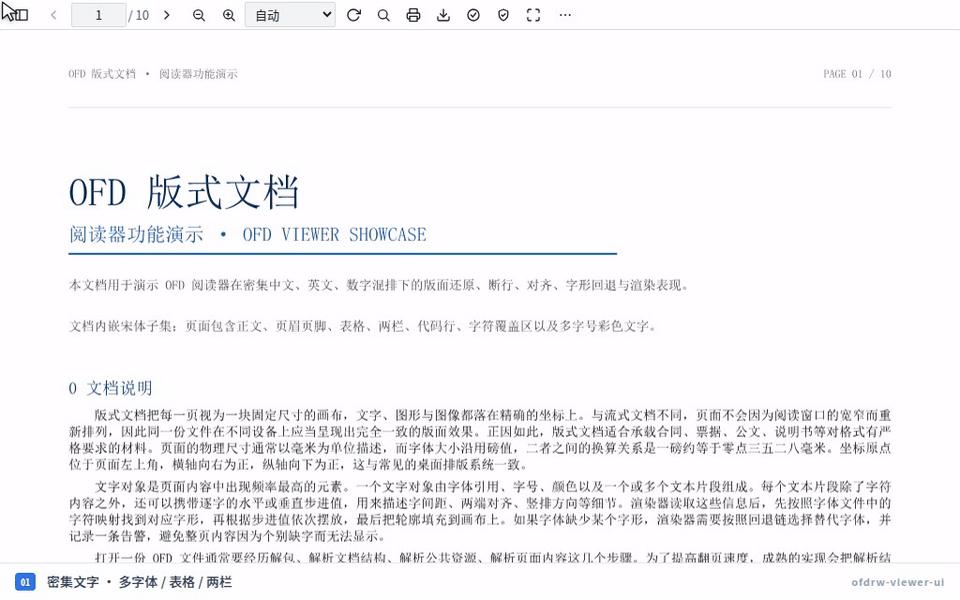

# @ofdrw/ofdrw-viewer-ui

[](https://www.npmjs.com/package/@ofdrw/ofdrw-viewer-ui) [](https://github.com/ofdrw/ofdrw-viewer/releases) [](../../LICENSE) 
[](../../examples/viewer-ui-react/) [](../../examples/viewer-ui-vue/) [](skills/SKILL.md#web-component)

## ✨ 功能概述

**ofdrw-viewer-ui** 是一款产品级的 Web OFD 阅读器组件，内置连续滚动、缩放/旋转、缩略图、大纲、书签、全文查找、文本选择、打印与图片导出等功能。组件基于 ofdrw-viewer-engine 实现高质量的 OFD 页面绘制，同时提供 Web Component 与 React、Vue API适配，可直接嵌入现有应用在线预览 OFD 文件，并自适应桌面、平板与手机。



## 🚀 在线体验

[**👉 打开在线演示**](https://ofdrw.github.io/ofdrw-viewer/)：你可以快速了解ofdrw-viewer-ui阅读器OFD页面绘制效果和功能。

## 📦 安装

```bash
npm install @ofdrw/ofdrw-viewer-ui
```

支持原生 HTML / Web Component、React 18/19 与 Vue 3.3+，您可以`OFDViewer` 实例来获取一致的API。

## 🚀 快速开始 Quick Start

以下示例以原生 HTML + ES Module 环境演示。样式必须由宿主显式引入，阅读器容器需要有确定高度：

```html
<div id="viewer" style="height: 640px"></div>
```

```ts
import { OFDViewer } from '@ofdrw/ofdrw-viewer-ui';
import '@ofdrw/ofdrw-viewer-ui/style.css';

const viewer = new OFDViewer({
  container: '#viewer',
  source: file, // 可选；File / Blob / ArrayBuffer / Uint8Array / URL / { url, headers? }
});

await viewer.ready;
```

完整选项、方法、事件与使用边界见 [API.md](skills/API.md)。

各平台演示代码：

- [Web Component 示例](skills/SKILL.md#web-component)
- [React 示例](skills/SKILL.md#react)
- [Vue 示例](skills/SKILL.md#vue)

可直接运行的示例项目：

- [React 示例项目](../../examples/viewer-ui-react/)：Vite + React 19
- [Vue 示例项目](../../examples/viewer-ui-vue/)：Vite + Vue 3

## 🤖 智能体 SKILL

本包提供智能体协作指南（SKILL），若你是智能体，请按照以下指南完成阅读器接入与调用：

- 📖 [**ofdrw-viewer-ui** · SKILL](skills/SKILL.md) — 在网页中嵌入完整的 OFD 阅读器，具备滚动缩放、缩略图与大纲、文本搜索、打印导出、加密文档打开与签章验证等能力。

## 📄 许可证

本项目采用 [MIT](../../LICENSE) 许可证，Copyright (c) 2026 Quan Guanyu。
